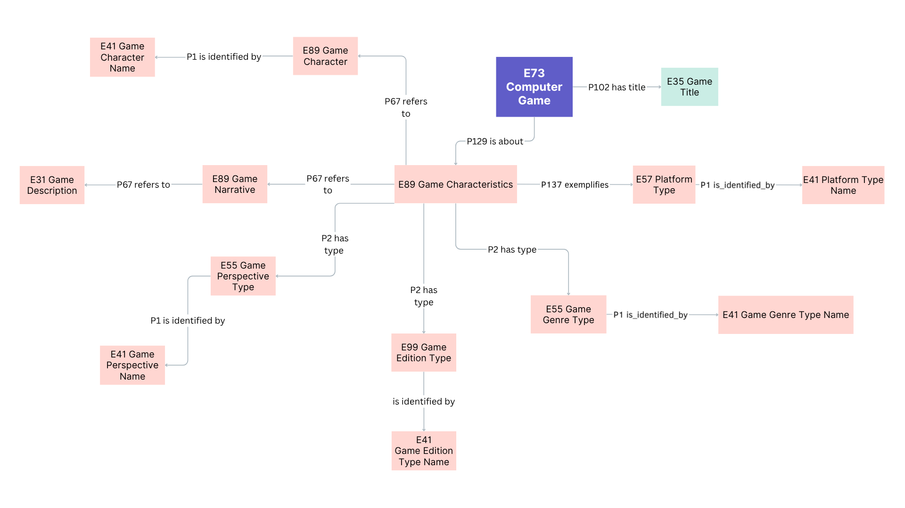
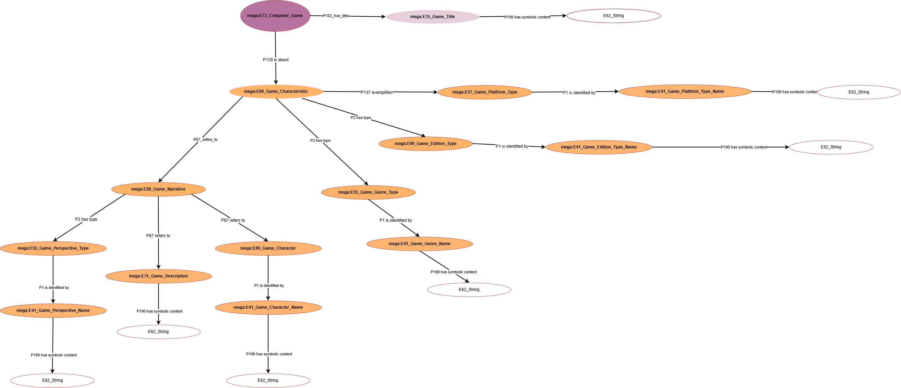

<!--

author: Canan Hastik (0000-0003-1729-4642)

author: Gudrun Schwenk (0009-0002-3156-8339)

email: info@igsd-ev.de

version:  v1.0.0

language: en

icon: https://raw.githubusercontent.com/soda-collections-objects-data-literacy/WissKIBits_How-to-Tutorial/refs/heads/main/assets/SODa-Logo_Wort-Bild_RGB.png

link: https://raw.githubusercontent.com/soda-collections-objects-data-literacy/WissKIBits_How-to-Tutorial/refs/heads/main/soda.css

license: CC BY 4.0 <https://creativecommons.org/licenses/by/4.0/>

comment: This Fast Track is part of the how-to tutorial “Ontology-Based Modeling of Research Data.” Using a video game collection as an example, it provides experienced users with a concise, hands-on workflow covering conceptual modeling and mapping to CIDOC CRM, ontology formalization, and the configuration of semantic paths in WissKI.

title: WissKI Bits – Ontology-Based Modeling of Research Data

module: Fast Track – From Collection Object to Data Entry in WissKI

unit: Practice-Oriented Step-by-Step Guide for Advanced Users

description: This WissKI Bit Fast Track guides experienced users through the practical steps of ontology-based research data modeling. Using a video game collection as an example, they create a conceptual model sketch, formalise selected concepts using CIDOC CRM, transfer a section of the ontology into Protégé, prepare a Draw.io diagram, and generate and import semantic paths and path groups into WissKI.

keywords: WissKI, CIDOC CRM, ontology, domain ontology, semantic modeling, research data, research data management, OER

community: Scientific Communication Infrastructure (WissKI) and Collections, Objects, Data Literacy (SODa)

PublicationDate: 2026-10-05

LearningResourceType: How-to-Tutorial

-->

# WissKI Bits: Ontology-Based Modelling of Research Data

**DEVELOPING AND IMPLEMENTING A DATA MODEL USING AN EXAMPLE** 

**Fast Track: From Collection Object to Data Entry in WissKI**

**An Exercise-Based Walkthrough for Expert Users**  

**Audience:** Advanced/Expert users familiar with basic semantic modelling, CIDOC CRM, and ontology editors.  

**Objective:** This Fast Track includes all practical exercises from Modules 1–3 of the WissKI Bits how-to tutorial: from a conceptual and formalised model sketch to a Draw.io diagram and an OWL ontology excerpt, through to imported WissKI paths, path groups, and data entry fields for initial data entry.

**Important:** Explanations, definitions, quiz questions, and additional image and video documentation are available in the WissKI Bits how-to tutorial.

**Example:** The 1991 Super Nintendo Entertainment System (SNES) game 'The Legend of Zelda: A Link to the Past'.

**Duration:** ~ 90 min.

---

## About This Fast Track

This fast track brings together the **five practical exercises from modules 1–3** of the WissKI Bits how-to tutorial, following their original sequence and using **existing exercise materials**, to form a coherent step-by-step guide.

Starting with the **example object:** **The Legend of Zelda: A Link to the Past**, you will complete the following steps in sequence:

- Conceptual modelling,
- Mapping to CIDOC CRM,
- Formalising a small section of the ontology in Protégé,
- Completing a prepared Draw.io diagram, and
- Converting the Draw.io diagram into a WissKI Pathbuilder configuration.

**Important:** The activities follow the example domain and modelling approach used in the tutorial. The required materials are provided at the beginning of each exercise. Afterwards, compare your results with the provided model solutions and review your modelling decisions.

**Time plan**

| Activity | Time |
|---|---:|
| Preparation and orientation | 5 min |
| 1. Examine a collection object and create a conceptual model sketch | 10 min |
| 2. Map selected concepts to CIDOC CRM | 15 min |
| 3. Implement and formalise a section of the model in Protégé | 15 min |
| 4. Complete a Draw.io diagram | 15 min |
| 5. Import and review the WissKI Pathbuilder configuration | 20 min |
| 6. Review data entry fields and enter data | 10 min |
| **Total** | **90 min** |

The schedule assumes that you are familiar with the fundamentals of semantic modelling and have access to the **tools, sample data and model solutions**.

Relevant supplementary materials are linked where appropriate. 

The complete modules are available in English and German:
- [Modul 1: Von der Sammlung über Modellierentscheidungen zum Diagramm – verstehen und erklären](https://github.com/soda-collections-objects-data-literacy/WissKIBits_How-to-Tutorial/tree/main/WissKIBits_Modul1)
- [Modul 2: Modellieren mit CIDOC CRM – verstehen und anwenden](https://github.com/soda-collections-objects-data-literacy/WissKIBits_How-to-Tutorial/tree/main/WissKIBits_Modul2)
- [Modul 3: Vom Diagramm zu Pfaden – erläutern und anwenden](https://github.com/soda-collections-objects-data-literacy/WissKIBits_How-to-Tutorial/tree/main/WissKIBits_Modul3)

---

### Before You Start - 5 min

Set up your working environment:

- You will need a computer with internet access.
- Open each of the following in a separate browser tab (Firefox is recommended):
  - [Draw.io / diagrams.net](https://app.diagrams.net/),
  - [Protégé Desktop or WebProtégé](https://protege.stanford.edu/), 
  - [Erlangen CRM 240307 (OWL)](https://erlangen-crm.org/ontology/ecrm/ecrm_240307.owl) based on CIDOC CRM 7.1.3,
  - WissKI instance in the [SODa Semantic Co-Working Space](https://manager.scs.sammlungen.io/de),
  - [CIDOC CRM 7.1.3 documentation and scope notes](https://cidoc-crm.org/html/cidoc_crm_v7.1.3.html),
  - [GNM-Service](https://isl.ics.forth.gr/gnm_services/drawioXMLtoWisskiPathbuilder/).

**Note on software versions:** The user interfaces of Protégé (version 5.6.3), WebProtégé (4.0.2:20200731), Draw.io (v32.6.1), WissKI (version 8.X-4.9) and Drupal (version 11.4.11) may change as a result of software updates. Consequently, some menu labels, buttons and views may differ from the screenshots and descriptions provided in this tutorial. If a newer ISO-certified version of CIDOC CRM (currently version 7.1.3, February 2024) is published, it should be used.

---

## 1. Explore the Collection Object - 10 min.

**Starting Point**

As part of a brief research task on Wikipedia, familiarise yourself with the collection object **[The Legend of Zelda: A Link to the Past](https://de.wikipedia.org/wiki/The_Legend_of_Zelda:_A_Link_to_the_Past)** and basic terminology from the video game domain. (Wikipedia, 2026)

Consider the following questions:
- **What characteristics describe the SNES video game The Legend of Zelda: A Link to the Past?**
- **How are these characteristics related to one another?**

Consider the following characteristics:

- **Video game title:** What is the game called?
- **Video game characteristics:** Which genres, platforms or other classifications are relevant to the video game domain?
- **Narrative elements:** Which descriptions, narrative or gameplay perspectives, and characters are characteristic of the video game?

You may include additional metadata (e.g. place and date of publication) where relevant to explaining the characteristics listed above.

### Step 1: Complete the Puzzle

> 1. Save the prepared **[XML puzzle](assets/puzzle.drawio_en.xml)** to your computer.
> 2. Open the downloaded **puzzle file** in **[Draw.io](https://app.diagrams.net/)**.
> 3. **Examine, arrange and connect** only the relevant characteristics to create a meaningful conceptual model sketch.
> 4. Check whether your conceptual model sketch expresses meaningful statements about the characteristic features of the example object.

**Result:** A conceptual model sketch that illustrates selected key characteristics and relationships associated with the example object.

**Transition to the next exercise:** In the next exercise, you will explore how to appropriately represent these key characteristics using **existing CIDOC CRM classes**.

> **For further information, see Module 1, including:**
> - [M1U0A: Mindmap of the Application Example from Object Collections](https://github.com/soda-collections-objects-data-literacy/WissKIBits_How-to-Tutorial/blob/main/WissKIBits_Modul1/en/M1U0A_Mindmap_Object_en.md)
> - [M1U1: Basics in Conceptual Knowledge Modelling](https://github.com/soda-collections-objects-data-literacy/WissKIBits_How-to-Tutorial/blob/main/WissKIBits_Modul1/en/M1U1_Basics-Conceptual-Modelling_en.md)

---

## 2. Map Selected Concepts to CIDOC CRM - 15 min.

**Starting Point**

Now use the model solution **conceptual model sketch from Module 1** for your semantic model:

---

### Step 1: Examine and Justify Class Mappings

> 1. Select **two concepts or events** from the provided conceptual model sketch and clarify what they mean in the context of the collection.
> 2. Use the CIDOC CRM **[documentation](https://cidoc-crm.org/html/cidoc_crm_v7.1.3.html)** or explore CIDOC CRM using the **[Periodic Table](https://remogrillo.github.io/cidoc-crm_periodic_table/?code=E1)**
> 3. Identify suitable CIDOC CRM classes for the selected concepts by reading the **Scope Notes** and compare them with the conceptual model sketch.
> 5. Consider what each class includes and/or excludes, what CIDOC CRM relationships are available.
> 6. Record a brief justification and an open question for each mapping in the following table.

| Domain concept from your sketch | Possible CIDOC CRM class | Scope Note applicable | Justification and open question |
|---|---|---|---|
| Game title | E35 | [(X)] | Is there another suitable class? |
| [[Solution]] | [[Solution]] | [[Solution]] | [[Solution]] |
| [[Solution]] | [[Solution]] | [[Solution]] | [[Solution]] |
| [[Solution]] | [[Solution]] | [[Solution]] | [[Solution]] |
| [[Solution]] | [[Solution]] | [[Solution]] | [[Solution]] |

**Important:** A CIDOC CRM class name that sounds similar to your domain concept is not sufficient to establish a semantically correct mapping. Always compare the intended meaning of each concept based on the **Scope Note** of the corresponding CIDOC CRM class before making a modelling decision. Suitable classes may include:
- `E73 Information Object`,
- `E35 Title`,
- `E55 Type`,
- `E21 Person` or
- `E74 Group`.

---

### Step 2: Compare Modelling Decisions

> Discuss or reflect on whether...
> - the same domain term can refer to different characteritics depending on the research question.
> - a name, for example, can be formalised as a `Title`, an `Identifier` or using another class.

**Result:** Your semantic model sketch includes at least two **justified, provisional class mappings** and, where applicable, any remaining uncertainties.

**Transition to the next exercise:**
Next, you will implement your modelling decisions in Protégé by defining **domain-specific subclasses** of existing CIDOC CRM classes, thereby formalising a section of your semantic model.

> **For further information, see Module 1, including:**
> - [M1U3: Introduction to CIDOC CRM](https://github.com/soda-collections-objects-data-literacy/WissKIBits_How-to-Tutorial/blob/main/WissKIBits_Modul1/en/M1U3_Introduction-CIDOCCRM_en.md)

---

## 3. Formalise a Small Section of the Ontology in Protégé — 15 min.

**Starting Point**

Now use the model solution **semantic model sketch from Module 2** for your modelling in Protégé:

### Step 1: Load Erlangen CRM into Protégé

> Open [Erlangen CRM 240307 OWL](https://erlangen-crm.org/ontology/ecrm/ecrm_240307.owl) in Protégé.

!?[Video Demonstration: Getting Started with Protégé](assets/Short_Protege_Intro.mp4)

> **For further information, see Module 2, including:**
> - [M2U1A: Setting Up the Working Environment with Protégé](https://github.com/soda-collections-objects-data-literacy/WissKIBits_How-to-Tutorial/blob/main/WissKIBits_Modul2/en/M2U1A_Setup-Protege_en.md)
> - [M2U2: Introduction to Protégé](https://github.com/soda-collections-objects-data-literacy/WissKIBits_How-to-Tutorial/blob/main/WissKIBits_Modul2/en/M2U2_Protege_en.md)

---

### Step 2: Examine Relevant Classes

> Find the following classes in the CIDOC CRM class hierarchy and examine their **Scope Notes**:
> 
> - `E41 Appellation`
> - `E35 Title` (a subclass of `E41 Appellation`)
> - `E55 Type`
> - `E73 Information Object`

---

### Step 3: Review Selected Class Mappings

> 1. Compare your semantic model sketch with the formal class descriptions in CIDOC CRM.
> 2. Remember: Do not assume that a mapping is correct simply because the class names are similar.

The WissKI Bits how-to tutorial uses the following CIDOC CRM classes, among others:

| Domain concept | Possible CIDOC CRM class | Question to consider |
|---|---|---|
| Game title | `E35 Title` | Which entity is this title assigned to? |
| Game genre | `E55 Type` | What exactly is being classified? |
| Game platform type | `E55 Type` | Is this a classification of the game? |

---

### Step 4: Create Domain-Specific Subclasses

> 1. Create the selected **subclasses** under the appropriate CIDOC CRM classes, for example:
>
> - E73 Information Object → Computer_Game
> - E35 Title → Game_Title
> - E55 Type → Game_Genre_Type, Game_Platform_Type
>
> 2. Examine only the corresponding properties in Protégé and document your modelling decisions, but **do not create any new CIDOC CRM properties**.

The WissKI Bits how-to tutorial uses the following CIDOC CRM properties, among others:

| Source class | Existing property | Target class | Intended statement |
|---|---|---|---|
| `Computer_Game` | `P102 has title` | `Game_Title` | A computer game has a title. |
| `Computer_Game` | `P2 has type` | `Game_Genre_Type` | A game is assigned to a genre type. |
| `Computer_Game` | `P2 has type` | `Game_Platform_Type` | A game is assigned to a platform type. |

---

### Step 5: Review, Document and Save

> 1. Check whether...
> - the domain subclasses are placed under the correct CIDOC CRM superclasses,
> - the reused CIDOC CRM properties express the intended relationships and any open questions have been documented.
> 2. Save your ontology.

**Result:** A small, formalised and documented section of an ontology describing video game characteristics, **not** a complete video game ontology.

**Transition to the next exercise:** In the next exercise, you will use the **prepared Draw.io diagram with missing elements** from Module 3. You will complete the diagram according to the conventions required by the GNM Service transformation tool.

> **For further information, see Module 2, including:**
> - [M2U1: Methods and Workflows of Semantic Modelling](https://github.com/soda-collections-objects-data-literacy/WissKIBits_How-to-Tutorial/blob/main/WissKIBits_Modul2/en/M2U1_Methods-Workflows_en.md)
> - [M2U2: Introduction to Protégé](https://github.com/soda-collections-objects-data-literacy/WissKIBits_How-to-Tutorial/blob/main/WissKIBits_Modul2/en/M2U2_Protege_en.md)

---

## 4. Complete the Draw.io Diagram — 15 min.

**Starting Point**

You will now work with a **prepared Draw.io diagram with missing elements**, which visualises selected classes and relationships of a video game domain ontology (see the figure below):

---

### Step 1: Complete the Prepared Diagram

> 1. Download the prepared **[Draw.io diagram with missing elements](assets/Gruppe_B.drawio.xml)**.
> 2. Open the downloaded XML file in **[Draw.io](https://app.diagrams.net/)**.
> 3. Find the **four** placeholders `(???)`.
> 4. Replace these placeholders `(???)` with the following classes and properties:
>    - `P102_has_title`,
>    - `P1 is identified by`,
>    - `P190 has symbolic content`,
>    - `mega:E41_Game_Character_Name`.
> 5. Check whether the classes and properties form **complete semantic paths**. Refer to the **Modelling Rules in Draw.io** below.
> 6. Examine the **attributes** of the central starting node, group nodes and end nodes in the diagram. To do this, select each node and press **Ctrl + M** (Windows) to open the attribute dialogue. Check the following attributes:
>    - `element_id`,
>    - `group_name` and
>    - `name`.
> 7. Set the **attribute values**. For example, the `group_name` attribute of the **group node** `mega:E89_Game_Characteristic` should have the value `Game_Characteristic`.
> 8. Export your diagram as **Draw.io XML** and save it locally.

> **Modelling Rules in Draw.io:**
>
> - The diagram contains **classes and properties** representing paths and path groups, but no individual instances.
> - All four placeholders `(???)` have been replaced.
> - All connections between nodes and properties are complete.
> - Class and property labels, as well as the required attribute values, are consistent and correspond to the [model solution: Game Characteristics](https://games.m-e-g-a.org/ontology/game_characteristics/Game_characteristics_v1.0.3.rdf).

**Result:** A [Draw.io XML export](assets/WissKIBits.drawio.xml) based on the completed Draw.io diagram:

**Transition to the next exercise:** Next, you will use the **GNM Service** to convert the XML diagram into a **WissKI Pathbuilder XML configuration**, which you will then import into WissKI for further use.

> **For further information, see Module 3, including:**
> - [M3UE1: Visualising a Semantic Domain Ontology](https://github.com/soda-collections-objects-data-literacy/WissKIBits_How-to-Tutorial/blob/main/WissKIBits_Modul3/en/M3UE1_Domain-Ontologie-Diagram_en.md)

---

## 5. Convert and Import WissKI Paths — 20 min

**Starting Point**

You will now continue working with the model solution [Draw.io XML-Export](assets/WissKIBits.drawio.xml) and the [GNM Service](https://isl.ics.forth.gr/gnm_services/drawioXMLtoWisskiPathbuilder).

---

### Step 1: Convert the Draw.io XML File into a Pathbuilder XML File

> 1. Open the [GNM Service: Draw.io Diagrams to WissKI Pathbuilders](https://isl.ics.forth.gr/gnm_services/drawioXMLtoWisskiPathbuilder/) in your browser.
> 2. Upload your Draw.io XML export or the model solution [Draw.io XML export](assets/WissKIBits.drawio.xml) under **Upload draw.io XML file for conversion to WissKI Pathbuilder XML**.
> 3. Start the conversion and check the status of the uploaded file.
> 4. If the conversion is successful, you will need one of the following links **later in WissKI** (6: Create a WissKI Pathbuilder – Step 2: Create and Import the Pathbuilder):
>    - a copy of the link to your **Pathbuilder XML Output: Download XML file**, or
>    - a copy of the link to the model solution: [**Example Output Pathbuilder XML File**](https://isl.ics.forth.gr/gnm_services/files/examples/diagrams_to_pathbuilders/DrawioPathBuilderExampleOutput_WissKIBits.xml).

---

## 6. Create a WissKI Pathbuilder — 10 min

**Starting Point**

You will now continue working in your **WissKI test instance in the SCS**.

---

### Step 1: Load the Games Ontology into WissKI and Update the SALZ Adapter

> 1. Log in to your WissKI test instance.
> 2. Navigate to **Configuration → WissKI → WissKI Ontology**.
> 3. Delete the existing ontology.
> 4. Load the [Games domain ontology](http://games.m-e-g-a.org/game_domain.rdf) via its URL under **Pathbuilder Definition Import**.
> 5. Update the **WissKI SALZ Adapter**:
>    - Navigate to **Configuration → WissKI → WissKI Salz Adapters**.
>    - Edit the **Default Salz Adapter** and go to **Compute Type and Property Hierarchy and Domains and Ranges**.
>    - Delete the existing reasoning table using **Delete Reasoning Table**.
>    - Recompute the reasoning table using **Re-Compute results** and **Start Reasoning**.
>    - Update the adapter using **Update Adapter**.
> 6. Navigate to **Configuration → Development → Performance** and clear the cache using **Clear all caches**.

---

### Step 2: Create and Import the Pathbuilder

> 1. Navigate to **Configuration → WissKI → Pathbuilders**.
> 2. Select **Add Pathbuilder**, enter a unique name and select the appropriate adapter.
> 3. Save the new Pathbuilder.
> 4. Open the new Pathbuilder again, locate **Pathbuilder Definition Import**, insert the generated **Pathbuilder XML Output: Download XML file** and start the import.
> 5. Wait until the Pathbuilder structure appears.
> 6. Edit the starting node **Computer Game** and save again.

---

### Step 3: Review and Document the Generated Path Groups and Paths

> 1. Compare the imported **Pathbuilder** with the **Draw.io diagram**.
> 2. Check whether:
>    - the expected path groups are present.
>    - the relevant classes and properties are included.
>    - any paths are missing, incorrectly grouped or appear unexpectedly.
> 3. Document your results and archive the relevant files. [[REFERENCE Basic Course – Research Data Documentation]]

**Result:** A generated, imported and **verified WissKI Pathbuilder configuration**. This is a configuration import, not an ontology import.

> **For further information, see Module 3, including:**
> - [M3UE2: Transforming Semantic Models into WissKI Paths](https://github.com/soda-collections-objects-data-literacy/WissKIBits_How-to-Tutorial/blob/main/WissKIBits_Modul3/en/M3UE2_Drawio-to-WissKI-Paths_en.md)

---

### Step 4: Generate Data Entry Fields and Enter Data

After reviewing the Pathbuilder, you can generate the structure and fields required for data entry.

> Navigate to **Configuration → WissKI → Pathbuilders**.
> Edit your Pathbuilder and select **Save and generate bundles and fields**.
> You can then enter data on your WissKI site under **Create**.

**Result:** We provide a [Pathbuilder export](assets/games_ontology_20261020T220812) containing some data relating to the **example object: The Legend of Zelda: A Link to the Past**.

---

# Bibliography

(Wikipedia, 2026) The Legend of Zelda: A Link to the Past. (2026). In *Wikipedia*. Last accessed on 15 October 2026, from https://de.wikipedia.org/w/index.php?title=The_Legend_of_Zelda:_A_Link_to_the_Past&oldid=268272133
