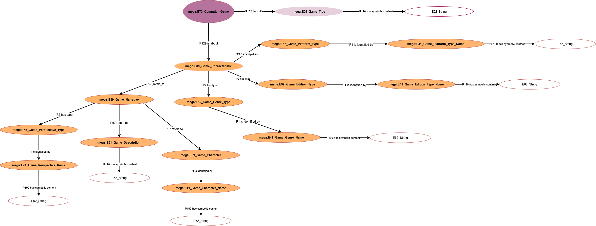
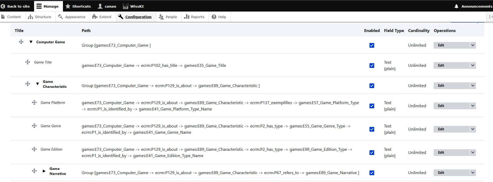

<!--
author: Canan Hastik (0000-0003-1729-4642)

author: Gudrun Schwenk (0009-0002-3156-8339)

email: info@igsd-ev.de

version:  v1.0.0

language: de

icon: https://raw.githubusercontent.com/soda-collections-objects-data-literacy/WissKIBits_How-to-Tutorial/refs/heads/main/assets/SODa-Logo_full.svg

link: https://raw.githubusercontent.com/soda-collections-objects-data-literacy/WissKIBits_How-to-Tutorial/refs/heads/main/soda.css

license: CC BY 4.0 <https://creativecommons.org/licenses/by/4.0/>

comment: Dieser Fast Track ist Teil des How-to-Tutorials „Ontologiebasierte Modellierung von Forschungsdaten“. Anhand einer Computerspielsammlung bietet er erfahrenen Nutzenden einen kompakten, übungsorientierten Arbeitsablauf von der konzeptionellen Modellierung und Zuordnung zu CIDOC CRM über die Formalisierung einer Ontologie bis zur Konfiguration semantischer Pfade in WissKI.

title: WissKI Bits – Ontologiebasierte Modellierung von Forschungsdaten

module: Fast Track – Vom Sammlungsobjekt zu WissKI-Pfaden

unit: Übungsorientierte Schritt-für-Schritt-Anleitung für Fortgeschrittene

description: Dieser WissKI Bit Fast Track führt erfahrene Nutzende durch die praktischen Schritte der ontologiebasierten Modellierung von Forschungsdaten. Anhand einer Computerspielsammlung erstellen sie eine konzeptionelle Modellskizze, formalisieren ausgewählte Konzepte mit CIDOC CRM, überführen einen Ontologieausschnitt in Protégé, bereiten ein Draw.io-Diagramm vor und erzeugen und importieren semantische Pfade und Pfadgruppen in WissKI.

keywords: WissKI, CIDOC CRM, Ontologie, Domänenontologie, semantische Modellierung, Forschungsdaten, Forschungsdatenmanagement, OER

community: Wissenschaftliche KommunikationsInfrastruktur (WissKI) und Sammlungen, Objekte, Datenkompetenzen (SODa)

PublicationDate: 2026-10-05

LearningResourceType: How-to-Tutorial
-->

# WissKI Bits: Ontologiebasierte Modellierung von Forschungsdaten

**ENTWICKLUNG UND IMPLEMENTIERUNG EINES DATENMODELLS ANHAND EINES BEISPIELS**

**Fast Track: Vom Sammlungsobjekt zu WissKI-Pfaden**

**Eine übungsbasierte Schritt-für-Schritt-Anleitung für Fortgeschrittene**

**Zielgruppe:** Nutzende die mit den Grundlagen der semantischen Modellierung, CIDOC CRM und Ontologie-Editoren vertraut sind.

**Ziel:** Von einer konzeptionellen Modell-Skizze und einer formalisierten Modell-Skizze über ein Draw.io-Diagramm und einen kleinen OWL-Ontologieausschnitt zu importierten WissKI-Pfaden und -Pfadgruppen gelangen.

Dieser Fast Track enthält die Übungsaufgaben aus den Modulen 1–3 des WissKI Bits How-to-Tutorials. 

Erläuterungen, Definitionen, Quizfragen und ausführliche Screenshots finden Sie im vollständigen Tutorial.

**Beispiel:** **The Legend of Zelda: A Link to the Past**

**Dauer:** ca. 90 Min.

---

## Über diesen Fast Track

Dieser Fast Track führt die **fünf praktischen Übungen aus den Modulen 1–3** des WissKI Bits How-To-Tutorials zu einer zusammenhängenden Schritt-für-Schritt-Anleitung zusammen. 

Dabei folgt der **Fast Track** folgt der ursprünglichen Reihenfolge der Übungen im Tutorial und verwendet die **vorhandenen Übungsmaterialien**, darunter 
- das vorbereitete Puzzle zur konzeptionellen Modell-Skizze,
- Erlangen CRM,
- die vorbereitete Games-Ontologie,
- das Draw.io-Lückendiagramm und
- den GNM-Service.

Ausgehend von diesem **Beispielobjekt: The Legend of Zelda: A Link to the Past** durchlaufen Sie die folgenden aufeinander aufbauenden Schritte der ontologiegestützten Modellierung:
- Konzeptionelle Modellierung
- Zuordnung zu CIDOC CRM
- Formalisierung eines kleinen Ausschnitts in Protégé
- vervollständigen ein vorbereitetes Draw.io-Diagramm und
- wandeln dieses Diagramm in eine WissKI-Pathbuilder-Konfiguration um.

**Wichtig:** Die Aktivitäten beziehen sich auf die Beispiel-Domäne und den Modellierungsansatz aus dem Tutorial. Sie bilden jedoch keine automatische Verarbeitungskette von Datei zu Datei wie im Tutorial. 

**Zeitplan**

| Aktivität | Zeit |
|---|---:|
| Vorbereitung und Orientierung | 5 Min. |
| 1. Sammlungsobjekt untersuchen und konzeptionelle Skizze erstellen | 10 Min. |
| 2. Ausgewählte Konzepte mit CIDOC CRM formalisieren | 15 Min. |
| 3. Einen Modellausschnitt in Protégé umsetzen | 25 Min. |
| 4. Das Draw.io-Diagramm vervollständigen | 15 Min. |
| 5. WissKI-Pfade umwandeln und importieren | 20 Min. |
| **Gesamt** | **90 Min.** |

Der Zeitplan setzt voraus, dass Sie mit den Grundlagen der semantischen Modellierung vertraut sind und Zugang zu einer **vorbereiteten Arbeitsumgebung** haben. 

Bearbeiten Sie die nachfolgenden, klar abgegrenzten Aufgaben. Für weitere Erläuterungen oder vertiefende Übungen können Sie die verlinkten vollständigen Lerneinheiten heranziehen.

---

### Bevor Sie beginnen - 5 Min.

Halten Sie Folgendes bereit:

- Einen Computer mit Internetzugang und [Draw.io / diagrams.net](https://app.diagrams.net/).
- [Protégé Desktop oder WebProtégé](https://protege.stanford.edu/), bereits verfügbar und einsatzbereit.
  (Hilfe zur Installation finden Sie in **[M2U1A – Setup Protégé](https://github.com/soda-collections-objects-data-literacy/WissKIBits_How-to-Tutorial/blob/main/WissKIBits_Modul2/en/M2U1A_Setup-Protege_en.md)**.)
- Zugang zu einer konfigurierten WissKI-Instanz mit einem geeigneten Adapter.
  (Der [SODa Semantic Co-Working Space](https://manager.scs.sammlungen.io/de) bietet eine Möglichkeit für kostenfreie WissKI-Instanz.)
- [Erlangen CRM 240307 (OWL)](https://erlangen-crm.org/ontology/ecrm/ecrm_240307.owl), basierend auf CIDOC CRM 7.1.3.
- [CIDOC CRM 7.1.3 – Dokumentation und Scope Notes](https://cidoc-crm.org/html/cidoc_crm_v7.1.3.html).
- [Games-Domänenontologie](http://games.m-e-g-a.org/game_domain.rdf), die im WissKI Bits How-to-Tutorial verwendet wird.

Sie nutzen die vorhandenen vorbereiteten Dateien, sobald Sie in den folgenden Aufgaben dazu aufgefordert werden. 

**Beginnen Sie nicht damit, eine neue Ontologie oder ein neues Diagramm zu entwerfen.**

---

## 1. Das Sammlungsobjekt untersuchen - 10 Min.

*Basierend auf Modul 1, [Activation Unit M1U0A: Mindmap of the Application Example from Object Collections](https://github.com/soda-collections-objects-data-literacy/WissKIBits_How-to-Tutorial/blob/main/WissKIBits_Modul1/en/M1U0A_Mindmap_Object_en.md) and [Unit M1U1: Basic concepts of conceptual knowledge modelling](https://github.com/soda-collections-objects-data-literacy/WissKIBits_How-to-Tutorial/blob/main/WissKIBits_Modul1/en/M1U1_Basics-Conceptual-Modelling_en.md)*

**Ziel und Ausgangspunkt**

Sie beginnen mit dem Sammlungsobjekt **The Legend of Zelda: A Link to the Past**. 

Fragen Sie sich: 

- **Welche charakteristischen Merkmale beschreiben das SNES-Computerspiel 'The Legend of Zelda: A Link to the Past'?**
- **Wie hängen diese spezifischen Merkmale miteinander zusammen?** 

Verwenden Sie in dieser Phase die üblichen Fachbegriffe aus der Computerspiele-Domäne und noch keine formalen CIDOC CRM-Klassen.

Berücksichtigen Sie drei Aspekte:

- **Spieltitel:** Wie wird das Spiel bezeichnet?
- **Spieleigenschaften:** Welche Genres, Plattformen oder anderen Klassifikationen sind relevant?
- **Narrative Elemente:** Welche Beschreibungen, Perspektiven oder Figuren sind relevant?

Akteure, Ereignisse, Orte und Zeiten können Sie einbeziehen, sofern sie zur Erklärung der ausgewählten Beziehungen beitragen. 

> **Schritt 1: Das Puzzle zum konzeptionellen Modell vervollständigen**
>
> 1. Öffnen Sie **[Draw.io](https://app.diagrams.net/)** und laden Sie die vorbereitete **[Puzzle-Vorlage (`puzzle.drawio_en.xml`)](https://github.com/soda-collections-objects-data-literacy/WissKIBits_How-to-Tutorial/blob/main/WissKIBits_Modul1/assets/puzzle.drawio_en.xml)**.
> 2. Untersuchen Sie die **vorgegebenen** Konzepte, Ereignisse und Beziehungen. **Ordnen und verbinden** Sie die relevanten Elemente zu einer sinnvollen konzeptionellen Modellskizze des Beispielobjekts.
> 3. Lesen Sie die Verbindungen als Aussagen: *Welche Entität steht mit welcher anderen Entität in welcher Beziehung?* Verwenden Sie aussagekräftige Beziehungsbezeichnungen.
> 4. Prüfen Sie, ob die Beziehungen zwischen den Konzepten und Ereignissen die Fragen zur Merkmalen des Beispielobjektes stüzen.
>
> **Ergebnis:** Eine konzeptionelle Skizze, die ausgewählte Domänenkonzepte und Beziehungen sichtbar macht. **Ordnen Sie noch keine CIDOC-CRM-Klassen zu.**
>
> **Übergang zur nächsten Übung**
>
> Ihre Skizze beschreibt Domänenwissen in vertrauten Begriffen. In der nächsten Übung prüfen Sie, ob ausgewählte Konzepte durch **bestehende CIDOC-CRM-Klassen** angemessen repräsentiert werden können und warum.

---

## 2. Ausgewählte Konzepte dem CIDOC CRM zuordnen — 15 Min.

*Basierend auf Modul 1, [M1U3: Introduction to CIDOC CRM](https://github.com/soda-collections-objects-data-literacy/WissKIBits_How-to-Tutorial/blob/main/WissKIBits_Modul1/en/M1U3_Introduction-CIDOCCRM_en.md)*

**Ziel**

Verwenden Sie die folgende konzeptionelle Skizze nun als Ausgangspunkt für **vorläufige** semantische Zuordnungen. 

**Wichtig:** Ein ähnlich klingender CIDOC CRM Klassenname reicht nicht aus um eine semantische Zuordnung zu erreichen. Vergleichen Sie immer die beabsichtigte Bedeutung jedes Konzepts mit der **Scope Note** der jeweiligen CIDOC CRM Klasse und treffen Sie dann eine Entscheidung.

> **Schritt 1: Erste Zuordnungen untersuchen und begründen**
>
> 1. Wählen Sie **zwei Konzepte oder Ereignisse** aus der bereitgestellten konzeptuellen Skizze aus und klären Sie, was diese jeweils im Sammlungskontext bedeuten.
> 2. Konsultieren Sie die **[CIDOC-CRM-Dokumentation](https://cidoc-crm.org/html/cidoc_crm_v7.1.3.html)** und identifizieren Sie passende CIDOC CRM Klassen zu den Konzepten und Ereignissen.
> (Je nach ausgewählten Konzepten können `E73 Information Object`, `E35 Title`, `E55 Type`, `E21 Person` oder `E74 Group` geeignete Ausgangspunkte sein.)
> 4. Lesen Sie die **Scope Notes** und vergleichen Sie die Klassen mit Ihrem Domänenkonzept. Berücksichtigen Sie dabei, was die jeweilige Klasse einschließt oder ausschließt.
> 5. Halten Sie für jede Zuordnung eine kurze Begründung und eine offene Frage fest.

| Domänenkonzept aus Ihrer Skizze | Mögliche CIDOC CRM-Klasse | Begründung anhand der Scope Note | Offene Frage |
|---|---|---|---|
| Konzept 1 | | | |
| Konzept 2 | | | |

> **Schritt 2: Modellierungsentscheidungen vergleichen**
>
> Diskutieren oder reflektieren Sie kurz:
> - Kann derselbe Domänenbegriff je nach Forschungsfrage unterschiedliche Dinge bezeichnen?
> - Wird beispielsweise ein Name als Titel, als Identifikator oder als andere Art einer Benennung verwendet?
> - Welche zusätzlichen Informationen würden die Mehrdeutigkeit auflösen?
>
> **Ergebnis:** Ihre semantische Modellierungsentscheidung umfasst zwei **begründete, vorläufige Zuordnungen** und gegebenenfalls verbleibende Unsicherheiten.
> Sie haben **noch keine OWL-Ontologie**.
>
> **Übergang zur nächsten Übung**
>
> Nachdem Sie den Unterschied zwischen einem Domänenkonzept und einer CIDOC CRM Klasse des Referenzmodells untersucht haben, werden Sie in Protégé Ihre Modellierungsentscheidungen als **domänenspezifische Unterklassen** bestehender CIDOC-CRM-Klassen explizit festlegen.

---

## 3. Einen kleinen Ontologieausschnitt in Protégé formalisieren — 25 Min.

*Basierend auf Modul 2, [M2U2: Methods and Workflows of Semantic Modelling](https://github.com/soda-collections-objects-data-literacy/WissKIBits_How-to-Tutorial/blob/main/WissKIBits_Modul2/en/M2U1_Methods-Workflows_en.md) und [M2U2: Introduction to Protégé.](https://github.com/soda-collections-objects-data-literacy/WissKIBits_How-to-Tutorial/blob/main/WissKIBits_Modul2/en/M2U2_Protege_en.md)*

**Ziel**

Formalisieren Sie einen **den Ausschnitt** der Beispieldomäne. 

Folgen Sie der einfachen Erweiterungsstrategie des Tutorials: 
- **Erstellen Sie Unterklassen bestehender CIDOC-CRM-Klassen**
- **verwenden Sie bestehende CIDOC CRM-Eigenschaften wieder;**
- **definieren Sie keine neuen Eigenschaften.**

> **Schritt 1: Erlangen CRM laden**
>
> Öffnen Sie [Erlangen CRM 240307 OWL](https://erlangen-crm.org/ontology/ecrm/ecrm_240307.owl) in Protégé.
>
> Für eine detaillierte Beschreibung, nutzen Sie die [M2U1A: Setting Up the Working Environment with Protégé](https://github.com/soda-collections-objects-data-literacy/WissKIBits_How-to-Tutorial/blob/main/WissKIBits_Modul2/en/M2U1A_Setup-Protege_en.md) und [M2U2: Introduction to Protégé](https://github.com/soda-collections-objects-data-literacy/WissKIBits_How-to-Tutorial/blob/main/WissKIBits_Modul2/en/M2U2_Protege_en.md)

> **Schritt 2: Relevante Klassen untersuchen**
>
> Suchen Sie die folgenden Klassen in der Hierarchie:
>
> - `E41 Appellation`
> - `E35 Title` (eine Unterklasse von `E41 Appellation`)
> - `E55 Type`
> - `E73 Information Object`
>
> Untersuchen Sie für jede Klasse ihre Position in der Hierarchie, ihre Annotationen und ihre **Scope Note**.
> Achten Sie besonders auf den Unterschied zwischen einer allgemeinen Benennung und einem Titel.

> **Schritt 3: Ausgewählte Zuordnungen erneut prüfen**
>
> Vergleichen Sie Ihre konzeptionellen Entscheidungen aus *2. Ausgewählte Konzepte dem CIDOC CRM zuordnen* mit den formalen Klassen in CIDOC CRM.
>
> Gehen Sie nicht davon aus, dass eine Zuordnung allein deshalb korrekt ist, weil sich die Bezeichnungen ähneln.
>
> Die ursprüngliche Übung verwendet unter anderem folgende Beispiele:

| Domänenkonzept | Mögliche CIDOC CRM-Klasse | Zu prüfende Frage |
|---|---|---|
| Spieltitel | `E35 Title` | Welcher Entität wird dieser Titel zugeordnet? |
| Spielgenre | `E55 Type` | Was genau wird klassifiziert? |
| Spielplattformtyp | `E55 Type` | Handelt es sich um eine Klassifikation des Spiels? |

> **Schritt 4: Domänenspezifische Unterklassen erstellen**
>
> Erstellen Sie die ausgewählten Unterklassen unter den passenden CIDOC-CRM Klassen:
>
> - E73 Information Object → Computer_Game
> - E35 Title → Game_Title
> - E55 Type → Game_Genre_Type, Game_Platform_Type
>
> **Erstellen Sie keine neuen CIDOC CRM-Eigenschaften.** untersuchen Sie nur die entsprechenden Eigenschaften in Protégé und dokumentieren Sie ihre Entscheidungen.

Verwenden Sie bestehende CIDOC-CRM-Eigenschaften, um die beabsichtigten Beziehungen auszudrücken. Die Übung hebt folgende hervor:

| Ausgangsklasse | Bestehende Eigenschaft | Zielklasse | Beabsichtigte Aussage |
|---|---|---|---|
| `Computer_Game` | `P102 has title` | `Game_Title` | Ein Computerspiel hat einen Titel. |
| `Computer_Game` | `P2 has type` | `Game_Genre_Type` | Ein Spiel wird einem Genretyp zugeordnet. |
| `Computer_Game` | `P2 has type` | `Game_Platform_Type` | Ein Spiel wird einem Plattformtyp zugeordnet. |

> **Schritte 5–6: Überprüfen, dokumentieren und speichern**
>
> Prüfen Sie, ob...
> - die Unterklassen unter den richtigen Oberklassen eingeordnet sind,
> - die wiederverwendeten Eigenschaften die beabsichtigten Beziehungen ausdrücken und
> - offene Fragen dokumentiert wurden.
> 
> Speichern Sie ihre Ontologie.
>
> **Ergebnis:** Ein kleiner formalisierter und dokumentierter Ontologieausschnitt, **keine** vollständige Computerspieleontologie.
>
> **Übergang zur nächsten Übung**
>
> Die nächste Übung verwendet das **vorbereitete Draw.io-Lückendiagramm** aus Modul 3.
> Es stellt ausgewählte Klassen und Eigenschaften derselben Beispieldomäne dar, wird jedoch **nicht automatisch aus deiner Protégé-Datei erzeugt**.
> Sie vervollständigen das Diagramm gemäß der Konventionen, die der Transformationsdienst GNM-Service voraussetzt.

---

## 4. Das Draw.io-Diagramm vervollständigen - 15 Min.

*Basierend auf Modul 3, [M3UE1: Visualising a Semantic Domain Ontology](https://github.com/soda-collections-objects-data-literacy/WissKIBits_How-to-Tutorial/blob/main/WissKIBits_Modul3/en/M3UE1_Domain-Ontologie-Diagram_en.md)*

**Ziel**

Stellen Sie zusammenhängende semantische Pfade mithilfe ausgewählter Ontologieklassen und bestehender CIDOC-CRM-Eigenschaften als Diagramm dar. 

Arbeiten Sie mit dem **vorbereiteten Lückendiagramm**:

> **Schritt 1: Das vorbereitete Diagramm vervollständigen**
>
> 1. Laden Sie das ursprüngliche **[Draw.io-XML-Lückendiagramm (`Gruppe_B.drawio.xml`)](https://github.com/soda-collections-objects-data-literacy/WissKIBits_How-to-Tutorial/blob/main/WissKIBits_Modul3/assets/Gruppe_B.drawio.xml)** herunter und öffnen Sie es in **[Draw.io](https://app.diagrams.net/)**.
> 2. Identifizieren Sie die fehlenden Knoten und Kanten und ersetzen Sie die temporären Platzhalter `(???)`.
> 3. Verwenden Sie die in der ursprünglichen Übung angegebenen Elemente **an den entsprechenden Stellen**, darunter `P102_has_title`, `P1 is identified by`, `P190 has symbolic content` und `mega:E41_Game_Character_Name`.
> 4. Verbinden Sie die Klassen und Eigenschaften zu **vollständigen semantischen Pfaden** und stellen Sie sicher, dass jede Eigenschaftsbezeichnung der zugehörigen Kante zugeordnet ist.
> 5. Fügen Sie keine einzelnen Spielinstanzen hinzu.
> 6. Untersuchen Sie die Attribute des zentralen Startknotens und der Gruppenknoten: `element_id`, `group_name` und `name`.
> 7. Die ursprüngliche Übung nennt `Computer_Game` als Beispielwert für diese Attribute. Prüfen Sie die Attribute der Endknoten anhand des **vorbereiteten Diagramms und der ursprünglichen Übung**, anstatt Werte zu erfinden.
> 8. Speichern óder exportieren Sie das vervollständigte Diagramm als **Draw.io XML**.

> **Ein Beispiel-Pfad lautet:**
>
> mega:E73_Computer_Game
>
> → P102_has_title
>
> → mega:E35_Game_Title
>
> → P190 has symbolic content
>
> → E62_String

> **Prüfen Sie die Modellierungsregeln:**
>
> (Eine detaillierte Beschreibung finden Sie in [M3UE1: Visualising a Semantic Domain Ontology](https://github.com/soda-collections-objects-data-literacy/WissKIBits_How-to-Tutorial/blob/main/WissKIBits_Modul3/en/M3UE1_Domain-Ontologie-Diagram_en.md))
> 
> - Es sind keine `(???)`-Platzhalter mehr vorhanden;
> - Die Verbindungen sind vollständig;
> - Klassen- und Eigenschaftsnamen sowie die erforderlichen Attribute sind konsistent;
> - Das Diagramm enthält **Klassen und Eigenschaften**, keine einzelnen Instanzen.
>
> **Ergebnis:** Ein vervollständigtes Draw.io-XML-Diagramm, das für den bestehenden gnm-service bereit ist.
>
> **Übergang zur nächsten Übung**
>
> Das Diagramm beschreibt semantische Pfade visuell. Der GNM-Service wandelt seine XML-Repräsentation in eine **WissKI-Pathbuilder-XML-Konfiguration** um, die Sie anschließend in WissKI importieren und untersuchen.

---

## 5. WissKI-Pfade umwandeln und importieren - 20 Min.

*Basierend auf Modul 3, [MeUE2: Transforming Semantic Models into WissKI Paths](https://github.com/soda-collections-objects-data-literacy/WissKIBits_How-to-Tutorial/blob/main/WissKIBits_Modul3/en/M3UE2_Drawio-to-WissKI-Paths_en.md)*

**Ziel**

Wandeln Sie das vervollständigte Draw.io-Diagramm in Pathbuilder XML um, importieren Sie die erzeugte **Konfiguration** in WissKI und vergleichen Sie die importierten Pfade und Pfadgruppen mit dem Ausgangsdiagramm.

> **Schritt 1: Das Draw.io-Diagramm umwandeln**
>
> 1. Öffnen Sie den [GNM-Service: Draw.io diagrams to WissKI Pathbuilders](https://isl.ics.forth.gr/gnm_services/drawioXMLtoWisskiPathbuilder/).
> 2. Laden Sie die **vervollständigte Draw.io-XML-Datei** aus Übung 4 hoch.
> 3. Starten Sie die Transformation und untersuchen Sie die Antwort des Dienstes.
> 4. Kopieren oder speichern Sie die URL der erzeugten **Pathbuilder-XML-Datei** für den Import in WissKI.
>
> Die aktuelle Dokumentation des Dienstes nennt **Erlangen CRM 240307** und die **Games-Ontologie** als unterstützte Ontologiegrundlage.

> **Schritt 2: Die Ontologie in WissKI überprüfen**
>
> Melden Sie sich bei Ihrer WissKI-Instanz an und navigieren Sie zu **WissKI → Configuration → WissKI Ontology**.
> Überprüfen Sie den konfigurierten Adapter und die in der Instanz verfügbare Ontologie.
> Falls die benötigte [Games-Domänenontologie](http://games.m-e-g-a.org/game_domain.rdf) nicht vorhanden ist, fügen Sie diese hinzu und aktualisieren Sie den Salz-Adapter
> 
> **Wichtig:** Der Import der Pathbuilder XML-Datei definiert **nicht** die Ontologie.
> Die referenzierten Klassen und Eigenschaften müssen bereits in der von WissKI verwendeten Ontologie verfügbar sein.

> **Schritt 3: Einen Pathbuilder erstellen und die XML-Datei importieren**
>
> 1. Navigieren Sie zu **Configuration → Pathbuilders**.
> 2. Wählen Sie **Add Pathbuilder**, vergeben Sie einen eindeutigen Namen und wählen Sie den vorgesehenen Adapter.
> 3. Speichern und öffnen Sie den neuen Pathbuilder.
> 4. Suchen Sie **Pathbuilder Definition Import**, fügen Sie die erzeugte XML-URL ein und starten Sie den Import.
> 5. Warten Sie, bis die Pathbuilder-Struktur erscheint.
> 6. **Überprüfen Sie die Pfade, bevor Sie Bundles oder Felder erzeugen.**

> **Schritt 4: Die importierten Pfade und Pfadgruppen untersuchen**
>
> Suchen Sie die Beziehung:
>
> **Computer_Game → P102 has title → Game_Title**
>
> Prüfen Sie, welche Pfadgruppe diese Beziehung enthält, identifizieren Sie die Eigenschaft, die die Klassen verbindet, und vergleichen Sie das Ergebnis mit dem Ausgangsdiagramm. Verwenden Sie die folgenden Fragen aus der ursprünglichen Übung als kurze Kontrolle:
>
> - Welche Pfadgruppe enthält diese Beziehung? (Suche nach **Computer Game**.)
> - Welche Eigenschaft verbindet die Ausgangs- und Zielklasse? (**P102 has title**.)
> - Entspricht der importierte Pfad Ihrem Ausgangsdiagramm? **Prüfen Sie das tatsächliche Ergebnis**, anstatt anzunehmen, dass der Import die Korrektheit garantiert.

> **Schritt 5: Die erzeugten Pfade überprüfen**
>
> Vergleichen Sie die importierte Pathbuilder-Konfiguration mit dem Draw.io-Diagramm. Prüfen Sie, ob die erwarteten Pfadgruppen vorhanden sind, ob die relevanten Klassen und Eigenschaften enthalten sind und ob Pfade fehlen, unerwartet auftreten oder falsch gruppiert wurden.
> Dokumentieren Sie alles, was gegebenenfalls im Diagramm oder in der Konfiguration korrigiert werden muss.
>
> **Ergebnis:** Eine erzeugte, importierte und **überprüfte WissKI-Pathbuilder-Konfiguration**. Dabei handelt es sich um einen Konfigurationsimport, nicht um einen Ontologieimport.

---

## Abschlusskontrolle

- [ ] Das vorbereitete Puzzle zum konzeptionellen Modell wurde vervollständigt und unsichere Beziehungen wurden identifiziert.
- [ ] Zwei vorläufige CIDOC-CRM-Zuordnungen wurden anhand der Scope Notes begründet.
- [ ] Ein ausgewählter Ontologieausschnitt wurde in Protégé mithilfe domänenspezifischer Unterklassen und **bestehender Eigenschaften** formalisiert.
- [ ] Das bereitgestellte Lückendiagramm `Gruppe_B.drawio.xml` wurde vervollständigt und als Draw.io XML gespeichert.
- [ ] Das Diagramm wurde mit dem bestehenden gnm-service umgewandelt.
- [ ] Die Pathbuilder-XML-Datei wurde importiert und die entstandenen Pfade und Pfadgruppen wurden in WissKI überprüft.

> **Nächster Schritt**
>
> Nach der Überprüfung der importierten Pathbuilder-Konfiguration können Sie mit der Erzeugung von **Bundles und Feldern** für die Dateneingabe und -anzeige in WissKI fortfahren.

---

## Optionale Referenz: Beispieldateien des GNM-Service

Der Dienst stellt zusätzliche Beispiele zur Überprüfung des Transformationsformats bereit. **Sie dienen als Referenz und sind keine zusätzlichen verpflichtenden Eingabedateien für diesen Fast Track.**

- [Beispiel einer Draw.io-XML-Eingabedatei](https://isl.ics.forth.gr/gnm_services/files/examples/diagrams_to_pathbuilders/SODa_ISWC2025.drawio.xml) ([in diagrams.net öffnen](https://app.diagrams.net/#Uhttps%3A%2F%2Fisl.ics.forth.gr%2Fgnm_services%2Ffiles%2Fexamples%2Fdiagrams_to_pathbuilders%2FSODa_ISWC2025.drawio.xml#%7B%22pageId%22%3A%22iUIuGOhsytNMqk53lauw%22%7D); [PNG-Vorschau](https://isl.ics.forth.gr/gnm_services/files/examples/diagrams_to_pathbuilders/SODa_ISWC2025.drawio.png)).
- [Optionale JSON-Konfiguration mit Standardwerten](https://isl.ics.forth.gr/gnm_services/files/examples/diagrams_to_pathbuilders/config_defaults.json).
- [Beispiel einer Pathbuilder-XML-Ausgabedatei](https://isl.ics.forth.gr/gnm_services/files/examples/diagrams_to_pathbuilders/DrawioPathBuilderExampleOutput_ISWC2025.xml).

**Umfang:** Dieser Fast Track ist eine begrenzte Auswahl und Verknüpfung der **bestehenden praktischen Übungen**. 

Er erfordert weder die Entwicklung eines neuen durchgängigen Modells von Grund auf noch eine Erweiterung des GNM-Service. 

Für vertiefende Erläuterungen, optionale Aufgaben, vollständige Screenshots und weiterführende Reflexionen können Sie das vollständige Tutorial konsultieren.

