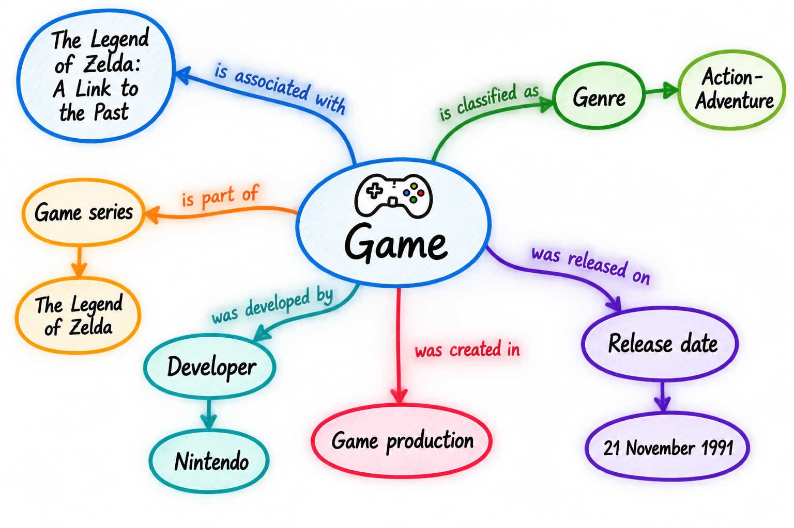
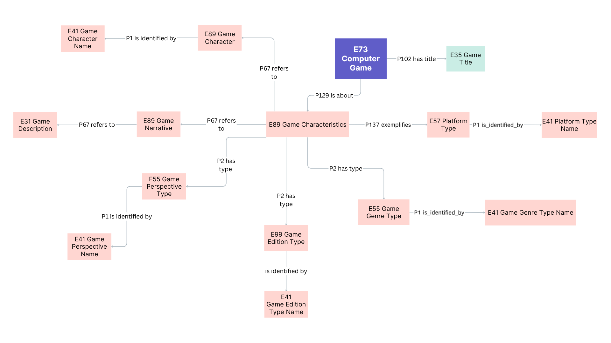
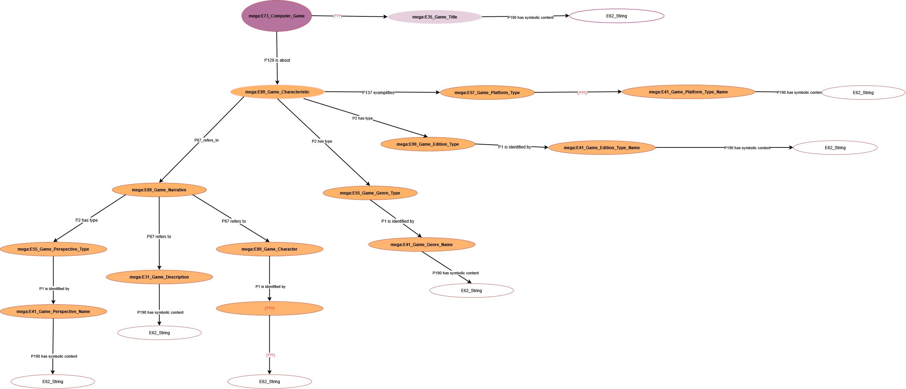
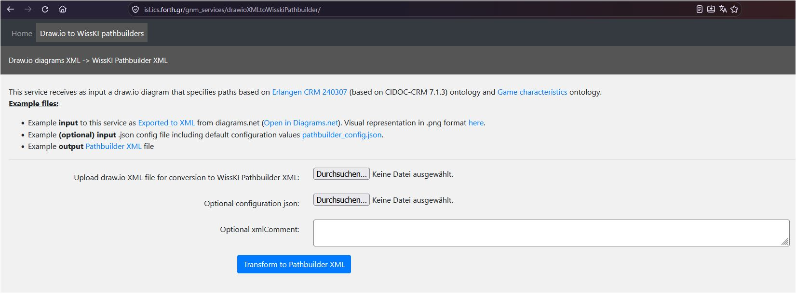
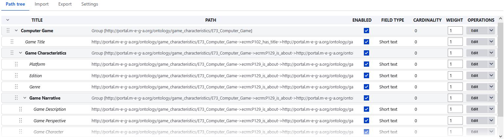

<!--
author: Canan Hastik (0000-0003-1729-4642)

author: Gudrun Schwenk (0009-0002-3156-8339)

email: info@igsd-ev.de

version:  v1.0.0

language: de

icon: https://raw.githubusercontent.com/soda-collections-objects-data-literacy/WissKIBits_How-to-Tutorial/refs/heads/main/assets/SODa-Logo_Wort-Bild_RGB.png

link: https://raw.githubusercontent.com/soda-collections-objects-data-literacy/WissKIBits_How-to-Tutorial/refs/heads/main/soda.css

license: CC BY 4.0 <https://creativecommons.org/licenses/by/4.0/>

comment: Dieser Fast Track ist Teil des How-to-Tutorials „Ontologiebasierte Modellierung von Forschungsdaten“. Anhand einer Computerspielsammlung bietet er erfahrenen Nutzenden einen kompakten, übungsorientierten Arbeitsablauf von der konzeptionellen Modellierung und Zuordnung zu CIDOC CRM über die Formalisierung einer Ontologie bis zur Konfiguration semantischer Pfade in WissKI.

title: WissKI Bits – Ontologiebasierte Modellierung von Forschungsdaten

module: Fast Track –  Vom Sammlungsobjekt zur Dateneingabe in WissKI

unit: Übungsorientierte Schritt-für-Schritt-Anleitung für Fortgeschrittene

description: Dieser WissKI Bit Fast Track führt erfahrene Nutzende durch die praktischen Schritte der ontologiebasierten Modellierung von Forschungsdaten. Anhand einer Computerspielsammlung erstellen sie eine konzeptionelle Modellskizze, formalisieren ausgewählte Konzepte mit CIDOC CRM, überführen einen Ontologieausschnitt in Protégé, bereiten ein Draw.io-Diagramm vor und erzeugen und importieren semantische Pfade und Pfadgruppen in WissKI.

keywords: WissKI, CIDOC CRM, Ontologie, Domänenontologie, semantische Modellierung, Forschungsdaten, Forschungsdatenmanagement, OER

community: Wissenschaftliche KommunikationsInfrastruktur (WissKI) und Sammlungen, Objekte, Datenkompetenzen (SODa)

PublicationDate: 2026-10-05

LearningResourceType: How-to-Tutorial
-->

# WissKI Bits: Ontologiebasierte Modellierung von Forschungsdaten

**ENTWICKLUNG UND IMPLEMENTIERUNG EINES DATENMODELLS ANHAND EINES BEISPIELS**

**Fast Track: Vom Sammlungsobjekt zur Dateneingabe in WissKI**

**Eine übungsbasierte Schritt-für-Schritt-Anleitung für Fortgeschrittene**

**Zielgruppe:** Fortgeschrittene, die mit den Grundlagen der semantischen Modellierung, CIDOC CRM und Ontologie-Editoren sehr gut vertraut sind.

**Ziel:** Dieser Fast Track enthält alle Übungsaufgaben aus den Modulen 1–3 des WissKI Bits How-to-Tutorials: von einer konzeptionellen und formalisierten Modell-Skizze, über ein Draw.io-Diagramm und einem OWL-Ontologieausschnitt bis zu importierten WissKI-Pfaden, -Pfadgruppen und Dateneingabefeldern für eine erste Dateneingabe.

**Wichtig:** Erläuterungen, Definitionen, Quizfragen sowie weiterführende Bild-/Video-Dokumentation finden Sie im WissKI Bits How-to-Tutorial.

**Beispielobjekt:** Das Super Nintendo Entertainment System (SNES) Spiel *The Legend of Zelda: A Link to the Past* von 1991.

**Dauer:** ca. 90 Min.

---

## Über diesen Fast Track

Dieser Fast Track führt **sechs praktische Übungen aus den Modulen 1–3** des WissKI Bits How-To-Tutorials in der ursprünglichen Reihenfolge unter Verwendung **vorhandener Übungsmaterialien** zu einer zusammenhängenden Schritt-für-Schritt-Anleitung zusammen. 

Ausgehend von dem **Beispielobjekt: The Legend of Zelda: A Link to the Past** führen Sie folgenden aufeinander aufbauenden Schritte durch:
- konzeptionelle Modellierung,
- Zuordnung zu CIDOC CRM,
- Formalisierung eines kleinen Ausschnitts in Protégé,
- Vervollständigung eines vorbereiteten Draw.io-Diagramms und
- Umwandlung des Draw.io-Diagramms in eine WissKI-Pathbuilder-Konfiguration.

**Wichtig:** Die Aktivitäten orientieren sich an der Beispieldomäne und dem Modellierungsansatz des Tutorials. Zu Beginn jeder Übung werden Ihnen die benötigten Materialien bereitgestellt. Vergleichen Sie Ihre Ergebnisse anschließend mit den bereitgestellten Musterlösungen und überprüfen Sie Ihre Modellierungsentscheidungen.

**Zeitplan**

| Aktivität | Zeit |
|---|---:|
| Vorbereitung und Orientierung | 5 Min. |
| 1. Sammlungsobjekt untersuchen und konzeptionelle Skizze erstellen | 10 Min. |
| 2. Ausgewählte Konzepte auf CIDOC CRM übertragen | 15 Min. |
| 3. Modellausschnitt in Protégé mit CIDOC CRM formalisieren | 15 Min. |
| 4. Draw.io-Diagramm vervollständigen | 15 Min. |
| 5. WissKI Pathbuilder erstellen und prüfen | 20 Min. |
| 6. Dateineingabefelder prüfen und Daten eingeben | 10 Min. |
| **Gesamt** | **90 Min.** |

Der Zeitplan setzt voraus, dass Sie mit den Grundlagen der semantischen Modellierung vertraut sind und Zugang zu den **Werkzeugen, Beispieldaten und Musterlösungen** haben. 

Relevante vertiefende Inhalte sind an entsprechenden Stellen verlinkt. 

Die vollständigen Module sind in Englisch und Deutsch verfügbar (Dauer insgesamt 3 x 90 Minuten):
- [Modul 1: Von der Sammlung über Modellierentscheidungen zum Diagramm – verstehen und erklären](https://github.com/soda-collections-objects-data-literacy/WissKIBits_How-to-Tutorial/tree/main/WissKIBits_Modul1)
- [Modul 2: Modellieren mit CIDOC CRM – verstehen und anwenden](https://github.com/soda-collections-objects-data-literacy/WissKIBits_How-to-Tutorial/tree/main/WissKIBits_Modul2)
- [Modul 3: Vom Diagramm zu Pfaden – erläutern und anwenden](https://github.com/soda-collections-objects-data-literacy/WissKIBits_How-to-Tutorial/tree/main/WissKIBits_Modul3)

---

### Bevor Sie beginnen - 5 Min.

Richten Sie Ihre Arbeitsumgebung ein:

- Sie benötigen einen Computer mit Internetzugang.
- Öffnen Sie in jeweils einem Browser-Tab (Firefox wird empfohlen):
  - [Draw.io / diagrams.net](https://app.diagrams.net/),
  - [WebProtégé](https://protege.stanford.edu/) oder alternativ Protégé Desktop,
  - [Erlangen CRM 240307 OWL](https://erlangen-crm.org/ontology/ecrm/ecrm_240307.owl), 
  - Ihre WissKI-Instanz im [SODa Semantic Coworking Space](https://manager.scs.sammlungen.io/),
  - [CIDOC CRM 7.1.3 – Dokumentation und Scope Notes](https://cidoc-crm.org/html/cidoc_crm_v7.1.3.html),
  - [GNM-Service](https://isl.ics.forth.gr/gnm_services/drawioXMLtoWisskiPathbuilder/).

**Hinweis zur Aktualität der Werkzeuge:**  Die Benutzeroberflächen von Protégé (Version 5.6.3), WebProtégé (4.0.2:20200731), Draw.io (V32.6.1), WissKI (Version 8.X-4.9) und Drupal (Version 11.4.11) können sich durch Softwareupdates verändern. Daher können einzelne Menübezeichnungen, Schaltflächen und Ansichten von den Abbildungen und Beschreibungen in diesem Tutorial abweichen. Sollte eine neue ISO-zertifizierte CIDOC CRM Version (Version 7.1.3 	February 2024) publiziert werden, ist diese zu verwenden.

---

## 1. Sammlungsobjekt kennenlernen - 10 Min.

**Ausgangspunkt**

Sie machen sich im Rahmen einer kurzen Recherche auf Wikipedia mit dem Sammlungsobjekt **[The Legend of Zelda: A Link to the Past](https://de.wikipedia.org/wiki/The_Legend_of_Zelda:_A_Link_to_the_Past)** und grundlegenden Begriffen der Videospieldomäne vertraut. (Wikipedia, 2026)

Fragen Sie sich: 
- **Welche Merkmale beschreiben das SNES-Computerspiel: The Legend of Zelda: A Link to the Past?**
- **Wie hängen diese Merkmale miteinander zusammen?** 

Berücksichtigen Sie folgende Merkmale:

- **Titel des Videospiel:** Wie wird das Spiel bezeichnet?
- **Merkmale des Videospiels:** Welche Genres, Plattformen oder anderen Klassifikationen sind relevant für die Videospieldomäne?
- **Narrative Elemente:** Welche Beschreibungen, Perspektiven und Figuren sind charakteristisch für das Videospiel?

Weitere Metadaten (z.B. Publikationsort, -datum, etc.) können Sie einbeziehen, sofern sie zur Erklärung der oben genannten Merkmale beitragen. 

---

### Schritt 1: Vervollständigen Sie das Puzzle 

> 1. Klicken Sie mit der rechten Maustaste auf den Link [**Puzzle-Vorlage**](assets/puzzle.drawio_en.xml) und wählen Sie **„Link speichern unter …“** um die bereitgestellte Puzzle-Datei **puzzle.drawio_en.xml** herunter zu laden.
> 2. Öffnen Sie die heruntergeladene **Puzzle-Datei** in **[Draw.io](https://app.diagrams.net/)**.
> 3. **Untersuchen, ordnen und verbinden** Sie nur die relevanten Merkmale zu einer sinnvollen konzeptionellen Modellskizze.
> 4. Prüfen Sie, ob Ihre konzeptuelle Modellskizze sinnvolle Aussagen über die charakteristischen Merkmale wie Titel, Genre, Plattformen, andere Klassifikationen und narrative Elemente des Beispielobjektes formuliert.

**Ergebnis:** Eine konzeptionelle Modellskizze, die ausgewählte Mermale und Beziehungen zum Beispielobjekt sichtbar macht. 

**Übergang zur nächsten Übung:** In der nächsten Übung erarbeiten Sie eine angemessene Repräsentation dieser Merkmale durch **bestehende CIDOC-CRM-Klassen**.

> **Zur Vertiefung siehe Modul 1, u.a.:**
> - [M1E0A: Anwendungsbeispiel: Sammlungsobjekt „Zelda“](https://liascript.github.io/course/?https://raw.githubusercontent.com/soda-collections-objects-data-literacy/WissKIBits_How-to-Tutorial/refs/heads/main/WissKIBits_Modul1/de/M1E0A_Mindmap_Objekt.md#1)
> - [M1E1: Grundbegriffe konzeptueller Wissensmodellierung](https://liascript.github.io/course/?https://raw.githubusercontent.com/soda-collections-objects-data-literacy/WissKIBits_How-to-Tutorial/refs/heads/main/WissKIBits_Modul1/de/M1E1_Grundbegriffe-konzeptuelle-Wissensmodellierung.md#1)

---

## 2. Zuordnung der Kernentitäten zu CIDOC CRM - 15 Min.

**Ausgangspunkt**

Verwenden Sie nun für Ihr semantisches Modell die Musterlösung **konzeptuelle Modellskizze aus Modul 1**:

Vergleichen Sie die Musterlösung und Ihre konzeptionelle Modellskizze aus der Puzzle-Übung.

---

### Schritt 1: Klassen-Zuordnungen untersuchen und begründen

> 1. Wählen Sie **zwei Konzepte oder Ereignisse** aus der bereitgestellten konzeptuellen Modellskizze aus und klären Sie, was diese im Sammlungskontext bedeuten.
> 2. Nutzen Sie die CIDOC CRM **[Dokumentation](https://cidoc-crm.org/html/cidoc_crm_v7.1.3.html)** oder explorieren Sie CIDOC CRM mit dem **[Periodic Table](https://remogrillo.github.io/cidoc-crm_periodic_table/?code=E1)**.
> 3. Identifizieren Sie passende CIDOC CRM Klassen zu den Konzepten in dem Sie die **Scope Notes** lesen und vergleichen Sie diese mit der Musterlösung.
> 5. Berücksichtigen Sie, was die jeweilige Klasse ein- und/oder ausschließt und welche CIDOC CRM Beziehungen verfügbar sind.
> 6. Halten Sie für jede Zuordnung eine kurze Begründung und eine offene Frage in der folgenden Tabelle fest.

| Domänenkonzept aus Ihrer Skizze | Mögliche CIDOC CRM-Klasse | Scope Note zutreffend| Begründung und offene Frage |
|---|---|---|---|
| Game Titel | E35 |  ja |  Gibt es eine andere Klasse? |
| [[Lösung]] | [[Lösung]] |  [[Lösung]] |  [[Lösung]] |
| [[Lösung]] |  [[Lösung]] |  [[Lösung]] |  [[Lösung]] |
| [[Lösung]] | [[Lösung]] |  [[Lösung]] |  [[Lösung]] |
| [[Lösung]] |  [[Lösung]] |  [[Lösung]] |  [[Lösung]] |

**Wichtig:** Ein ähnlich klingender CIDOC CRM Klassenname zur Benennung Ihres Domänenkonzeptes reicht nicht aus um eine semantisch korrekte Zuordnung zu erreichen. Vergleichen Sie immer die beabsichtigte Bedeutung jedes Konzepts mit der **Scope Note** der jeweiligen CIDOC CRM Klasse und treffen Sie dann eine Modellierentscheidung. 

**Musterlösung**

Vergleichen Sie Ihre Zuordnungen erst nach Abschluss der Aufgabe mit dem folgenden Vorschlag.

| Domänenkonzept aus Ihrer Skizze | Mögliche CIDOC-CRM-Klasse | Scope Note zutreffend? | Begründung und offene Frage |
|---|---|---|---|
| Spieletitel | E35 Title | Ja, sofern ein Titel gemeint ist | Ein Titel dient der Benennung eines Spiels. Welcher Entität wird er zugeordnet? |
| Computerspiel | E73 Information Object | Abhängig vom Modellierungskontext | Das Spiel wird als Informationsobjekt betrachtet. Welche Aspekte des Spiels werden modelliert? |
| Spielgenre | E55 Type | Ja, als Klassifikation | Das Genre dient der Klassifikation eines Spiels, beispielsweise als Action-Adventure. |
| Plattformtyp | E55 Type | Abhängig vom Modellierungskontext | Wird das Spiel, eine Edition oder eine technische Plattform klassifiziert? |
| Spiel als Konzept | E73 Information Object | Zu prüfen | Eine Edition kann als eigenständiges Informationsobjekt betrachtet werden. Wie wird sie vom Spiel abgegrenzt? |

---

### Schritt 2: Modellierungsentscheidungen vergleichen

> Diskutieren oder reflektieren Sie ob...
> - derselbe Domänenbegriff je nach Forschungsfrage unterschiedliche Merkmale bezeichnen kann?
> - beispielsweise das Spiel als `Konzept`, als `physisches Objekt` oder `digitale Manifestation`?

**Ergebnis:** Ihre semantische Modellierungsskizze umfasst mindestens zwei **begründete, vorläufige Klassen-Zuordnungen** und gegebenenfalls verbleibende Unsicherheiten.

**Übergang zur nächsten Übung:**
Als Nächstes werden Sie Ihre Modellierungsentscheidungen in Protégé umsetzen, indem Sie **domänenspezifische Unterklassen** bestehender CIDOC-CRM-Klassen festlegen und damit einen Ausschnitt Ihres semantischen Modells formalisieren.

> **Zur Vertiefung siehe Modul 1 (Dauer 90 Minuten):**
> - [M1E00: Willkommen, Zielsetzung und Ablauf](https://liascript.github.io/course/?https://raw.githubusercontent.com/soda-collections-objects-data-literacy/WissKIBits_How-to-Tutorial/refs/heads/main/WissKIBits_Modul1/de/M1E00_Ablauf-Zielsetzung.md#1)
> - [M1E0A: Anwendungsbeispiel: Sammlungsobjekt „Zelda“](https://liascript.github.io/course/?https://raw.githubusercontent.com/soda-collections-objects-data-literacy/WissKIBits_How-to-Tutorial/refs/heads/main/WissKIBits_Modul1/de/M1E0A_Mindmap_Objekt.md#1)
> - [M1E1: Grundbegriffe konzeptueller Wissensmodellierung](https://liascript.github.io/course/?https://raw.githubusercontent.com/soda-collections-objects-data-literacy/WissKIBits_How-to-Tutorial/refs/heads/main/WissKIBits_Modul1/de/M1E1_Grundbegriffe-konzeptuelle-Wissensmodellierung.md#1)
> - [M1E2: Grundlagen von Ontologien](https://liascript.github.io/course/?https://raw.githubusercontent.com/soda-collections-objects-data-literacy/WissKIBits_How-to-Tutorial/refs/heads/main/WissKIBits_Modul1/de/M1E2_Grundlagen-Ontologien.md#1)
> - [M1E3: Einführung in CIDOC CRM](https://liascript.github.io/course/?https://raw.githubusercontent.com/soda-collections-objects-data-literacy/WissKIBits_How-to-Tutorial/refs/heads/main/WissKIBits_Modul1/de/M1E3_Einf%C3%BChrung-CIDOCCRM.md#1)*

---

## 3. Einen kleinen Ontologieausschnitt in Protégé formalisieren - 15 Min.

**Ausgangspunkt**

Verwenden Sie nun für Ihre Modellierung in Protégé die Musterlösung der semantischen Modellskizze aus [**Modul 2 des WissKi Bits How-to-Tutorials**](https://liascript.github.io/course/?https://raw.githubusercontent.com/soda-collections-objects-data-literacy/WissKIBits_How-to-Tutorial/refs/heads/main/WissKIBits_Modul2/de/M2E%C3%9C_Modellieren-CIDOCCRM.md#4):

---

### Schritt 1: Erlangen CRM in Protégé laden

> Öffnen Sie [Erlangen CRM 240307 OWL](https://erlangen-crm.org/ontology/ecrm/ecrm_240307.owl) in Protégé.

!?[Video Demonstration: Einführung in Protégé](assets/Short_Protege_Intro.mp4)

---

### Schritt 2: Relevante Klassen untersuchen

> Suchen Sie die folgenden Klassen in der CIDOC-CRM-Klassenhierarchie und untersuchen Sie deren **Scope Notes**:
>
> - `E41 Appellation`
> - `E35 Title` (Unterklasse von `E41 Appellation`)
> - `E55 Type`
> - `E73 Information Object`

---

### Schritt 3: Ausgewählte Klassen-Zuordnungen prüfen

> 1. Vergleichen Sie Ihre semantische Modellskizze mit den relevanten Klassenbeschreibungen in CIDOC CRM anhand der Scope Notes.
> 2. **Merke:** Gehen Sie nicht davon aus, dass eine Zuordnung allein deshalb korrekt ist, weil sich die Klassen-Bezeichnungen ähneln.

Das WissKI Bits How-to-Tutorial verwendet unter anderem folgende CIDOC CRM Klassen:

| Domänenkonzept | Mögliche CIDOC CRM-Klasse | Zu prüfende Frage |
|---|---|---|
| Spieltitel | `E35 Title` | Welcher Entität wird dieser Titel zugeordnet? |
| Spielgenre | `E55 Type` | Was genau wird klassifiziert? |
| Spielplattformtyp | `E55 Type` | Handelt es sich um eine Klassifikation des Spiels? |

---

### Schritt 4: Domänenspezifische Unterklassen erstellen

> 1. Erstellen Sie nun die ausgewählten **Unterklassen** unter den passenden CIDOC-CRM-Klassen, z.B.:
>
> - `E73 Information Object` → `Computer_Game`
> - `E35 Title` → `Game_Title`
> - `E55 Type` → `Game_Genre_Type`
> - `E57 Material` → `Game_Platform_Type`
>
> 2. Untersuchen Sie die entsprechenden Eigenschaften in Protégé und dokumentieren Sie Ihre Modellierungsentscheidungen. **Erstellen Sie keine neuen Eigenschaften.**

Das WissKI-Bits-How-to-Tutorial verwendet unter anderem folgende bestehende CIDOC-CRM-Eigenschaften:

| Ausgangsklasse | Bestehende Eigenschaft | Zielklasse | Beabsichtigte Aussage |
|---|---|---|---|
| `Computer_Game` | `P102 has title` | `Game_Title` | Ein Computerspiel hat einen Titel. |
| `Computer_Game` | `P2 has type` | `Game_Genre_Type` | Ein Spiel wird einem Genretyp zugeordnet. |
| `Computer_Game` | `P2 has type` | `Game_Platform_Type` | Ein Spiel wird einem Plattformtyp zugeordnet. |

> **Hinweis zur Modellierung:**
>
> Die Tabelle beschreibt mögliche **semantische Beziehungen** zwischen den ausgewählten Domänenkonzepten. Sie stellt noch keine formal implementierten OWL dar.
>
> **In diesem Schritt erstellen Sie ausschließlich domänenspezifische Unterklassen**. Die bestehenden CIDOC-CRM-Eigenschaften werden untersucht und die vorgesehenen Beziehungen dokumentiert.
>
> **Hinweis zur Benennung:**
>
> Die Klassenbezeichnungen `Computer_Game` und `Game_Title` sind vereinfachte Namen für die praktische Übung.
>
> In einer veröffentlichten Domänenontologie können die Klassen über einen eigenen Namensraum eindeutig identifiziert werden. Ein Beispiel ist die [MEGA Game Characteristics Domain Ontology](https://games.m-e-g-a.org/ontology/game_characteristics/1.0/Game_characteristics_v1.0.3.rdf), in der die Klasse `E35_Game_Title` als Unterklasse von `E35 Title` definiert ist.
> 
> Es ist sinnvoll, die CIDOC-CRM-Kennung im Namen einer domänenspezifischen Klasse beizubehalten, da diese die Zuordnung zur Referenzontologie sichtbar macht und die Nachvollziehbarkeit der Modellierung erleichtert. Sie ersetzt jedoch nicht die formale Unterklassenbeziehung über `rdfs:subClassOf`. Die formale Unterklassenbeziehung wird durch `rdfs:subClassOf` ausgedrückt.

---

### Schritte 5: Überprüfen, dokumentieren und speichern

> 1. Prüfen Sie, ob...
> - die Domänen-Unterklassen unter den richtigen CIDOC CRM Oberklassen eingeordnet sind,
> - die wiederverwendeten CIDOC CRM Eigenschaften die beabsichtigten Beziehungen ausdrücken und ob offene Fragen dokumentiert wurden.
> 2. Speichern Sie ihre Ontologie.
> 3. Vergleichen Sie Ihre Domänenontologie mit der [Musterlösung: Game Characteristics](https://games.m-e-g-a.org/ontology/game_characteristics/1.0/Game_characteristics_v1.0.3.rdf)

**Ergebnis:** Ein kleiner, formalisierter und dokumentierter Ontologieausschnitt zur Beschreibung von Videospielmerkmalen, jedoch **keine** vollständige Videospielontologie.

**Übergang zur nächsten Übung:** In der nächsten Übung verwenden Sie das **vorbereitete Draw.io-Lückendiagramm** aus Modul 3. Sie vervollständigen das Diagramm gemäß der Konventionen, die der Transformationsdienst GNM-Service voraussetzt.

> **Zur Vertiefung siehe Modul 2 (Dauer 90 Minuten):**
> - [M2E0: Willkommen, Zielsetzung und Ablauf](https://liascript.github.io/course/?https://raw.githubusercontent.com/soda-collections-objects-data-literacy/WissKIBits_How-to-Tutorial/refs/heads/main/WissKIBits_Modul2/de/M2E0_Ablauf-Zielsetzung.md#1)
- [M2E1: Methoden und Workflows semantischer Modellierung](https://raw.githubusercontent.com/soda-collections-objects-data-literacy/WissKIBits_How-to-Tutorial/refs/heads/main/WissKIBits_Modul2/de/M2E1_Methoden-Workflows.md)
> - [M2E2A: Arbeitsumgebung mit Protégé vorbereiten](https://liascript.github.io/course/?https://raw.githubusercontent.com/soda-collections-objects-data-literacy/WissKIBits_How-to-Tutorial/refs/heads/main/WissKIBits_Modul2/de/M2E2A_Protege-einrichten.md#1)
> - [M2E2: Einführung in Protégé](https://raw.githubusercontent.com/soda-collections-objects-data-literacy/WissKIBits_How-to-Tutorial/refs/heads/main/WissKIBits_Modul2/de/M2E2_Protege.md)
> - [M2EÜ:  Semantische Modellierung mit CIDOC CRM](https://raw.githubusercontent.com/soda-collections-objects-data-literacy/WissKIBits_How-to-Tutorial/refs/heads/main/WissKIBits_Modul2/de/M2E%C3%9C_Modellieren-CIDOCCRM.md)

---

## 4. Das Draw.io-Diagramm vervollständigen - 15 Min.

**Ausgangspunkt**

Sie arbeiten nun mit einem **vorbereiteten Draw.io-Lückendiagramm**, das die ausgewählten Klassen und Beziehungen einer Domänenontologie für Videospiele visualisiert (siehe folgende Abbildung):

---

### Schritt 1: Das vorbereitete Diagramm vervollständigen

> 1. Klicken Sie mit der rechten Maustaste auf den Link [**Draw.io-Lückendiagramm**](assets/Gruppe_B.drawio.xml) und wählen Sie **„Ziel speichern unter …“**, um die vorbereitete Datei **Gruppe_B.drawio.xml** herunterzuladen.
> 2. Öffnen Sie die heruntergeladene XML-Datei in **[Draw.io](https://app.diagrams.net/)**.
> 3. Suchen Sie nach **vier** Platzhaltern `(???)`.
> 4. Ersetzen Sie diese Platzhalter `(???)` durch folgende Klassen und Beziehungen:
>    - `P102_has_title`,
>    - `P1 is identified by`,
>    - `P190 has symbolic content`,
>    - `mega:E41_Game_Character_Name`.
> 5. Prüfen Sie, ob die Klassen und Beziehungen **vollständige semantische Pfade** bilden, siehe hierfür **Modellierregeln in Draw.io**.
> 6. Untersuchen Sie die **Attribute** des zentralen Startknotens, der Gruppenknoten und Endknoten des Diagramm. Wählen Sie dazu jeweils einen Knoten aus und öffnen Sie mit **Strg + M** (Windows) den Attributdialog. Prüfen Sie die folgenden Attribute:
>    - `element_id`,
>    - `group_name` und
>    - `name`.
>    - `element_id`,
>    - `group_name` und
>    - `name` sowie
> 7. Setzen Sie die **Attributwerte**, z.B. die Attributwerte des **Gruppenknoten** mega:E89_Game_Characteristic wäre `Game_Characteristic`.
> 8. Exportieren Sie Ihr Diagramm als **Draw.io XML** und speichern Sie es lokal.

> **Modellierungsregeln in Draw.io:**
>
> - Das Diagramm enthält **Klassen und Eigenschaften** die Pfade und Pfadgruppen aber keine einzelnen Instanzen repräsentieren.
> - Alle vier Platzhalter `(???)` wurden ersetzt. 
> - Die Verbindungen der Knoten und Beziehungen sind vollständig.
> - Klassen- und Eigenschaftsbezeichnungen sowie die erforderlichen Attributewerte sind konsistent und entsprechen der [Musterlösung: Games Charcteristics](https://games.m-e-g-a.org/ontology/game_characteristics/1.0/Game_characteristics_v1.0.3.rdf).

**Ergebnis:** Ein [Draw.io XML export](https://isl.ics.forth.gr/gnm_services/files/examples/diagrams_to_pathbuilders/WissKIBits.drawio.xml) basierend auf dem vervollständigten Draw.io-Diagramm:

 

> **Zur Vertiefung, siehe Modul 3 (Dauer 90 Minuten):**
> - [M3E0: Willkommen, Zielsetzung und Ablauf](https://liascript.github.io/course/?https://raw.githubusercontent.com/soda-collections-objects-data-literacy/WissKIBits_How-to-Tutorial/refs/heads/main/WissKIBits_Modul3/de/M3E0_Ablauf-Zielsetzung.md#1)
> - [M3Ü1: Semantische Domänenontologie visualisieren](https://liascript.github.io/course/?https://raw.githubusercontent.com/soda-collections-objects-data-literacy/WissKIBits_How-to-Tutorial/refs/heads/main/WissKIBits_Modul3/de/M3E%C3%9C1_Dom%C3%A4nenontologie-Diagramm.md#1)
> - [M3Ü2: Transformation semantischer Modelle in WissKI-Pfade](https://liascript.github.io/course/?https://raw.githubusercontent.com/soda-collections-objects-data-literacy/WissKIBits_How-to-Tutorial/refs/heads/main/WissKIBits_Modul3/de/M3E%C3%9C2_Drawio-to-WissKI-Paths.md#1)
---

## 5. WissKI-Pfade umwandeln und importieren - 20 Min.

**Ausgangspunkt**

Sie arbeiten nun mit dem [**GNM Service**](https://isl.ics.forth.gr/gnm_services/drawioXMLtoWisskiPathbuilder) um den Draw.io XML-Export in eine **WissKI Pathbuilder XML Konfiguration** umzuwandeln.

---

### Schritt 1: Die Draw.io-XML-Datei in Pathbuilder-XML-Datei umwandeln

> 1. Öffnen Sie den [GNM-Service: Draw.io diagrams to WissKI Pathbuilders](https://isl.ics.forth.gr/gnm_services/drawioXMLtoWisskiPathbuilder/) im Browser.
> 2. Laden Sie **Ihren Draw.io XML-Export** oder die Musterlösung [Exported to XML from diagrams.net](https://isl.ics.forth.gr/gnm_services/files/examples/diagrams_to_pathbuilders/WissKIBits.drawio.xml) (Klicken Sie mit der rechten Maustaste auf den folgenden Link und wählen Sie **„Link speichern unter …“** um die bereitgestellte Musterlösung herunter zu laden.) hier hoch: **Upload draw.io XML file for conversion to WissKI Pathbuilder XML**.
> 3. Starten Sie die Transformation und klicken Sie  **Transform to pathbuilder XML**.
> 4. Prüfen Sie den Status der Transformation.
> 5. Wenn die Tranformation erfolgreich war, benötigen Sie **später in WissKI** (siehe 6. WissKi Pathbuilder erstellen - Schritt 2: Pathbuilder erstellen und importieren)
>    - die Kopie des Links Ihres **Pathbuilder XML Output: Download XML file** oder
>    - die Kopie des Links der Musterlösung [**Example output Pathbuilder XML file**](https://isl.ics.forth.gr/gnm_services/files/examples/diagrams_to_pathbuilders/DrawioPathBuilderExampleOutput_WissKIBits.xml)

---

## 6. WissKi Pathbuilder erstellen - 10 Min.

**Ausgangspunkt**

Sie arbeiten nun in Ihrer **WissKI-Test-Instanz im SCS** weiter.

Wenn Sie noch keine eigene WissKI Instanz haben, können Sie diese hier beantragen: [SODa Semantic Co-Working Space](https://manager.scs.sammlungen.io)

---

<!-- 
### Schritt 1: Games-Ontologie in WissKI laden und SALZ Adapter aktualisieren

> 1. Loggen Sie sich in Ihre WissKI-Test-Instanz ein.
> 2. Navigieren Sie zu **Configuration → WissKI → WissKI Ontology**.
> 3. Löschen Sie die bestehende default Ontologie: **Delete Ontology**
> 4. Laden Sie die [Games-Domänenontologie](https://games.m-e-g-a.org/ontology/game_characteristics/1.0/Game_characteristics_v1.0.3.rdf) hier **Pathbuilder Definition Import** über die URL.
> 5. Aktualisieren Sie den **WissKI Salz Adapter**:
>    - Navigieren Sie **Configuration → WissKI → WissKI Salz Adapters**
> 6. Editieren Sie mit **Edit** den **Default Salz Adapter** und scrollen Sie zu **Compute Type and Property Hierarchy and Domains and Ranges**
>    - Löschen Sie die bestehende Schlussfolgerungstabelle mit **Delete reasoning tables**
>    - Berechnen Sie die Schlussfolgerungstabelle neu mit **Re-Compute results** und **Start Reasoning**
>    - Aktualisieren Sie den Adapter **Update adapter**.
> 7. Navigieren Sie zu **Tools → Flush all caches**.

---

### Schritt 2: Pathbuilder erstellen und importieren

> 1. Navigieren Sie zu **Configuration → WissKI → Pathbuilders**.
> 2. Wählen Sie **Add Pathbuilder**, vergeben Sie einen eindeutigen Namen und speichern Sie den neuen Pathbuilder **without form generation**.
> 3. Gehen Sie zu **Import Templates**
>    - Öffnen Sie den **[GNM-Service**](https://isl.ics.forth.gr/gnm_services/drawioXMLtoWisskiPathbuilder/) und den **output Pathbuilder XML** in einem neuen Browser-Tab um die URL des [DrawioPathBuilderExampleOutput_WissKIBits.xml](https://isl.ics.forth.gr/gnm_services/files/examples/diagrams_to_pathbuilders/DrawioPathBuilderExampleOutput_WissKIBits.xml) zu kopieren.
>    - Fügen Sie hier **Pathbuilder Definition Import** die kopierte URL des [DrawioPathBuilderExampleOutput_WissKIBits.xml](https://isl.ics.forth.gr/gnm_services/files/examples/diagrams_to_pathbuilders/DrawioPathBuilderExampleOutput_WissKIBits.xml) ein.
>    - Klicken Sie **Import**
> 5. Bei erfolgreichem Import sehen Sie den Startknoten **Computer Game** Ihres Pathbuilders. 
>    - Gehen Sie bei **Operations** auf **Edit**
>    - Die Pfadgruppe **Computer Game** öffnet sich.
>    - Klicken Sie **Save** ohne Änderungen vorzunehmen.
>    - Klicken Sie erneut **Save** um auf den Startknoten **Computer Game** Ihres Pathbuilders zurückzukehren.

Um den vollsändigen Pathbuilder anzuzeigen klicken Sie auf das Aufklappdreieck **>**

---

### Schritt 3: Erzeugten Pfadgruppen und Pfade überprüfen und dokumentieren

> 1. Vergleichen Sie den importierten **Pathbuilder** und das **Draw.io-Diagramm.**
> 2. Prüfen Sie,
> - ob die erwarteten Pfadgruppen vorhanden sind.
> - ob die relevanten Klassen und Eigenschaften enthalten sind.
> - ob Pfade fehlen, falsch gruppiert wurden oder unerwartet auftreten.
>   
> 3. Erstellen Sie eine Dokumentation und Archivieren Sie relevante Dateien. 

**Ergebnis:** Eine erzeugte, importierte und **überprüfte WissKI-Pathbuilder-Konfiguration**. Dabei handelt es sich um einen Konfigurationsimport, nicht um einen Ontologieimport.

> **Zur Vertiefung, siehe Modul 3, u.a.:**
- [Modul 3: Vom Diagramm zu Pfaden – erläutern und anwenden](https://github.com/soda-collections-objects-data-literacy/WissKIBits_How-to-Tutorial/tree/main/WissKIBits_Modul3)

---

### Schritt 4: Eingabefelder generieren und Daten eingeben

Nach der Überprüfung des Pathbuilders können Sie die Struktur und -felder für die Dateneingabe erstellen.

> 6. Generieren Sie nun die **Bundles and fields**
>   - Wenn Sie nicht im Pathbuilder sind, navigieren Sie zu **Configuration → WissKI → Pathbuilders**.
>   - Klicken Sie auf **Save and generate bundles and fields**
>   - Gehen Sie bei Startknoten **Computer Game** Ihres Pathbuilders zu **Operations** und auf **Edit**.
>    - Klicken Sie **Save** ohne Änderungen vorzunehmen.

**Ergebnis:** Hier stellen wir Ihnen einen [Pathbuilder Export](assets/games_ontology_20261020T220812) mit einigen Daten zum **Beispielobjekt: The Legend of Zelda: A Link to the Past** zur Verfügung.

-->

---

# Bibliografie

(Wikipedia, 2026)  The Legend of Zelda: A Link to the Past. (2026). In Wikipedia. Zuletzt abgerufen am 15. Oktober 2026 von https://de.wikipedia.org/w/index.php?title=The_Legend_of_Zelda:_A_Link_to_the_Past&oldid=268272133

