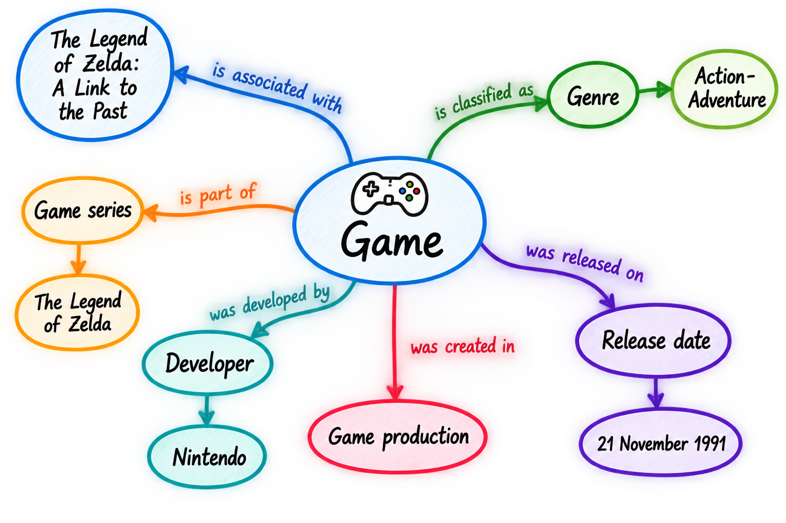
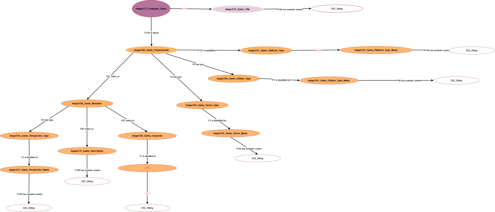

<!--
author: Canan Hastik (0000-0003-1729-4642)

author: Gudrun Schwenk (0009-0002-3156-8339)

email: info@igsd-ev.de

version:  v1.0.0

language: de

icon: https://raw.githubusercontent.com/soda-collections-objects-data-literacy/WissKIBits_How-to-Tutorial/refs/heads/main/assets/SODa-Logo_Wort-Bild_RGB.png

link: https://raw.githubusercontent.com/soda-collections-objects-data-literacy/WissKIBits_How-to-Tutorial/refs/heads/main/soda.css

license: CC BY 4.0 <https://creativecommons.org/licenses/by/4.0/>

comment: Dieser Fast Track ist Teil des How-to-Tutorials „Ontologiebasierte Modellierung von Forschungsdaten“. Anhand einer Computerspielsammlung bietet er erfahrenen Nutzenden einen kompakten, übungsorientierten Arbeitsablauf von der konzeptionellen Modellierung und Zuordnung zu CIDOC CRM über die Formalisierung einer Ontologie bis zur Konfiguration semantischer Pfade in WissKI.

title: WissKI Bits – Ontologiebasierte Modellierung von Forschungsdaten

module: Fast Track – Vom Sammlungsobjekt zu WissKI-Pfaden

unit: Übungsorientierte Schritt-für-Schritt-Anleitung für Fortgeschrittene

description: Dieser WissKI Bit Fast Track führt erfahrene Nutzende durch die praktischen Schritte der ontologiebasierten Modellierung von Forschungsdaten. Anhand einer Computerspielsammlung erstellen sie eine konzeptionelle Modellskizze, formalisieren ausgewählte Konzepte mit CIDOC CRM, überführen einen Ontologieausschnitt in Protégé, bereiten ein Draw.io-Diagramm vor und erzeugen und importieren semantische Pfade und Pfadgruppen in WissKI.

keywords: WissKI, CIDOC CRM, Ontologie, Domänenontologie, semantische Modellierung, Forschungsdaten, Forschungsdatenmanagement, OER

community: Wissenschaftliche KommunikationsInfrastruktur (WissKI) und Sammlungen, Objekte, Datenkompetenzen (SODa)

PublicationDate: 2026-10-05

LearningResourceType: How-to-Tutorial
-->

# WissKI Bits: Ontologiebasierte Modellierung von Forschungsdaten

**ENTWICKLUNG UND IMPLEMENTIERUNG EINES DATENMODELLS ANHAND EINES BEISPIELS**

**Fast Track: Vom Sammlungsobjekt zur Dateneingabe in WissKI**

**Eine übungsbasierte Schritt-für-Schritt-Anleitung für Fortgeschrittene**

**Zielgruppe:** Fortgeschrittene, die mit den Grundlagen der semantischen Modellierung, CIDOC CRM und Ontologie-Editoren sehr gut vertraut sind.

**Ziel:** Dieser Fast Track enthält alle Übungsaufgaben aus den Modulen 1–3 des WissKI Bits How-to-Tutorials: von einer konzeptionellen und formalisierten Modell-Skizze, über ein Draw.io-Diagramm und einem OWL-Ontologieausschnitt bis zu importierten WissKI-Pfaden, -Pfadgruppen und Dateneingabefeldern für eine erste Dateneingabe.

**Wichtig:** Erläuterungen, Definitionen, Quizfragen sowie weiterführende Bild-/Video-Dokumentation finden Sie im WissKI Bits How-to-Tutorial.

**Beispielobjekt:** Das Computerspiel 'The Legend of Zelda: A Link to the Past'

**Dauer:** ca. 90 Min.

---

## Über diesen Fast Track

Dieser Fast Track führt **fünf praktische Übungen aus den Modulen 1–3** des WissKI Bits How-To-Tutorials in der ursprünglichen Reihenfolge unter Verwendung **vorhandener Übungsmaterialien** zu einer zusammenhängenden Schritt-für-Schritt-Anleitung zusammen. 

Ausgehend von dem **Beispielobjekt: The Legend of Zelda: A Link to the Past** führen Sie folgenden aufeinander aufbauenden Schritte durch:
- konzeptionelle Modellierung,
- Zuordnung zu CIDOC CRM,
- Formalisierung eines kleinen Ausschnitts in Protégé,
- vervollständigen ein vorbereitetes Draw.io-Diagramm und
- umwandeln des Draw.io-Diagramms in eine WissKI-Pathbuilder-Konfiguration.

**Wichtig:** Die Aktivitäten orientieren sich an der Beispieldomäne und dem Modellierungsansatz des Tutorials. Zu Beginn jeder Übung werden Ihnen die benötigten Materialien bereitgestellt. Vergleichen Sie Ihre Ergebnisse anschließend mit den bereitgestellten Musterlösungen und überprüfen Sie Ihre Modellierungsentscheidungen.

**Zeitplan**

| Aktivität | Zeit |
|---|---:|
| Vorbereitung und Orientierung | 5 Min. |
| 1. Sammlungsobjekt untersuchen und konzeptionelle Skizze erstellen | 10 Min. |
| 2. Ausgewählte Konzepte auf CIDOC CRM mappen | 15 Min. |
| 3. Einen Modellausschnitt in Protégé umsetzen und formalisieren | 15 Min. |
| 4. Ein Draw.io-Diagramm vervollständigen | 15 Min. |
| 5. WissKI Pathbuilder importieren und prüfen | 20 Min. |
| 6. Dateineingabefelder prüfen und Daten eingeben | 10 Min. |
| **Gesamt** | **90 Min.** |

Der Zeitplan setzt voraus, dass Sie mit den Grundlagen der semantischen Modellierung vertraut sind und Zugang zu den **Werkzeugen, Beispieldaten und Musterlösungen** haben. 

Relevante vertiefende Inhalte sind an entsprechenden Stellen verlinkt. Die vollständigen Module sind in Englisch und Deutsch verfügbar:
- [Modul 1](https://github.com/soda-collections-objects-data-literacy/WissKIBits_How-to-Tutorial/tree/main/WissKIBits_Modul1)
- [Modul 2](https://github.com/soda-collections-objects-data-literacy/WissKIBits_How-to-Tutorial/tree/main/WissKIBits_Modul2)
- [Modul 3](https://github.com/soda-collections-objects-data-literacy/WissKIBits_How-to-Tutorial/tree/main/WissKIBits_Modul3)

---

### Bevor Sie beginnen - 5 Min.

Halten Sie Folgendes bereit:

- Computer mit Internetzugang,
- [Draw.io / diagrams.net](https://app.diagrams.net/),
- [Protégé Desktop oder WebProtégé](https://protege.stanford.edu/),
- Zugang zu einer WissKI-Instanz im [SODa Semantic Coworking Space](https://manager.scs.sammlungen.io/),
- [Erlangen CRM 240307 (OWL)](https://erlangen-crm.org/ontology/ecrm/ecrm_240307.owl), (Version 7.1.3),
- [CIDOC CRM 7.1.3 – Dokumentation und Scope Notes](https://cidoc-crm.org/html/cidoc_crm_v7.1.3.html),
- [Games-Domänenontologie](http://games.m-e-g-a.org/game_domain.rdf),
- [GNM-Service](https://isl.ics.forth.gr/gnm_services/drawioXMLtoWisskiPathbuilder/).

**Hinweis zu den Benutzeroberflächen:**  Die Benutzeroberflächen von Protégé, Draw.io und WissKI können sich durch Softwareupdates verändern. Daher können einzelne Menübezeichnungen, Schaltflächen und Ansichten von den Abbildungen und Beschreibungen in diesem Tutorial abweichen.

---

## 1. Das Sammlungsobjekt untersuchen - 10 Min.

**Ausgangspunkt**

Sie machen sich mit im Rahmen einer kurzen Recherche auf Wikipedia mit dem Sammlungsobjekt **[The Legend of Zelda: A Link to the Past](https://de.wikipedia.org/wiki/The_Legend_of_Zelda:_A_Link_to_the_Past)** und grundlegenden Begriffen aus der Computerspiele-Domäne vertraut. (Wikipedia, 2026)

Fragen Sie sich: 
- **Welche Merkmale beschreiben das SNES-Computerspiel: The Legend of Zelda: A Link to the Past?**
- **Wie hängen diese Merkmale miteinander zusammen?** 

Berücksichtigen Sie folgende Aspekte:

- **Spieltitel:** Wie wird das Spiel bezeichnet?
- **Spieleigenschaften:** Welche Genres, Plattformen oder anderen Klassifikationen sind relevant?
- **Narrative Elemente:** Welche Beschreibungen, Perspektiven und Figuren sind charakteristisch?

Weitere Akteure, Ereignisse, Orte und Zeiten können Sie einbeziehen, sofern sie zur Erklärung der ausgewählten Beziehungen beitragen. 

---

### Schritt 1: Vervollständigen Sie das Puzzle 

> 1. Speichern Sie das vorbereitete **[Puzzle](https://github.com/soda-collections-objects-data-literacy/WissKIBits_How-to-Tutorial/blob/main/WissKBits_FastTrack/assets/puzzle.drawio_en.xml)** auf Ihrem Computer, 
> 2. Öffnen Sie **[Draw.io](https://app.diagrams.net/)** und öffnen Sie die heruntergeladene **Puzzle-Datei**.
> 3. Untersuchen Sie die **vorgegebenen** Kernelemente.
> 4. **Ordnen und verbinden** Sie nur die Elemente zu einer konzeptionellen Modellskizze, die aus Ihrer Sicht die Merkmale von **The Legend of Zelda: A Link to the Past** sinnvoll beschreiben.
> 5. Prüfen Sie, ob Ihre konzeptuelle Modellskizze sinnvolle Aussagen über die charakteristischen Merkmale des Beispielobjektes stüzen.
>
> **Ergebnis:** Eine konzeptionelle Modellskizze, die ausgewählte Kernelemente und Beziehungen sichtbar macht. 
> **Übergang zur nächsten Übung:**
> In der nächsten Übung prüfen Sie, ob die Kernelemente durch **bestehende CIDOC-CRM-Klassen** angemessen repräsentiert werden können.

> **Zur Vertiefung, siehe Modul 1, u.a.:**
> - [M1U0A: Mindmap of the Application Example from Object Collections](https://github.com/soda-collections-objects-data-literacy/WissKIBits_How-to-Tutorial/blob/main/WissKIBits_Modul1/en/M1U0A_Mindmap_Object_en.md)
> - [M1U1: Basic concepts of conceptual knowledge modelling](https://github.com/soda-collections-objects-data-literacy/WissKIBits_How-to-Tutorial/blob/main/WissKIBits_Modul1/en/M1U1_Basics-Conceptual-Modelling_en.md)

---

## 2. Zuordnung der Kernentitäten zu CIDOC CRM  — 15 Min.

**Ausgangspunkt**

Verwenden Sie für Ihr semantisches Modell die **konzeptuelle Modellskizze aus Modul 1**:

---

### Schritt 1: Erste Klassen-Zuordnungen untersuchen und begründen

> 1. wählen Sie **zwei Konzepte oder Ereignisse** aus der bereitgestellten konzeptuellen Modellskizze aus und klären Sie, was diese im Sammlungskontext bedeuten,
> 2. konsultieren Sie die CIDOC CRM **[Dokumentation](https://cidoc-crm.org/html/cidoc_crm_v7.1.3.html)** oder explorieren Sie CIDOC CRM mit dem **[Periodic Table](https://remogrillo.github.io/cidoc-crm_periodic_table/?code=E1)**,
> 3. identifizieren Sie passende CIDOC CRM Klassen zu den Konzepten und Ereignissen,
> 4. lesen Sie die **Scope Notes** und vergleichen Sie die Klassen mit Ihrem Domänenkonzept,
> 5. berücksichtigen Sie, was die jeweilige Klasse einschließt oder ausschließt,
> 6. halten Sie für jede Zuordnung eine kurze Begründung und eine offene Frage fest.

| Domänenkonzept aus Ihrer Skizze | Mögliche CIDOC CRM-Klasse | Scope Note zutreffend| Offene Frage |
|---|---|---|---|
| Game Titel | E35 |  [(X)] |  keine |
| [[Lösung]] | [[Lösung]] |  [[Lösung]] |  [[Lösung]] |
| [[Lösung]] |  [[Lösung]] |  [[Lösung]] |  [[Lösung]] |

**Wichtig:** Ein ähnlich klingender CIDOC CRM Klassenname reicht nicht aus um eine semantische Zuordnung zu erreichen. Vergleichen Sie immer die beabsichtigte Bedeutung jedes Konzepts mit der **Scope Note** der jeweiligen CIDOC CRM Klasse und treffen Sie dann eine Entscheidung. Geeignete Konzepte können sein: `E73 Information Object`, `E35 Title`, `E55 Type`, `E21 Person` oder `E74 Group`

---

### Schritt 2: Modellierungsentscheidungen vergleichen

> 1. Diskutieren oder reflektieren Sie ob...
> - derselbe Domänenbegriff je nach Forschungsfrage unterschiedliche Dinge bezeichnen kann?
> - beispielsweise ein Name als `Title`, als `Identifikator` oder mit einer andere Klasse formalisiert wird?
>
> **Ergebnis:** Ihre semantische Modellierungsskizze umfasst mindestens zwei **begründete, vorläufige Zuordnungen** und gegebenenfalls verbleibende Unsicherheiten.
> **Übergang zur nächsten Übung:**
> Als nächstes werden Sie in Protégé Ihre Modellierungsentscheidungen als **domänenspezifische Unterklassen** bestehender CIDOC-CRM-Klassen explizit festlegen.

> **Zur Vertiefung, siehe Modul 1, u.a.:**
> - [M1U3: Introduction to CIDOC CRM](https://github.com/soda-collections-objects-data-literacy/WissKIBits_How-to-Tutorial/blob/main/WissKIBits_Modul1/en/M1U3_Introduction-CIDOCCRM_en.md)*

---

## 3. Einen kleinen Ontologieausschnitt in Protégé formalisieren — 25 Min.

**Ausgangspunkt**

Verwenden Sie für Ihre Modellierung in Protégé die **semantische Modellskizze aus Modul 2**:

---

### Schritt 1: Erlangen CRM in Protégé laden

> Öffnen Sie [Erlangen CRM 240307 OWL](https://erlangen-crm.org/ontology/ecrm/ecrm_240307.owl) in Protégé.

> **Zur Vertiefung, siehe Modul 2, u.a.:**
> - [M2U1A: Setting Up the Working Environment with Protégé](https://github.com/soda-collections-objects-data-literacy/WissKIBits_How-to-Tutorial/blob/main/WissKIBits_Modul2/en/M2U1A_Setup-Protege_en.md)
> - [M2U2: Introduction to Protégé](https://github.com/soda-collections-objects-data-literacy/WissKIBits_How-to-Tutorial/blob/main/WissKIBits_Modul2/en/M2U2_Protege_en.md)

---

### Schritt 2: Relevante Klassen untersuchen

> Suchen Sie die folgenden Klassen in der Hierarchie:
>
> - `E41 Appellation`
> - `E35 Title` (eine Unterklasse von `E41 Appellation`)
> - `E55 Type`
> - `E73 Information Object`
>
> Untersuchen Sie für jede Klasse ihre Position in der Hierarchie, ihre Beziehungen und **Scope Note**.

---

### Schritt 3: Ausgewählte Klassen-Zuordnungen erneut prüfen

> 1. Vergleichen Sie Ihre semantische Modellskizze mit den formalen Klassen in CIDOC CRM.
> 2. Gehen Sie nicht davon aus, dass eine Zuordnung allein deshalb korrekt ist, weil sich die Bezeichnungen ähneln.

Das Tutorial verwendet unter anderem folgende CIDOC CRM Klassen:

| Domänenkonzept | Mögliche CIDOC CRM-Klasse | Zu prüfende Frage |
|---|---|---|
| Spieltitel | `E35 Title` | Welcher Entität wird dieser Titel zugeordnet? |
| Spielgenre | `E55 Type` | Was genau wird klassifiziert? |
| Spielplattformtyp | `E55 Type` | Handelt es sich um eine Klassifikation des Spiels? |

---

### Schritt 4: Domänenspezifische Unterklassen erstellen

> 1. Erstellen Sie die ausgewählten **Unterklassen** unter den passenden CIDOC-CRM Klassen, z.B.:
>
> - E73 Information Object → Computer_Game
> - E35 Title → Game_Title
> - E55 Type → Game_Genre_Type, Game_Platform_Type
>
> 2. **Erstellen Sie keine neuen CIDOC CRM Eigenschaften.**
> 3. Untersuchen Sie nur die entsprechenden Eigenschaften in Protégé und dokumentieren Sie ihre Entscheidungen.

Das Tutorial verwendet unter anderem folgende CIDOC CRM Eigenschaften:

| Ausgangsklasse | Bestehende Eigenschaft | Zielklasse | Beabsichtigte Aussage |
|---|---|---|---|
| `Computer_Game` | `P102 has title` | `Game_Title` | Ein Computerspiel hat einen Titel. |
| `Computer_Game` | `P2 has type` | `Game_Genre_Type` | Ein Spiel wird einem Genretyp zugeordnet. |
| `Computer_Game` | `P2 has type` | `Game_Platform_Type` | Ein Spiel wird einem Plattformtyp zugeordnet. |

---

### Schritte 5: Überprüfen, dokumentieren und speichern

> 1. Prüfen Sie, ob...
> - die Unterklassen unter den richtigen Oberklassen eingeordnet sind,
> - die wiederverwendeten Eigenschaften die beabsichtigten Beziehungen ausdrücken und
> - offene Fragen dokumentiert wurden.
> 2. Speichern Sie ihre Ontologie.
>
> **Ergebnis:** Ein kleiner formalisierter und dokumentierter Ontologieausschnitt, **keine** vollständige Computerspieleontologie.
> **Übergang zur nächsten Übung:**
> Die nächste Übung verwendet das **vorbereitete Draw.io-Lückendiagramm** aus Modul 3. Sie vervollständigen das Diagramm gemäß der Konventionen, die der Transformationsdienst GNM-Service voraussetzt.

> **Zur Vertiefung, siehe Modul 2, u.a.:** 
> - [M2U2: Methods and Workflows of Semantic Modelling](https://github.com/soda-collections-objects-data-literacy/WissKIBits_How-to-Tutorial/blob/main/WissKIBits_Modul2/en/M2U1_Methods-Workflows_en.md)
> - [M2U2: Introduction to Protégé.](https://github.com/soda-collections-objects-data-literacy/WissKIBits_How-to-Tutorial/blob/main/WissKIBits_Modul2/en/M2U2_Protege_en.md)*

---

## 4. Das Draw.io-Diagramm vervollständigen - 15 Min.

**Ausgangspunkt**

Sie arbeiten mit dem **vorbereiteten Lückendiagramm**:

---

### Schritt 1: Das vorbereitete Diagramm vervollständigen

> 1. Laden Sie das **[Draw.io-XML-Lückendiagramm](../WissKIBits_Modul3/assets/Gruppe_B.drawio.xml)** herunter oder öffnen Sie es direkt von GitHub in **[Draw.io](https://app.diagrams.net/)**.
> 3. Identifizieren Sie die fehlenden Knoten und Kanten und ersetzen Sie die **vier** temporären Platzhalter `(???)`.
> 4. Verwenden Sie die angegebenen Elemente **an den richtigen Stellen**:
>    `P102_has_title`,
>    `P1 is identified by`,
>    `P190 has symbolic content`,
>    `mega:E41_Game_Character_Name`.
> 5. Prüfen Sie, dass die Klassen und Eigenschaften **vollständigee semantischee Pfade** bilden und dass jede Eigenschaftsbezeichnung der zugehörigen Beziehung zugeordnet ist.
> 6. Untersuchen Sie die **Attribute** `element_id`, `group_name` und `name` sowie **-werte** des zentralen Startknotens, der Gruppenknoten und Endknoten:
>    Beispielsweise, die Attributwerte des **Gruppenknoten** mega:E89_Game_Characteristic ist `Game_Characteristic`.
> 7. Exportieren Sie das Diagramm als **Draw.io XML** und speichern Sie es lokal.

> **Prüfen Sie die Modellierungsregeln:**
>
> - Das Diagramm enthält **Klassen und Eigenschaften** die Pfade und Pfadgruppen aber keine keine einzelnen Instanzen repräsentieren
> - Es sind keine `(???)`-Platzhalter mehr vorhanden;
> - Die Verbindungen sind vollständig;
> - Klassen- und Eigenschaftsbezeichnungen sowie die erforderlichen Attributewerte sind konsistent;
>
> **Ergebnis:** Ein vervollständigtes Draw.io-XML-Diagramm, das für den bestehenden GNM-Service bereit ist.
> **Übergang zur nächsten Übung:**
> Als nächstes wandelm Sie mit dem GNM-Service das Diagramm in eine XML-Repräsentation in eine **WissKI-Pathbuilder-XML-Konfiguration** um, die Sie anschließend in WissKI importieren und untersuchen.

> **Zur Vertiefung, siehe Modul 3, u.a.:**
> [M3UE1: Visualising a Semantic Domain Ontology](https://github.com/soda-collections-objects-data-literacy/WissKIBits_How-to-Tutorial/blob/main/WissKIBits_Modul3/en/M3UE1_Domain-Ontologie-Diagram_en.md)
> [M3UE1: Visualising a Semantic Domain Ontology](https://github.com/soda-collections-objects-data-literacy/WissKIBits_How-to-Tutorial/blob/main/WissKIBits_Modul3/en/M3UE1_Domain-Ontologie-Diagram_en.md)

---

## 5. WissKI-Pfade umwandeln und importieren - 20 Min.

**Ausgangspunkt**

Sie arbeiten mit der exportierten [Draw.io XML Datei](../WissKIBits_FastTrack/assets/SODa_ISWC2025.drawio.xml) und dem [GNM-Service](https://isl.ics.forth.gr/gnm_services/drawioXMLtoWisskiPathbuilder) weiter.

---

### Schritt 1: Die Draw.io-XML-Datei in Pathbuilder-XML-Datei umwandeln

> 1. Öffnen Sie den [GNM-Service: Draw.io diagrams to WissKI Pathbuilders](https://isl.ics.forth.gr/gnm_services/drawioXMLtoWisskiPathbuilder/).
> 2. Laden Sie die [Draw.io XML Datei](../WissKIBits_FastTrack/assets/SODa_ISWC2025.drawio.xml) hier hoch:
>    `Upload draw.io XML file for conversion to WissKI Pathbuilder XML`
> 4. Starten Sie die Transformation und prüfen Sie den Status der Eingabedatei.
> 5. Kopieren Sie den Link des [**Pathbuilder XML Output: Download XML file**](https://isl.ics.forth.gr/gnm_services/files/examples/diagrams_to_pathbuilders/DrawioPathBuilderExampleOutput_ISWC2025.xml)

**Wichtig:** Behalte den Link!

---

## 6. WissKi Pathbuilder erstellen

**Ausgangspunkt**

Sie arbeiten in Ihrer [WissKI-Test-Instanz]() weiter.

---

### Schritt 1: Games-Ontologie in WissKI laden und SALZ Adapter aktualisieren

> 1. Loggen Sie sich in Ihre WissKI-Test-Instanz ein.
> 2. Navigieren Sie zu **WissKI → Configuration → WissKI Ontology**.
> 3. Löschen Sie die bestehende Ontologie.
> 4. Laden Sie die [Games-Domänenontologie](http://games.m-e-g-a.org/game_domain.rdf) hier **Pathbuilder Definition Import** als URL.
> 5. Aktualisiere den **WissKI Salz Adapter**:
>    - Navigieren Sie **WissKI → Configuration → WissKI Salz Adapter**
>    - Editieren Sie den **Default Salz Adapter** und gehe zu **Compute Type and Property Hierarchy and Domains and Ranges**
>    - Lösche die bestehende Schlussfolgerungstabelle: **Delete Reasoning Table**
>    - Berechnen Sie die Schlussfolgerungstabelle neu mit **Re-Compute results** und **Start Reasoning**
>    - Aktualisieren Sie den Adapter **update adapter**.

---

### Schritt 2: Pathbuilder erstellen und importieren**  

> 1. Navigieren Sie zu **Configuration → Pathbuilders**.
> 2. Wählen Sie **Add Pathbuilder**, vergeben Sie einen eindeutigen Namen und wählen Sie den vorgesehenen Adapter.
> 3. Speichern und öffnen Sie den neuen Pathbuilder.
> 4. Suchen Sie **Pathbuilder Definition Import**, fügen Sie die erzeugte **Pathbuilder XML Output: Download XML file** ein und starten Sie den Import.
> 5. Warten Sie, bis die Pathbuilder-Struktur erscheint.
> 6. Editieren Sie den Starknoten **Computer Game** und speichern Sie erneut.

---

### Schritt 3: Importierten Pfade und Pfadgruppen untersuchen**

> Überprüfen Sie die Pfadgruppen und Pfade:
> 
> **Computer_Game → P102 has title → Game_Title**
>
> Prüfen Sie, welche Pfadgruppe diese Beziehung enthält, identifizieren Sie die Eigenschaft, die die Klassen verbindet, und vergleichen Sie das Ergebnis mit dem Ausgangsdiagramm. Verwenden Sie die folgenden Fragen aus der ursprünglichen Übung als kurze Kontrolle:
>
> - Welche Pfadgruppe enthält diese Beziehung? (Suche nach **Computer Game**.)
> - Welche Eigenschaft verbindet die Ausgangs- und Zielklasse? (**P102 has title**.)
> - Entspricht der importierte Pfad Ihrem Ausgangsdiagramm? **Prüfen Sie das tatsächliche Ergebnis**, anstatt anzunehmen, dass der Import die Korrektheit garantiert.

> **Schritt 5: Erzeugten Pfadgruppen und Pfade überprüfen und dokumentieren**
>
> 1. Vergleichen Sie den importierten **Pathbuilder** und das **Draw.io-Diagramm.**
> 2. Prüfen Sie,
> - ob die erwarteten Pfadgruppen vorhanden sind,
> - ob die relevanten Klassen und Eigenschaften enthalten sind.
> - ob Pfade fehlen, unerwartet auftreten oder falsch gruppiert wurden.
>   
> 3. Erstellen Sie eine Dokumentation und Archivieren Sie relevante Dateien. [[VERWEIS Basiskurs - Dokumentation von Forschungsdaten]]]
> 
> **Ergebnis:** Eine erzeugte, importierte und **überprüfte WissKI-Pathbuilder-Konfiguration**. Dabei handelt es sich um einen Konfigurationsimport, nicht um einen Ontologieimport.

 

> **Zur Vertiefung, siehe Modul 3, u.a.:**
> -[MeUE2: Transforming Semantic Models into WissKI Paths](https://github.com/soda-collections-objects-data-literacy/WissKIBits_How-to-Tutorial/blob/main/WissKIBits_Modul3/en/M3UE2_Drawio-to-WissKI-Paths_en.md)

---

> **Nächster Schritt**
>
> Nach der Überprüfung des Pathbuilders können Sie die Struktur und -felder für die Dateneingabe erstellen:  **save and generate bundles und fields**
> Danach können Sie Daten eingeben.
> Hier stellen wir Ihnen einen [Pathbuilder Export](assets/games_ontology_20261020T220812) mit einigen Daten zum **Beispielobjekt: The Legend of Zelda: A Link to the Past** zur Verfügung.

