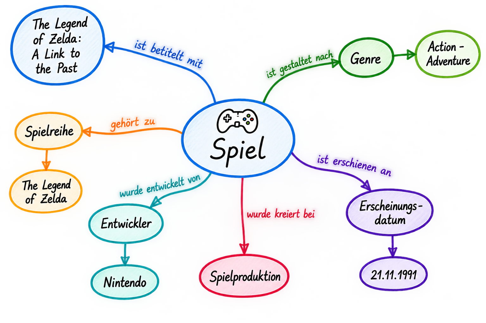

<!--

author: Canan Hastik (0000-0003-1729-4642)

author: Gudrun Schwenk (0009-0002-3156-8339)

email: info@igsd-ev.de

version:  v1.0.0

language: de

icon: https://raw.githubusercontent.com/soda-collections-objects-data-literacy/WissKIBits_How-to-Tutorial/refs/heads/main/assets/SODa-Logo_Wort-Bild_RGB.png

link: https://raw.githubusercontent.com/soda-collections-objects-data-literacy/WissKIBits_How-to-Tutorial/refs/heads/main/soda.css

license: CC BY 4.0 <https://creativecommons.org/licenses/by/4.0/>

comment: Dieses Modul ist Teil des How-to-Tutorials „Ontologiegestützte Modellierung von Forschungsdaten“. Das Tutorial vermittelt am Beispiel einer Computerspielsammlung schrittweise die Entwicklung eines semantischen Datenmodells auf Grundlage des CIDOC CRM und dessen Umsetzung mit WissKI.

title: WissKI Bits: Ontologiebasierte Modellierung von Forschungsdaten

module: Von der Sammlung über Modellierentscheidungen zum Diagramm – verstehen und erklären

unit: Anwendungsbeispiel: Sammlungsobjekt „Zelda“

description: Das SODa How-to-Tutorial vermittelt am Beispiel einer Computerspielsammlung Grundlagen und praktische Arbeitsschritte der ontologiegestützten Modellierung von Forschungsdaten. Die Lernenden entwickeln ein semantisches Datenmodell auf Grundlage des CIDOC CRM und setzen dieses schrittweise mit Protégé, Draw.io und WissKI um.

keywords: WissKI, CIDOC CRM, Ontologie, Domänenontologie, semantische Modellierung, Forschungsdaten, Forschungsdatenmanagement, OER

community: Wissenschaftliche Kommunikationsinfrastruktur (WissKI) und Sammlungen, Objekte, Datenkompetenzen (SODa)

PublicationDate: 2026-11-05

LearningResourceType: How-to-Tutorial

-->

# WissKI Bits: Ontologiebasierte Modellierung von Forschungsdaten

**DATENMODELL ENTWICKELN UND IMPLEMENTIEREN AM BEISPIEL** 

Modul 1 (M1): **Von der Sammlung über Modellierentscheidungen zum Diagramm – verstehen und erklären**

Einheit 0 (E0A): **Anwendungsbeispiel: Sammlungsobjekt „Zelda“**  

**Dauer:** ~ 15 Min.

**Lernziele:**

Die Teilnehmenden können...

- Kernentitäten (Objekt/Person/Ort/Zeit/Ereignis) einer Objektsammlung anwenden. (LZ-ID SODa\_03\_007\_0811)
- Methode der konzeptuellen Wissensmodellierung zur Beschreibung eines Forschungsobjektes anwenden. (LZ-ID SODa\_03\_007\_0856)

---

## Ziel und Szenario

In dieser Aktivierungsübung gehen Sie von einem **konkreten Sammlungsobjekt** aus, bevor Sie sich mit formalen Ontologien oder CIDOC CRM beschäftigen.

Ihre Aufgabe besteht darin, zu überlegen, welche Informationen für die Beschreibung des Objekts und seiner charakteristischen Merkmale relevant sind und wie diese Informationen miteinander in Beziehung stehen.

> **AKTIVIERUNG · Vom Objekt zum konzeptionellen Modell**
>
> **Leitfrage:**
>
> Was müssen Sie über dieses Objekt wissen – und wie hängen diese Informationen zusammen?
>
> Identifizieren Sie am Beispiel von **The Legend of Zelda: A Link to the Past** relevante **Konzepte, Ereignisse und Beziehungen**.
>
> Ziel ist es zunächst nicht, CIDOC CRM anzuwenden, sondern eine **erste Skizze eines konzeptionellen Modells für den Gegenstandsbereich** zu entwickeln.

---

## Ausgangspunkt: Beispielobjekt „Zelda“

Das Computerspiel [**The Legend of Zelda: A Link to the Past**](https://en.wikipedia.org/wiki/The_Legend_of_Zelda:_A_Link_to_the_Past) dient als Ausgangspunkt dieser Übung.

Anhand der verfügbaren Informationen über das Objekt und seinen Kontext untersuchen Sie, welche **Konzepte, Ereignisse und Beziehungen** für die Beschreibung eines Sammlungsobjekts relevant sind und in ein erstes konzeptionelles Modell aufgenommen werden sollten.

> **Vom Objekt ausgehend**
>
> Machen Sie sich zunächst mit dem Objekt und seinem fachlichen Kontext vertraut.
>
> Orientieren Sie sich an folgenden Fragen:
>
> - Objekt: Um was für ein Objekt handelt es sich?
> - Merkmale und Eigenschaften: Welche charakteristischen Merkmale und Eigenschaften weist das Objekt auf?
> - Beziehungen: Welche Personen, Organisationen oder anderen Objekte stehen mit ihm in Verbindung?
> - Ereignisse: Welche Ereignisse sind für das Objekt von Bedeutung?
> - Ort und Zeit: Welche Orte und Zeitangaben sind für die Beschreibung des Objekts relevant?
> - Zusammenhänge: In welchen Beziehungen stehen diese Elemente zueinander?

Ziel ist es, ein grundlegendes Verständnis des Objekts und seines fachlichen Kontexts zu entwickeln und darauf aufbauend eine **erste Skizze eines konzeptionellen Modells für den Bereich Computerspiele** zu erstellen.

Das Modell soll

- zentrale Konzepte und Ereignisse identifizieren und voneinander unterscheiden,
- die Beziehungen zwischen diesen Elementen sichtbar machen und
- als Grundlage für die anschließende Modellierung mit CIDOC CRM dienen.

---

## Warum Computerspiele?

Computerspiele eignen sich besonders gut als Beispiel für die konzeptuelle Wissensmodellierung, da sie aus unterschiedlichen Perspektiven beschrieben werden können.

Je nach **Forschungsfrage** oder Sammlungsinteresse können verschiedene Aspekte im Mittelpunkt stehen: ein **physisches Spielexemplar**, das Spiel als **digitaler Inhalt**, seine **Produktions- und Veröffentlichungsgeschichte** oder seine **narrativen und technischen Eigenschaften**.

Dabei können beispielsweise folgende Informationen relevant sein:

- **Objekte:** physische Datenträger, Verpackungen und digitale Spiele
- **Akteure:** Entwickler, Publisher und andere beteiligte Personen oder Organisationen
- **Ereignisse:** Entwicklung, Veröffentlichung, Portierung oder Neuauflage
- **Versionen und Editionen:** unterschiedliche Veröffentlichungen, Plattformen und Fassungen eines Spiels
- **Bezeichnungen und Identifikatoren:** Titelvarianten und Produktcodes
- **Orte und Zeiten:** Entwicklungsorte, Veröffentlichungsländer und Datierungen
- **Inhalte und Eigenschaften:** Genre, Handlung, Spielwelt und technische Merkmale

Welche dieser Aspekte in ein konzeptionelles Modell aufgenommen werden, hängt davon ab, **welche Fragen mit den Sammlungsdaten beantwortet werden sollen**.

Computerspiele bieten damit einen anschaulichen Ausgangspunkt, um unterschiedliche Perspektiven auf ein Sammlungsobjekt zu erkennen, relevante Informationen auszuwählen und daraus erste **Modellierungsentscheidungen** abzuleiten.

---

## Schwerpunkt dieser Aktivierungsübung

Für die erste konzeptionelle Modellskizze betrachten Sie ausgewählte Informationen zum Beispielobjekt **The Legend of Zelda: A Link to the Past**.

Im Mittelpunkt stehen zunächst drei Bereiche:

- **Spieletitel:** Bezeichnungen und mögliche Titelvarianten des Spiels
- **Spieleigenschaften:** beispielsweise Genre (Action-Adventure) und Plattform (Super Nintendo Entertainment System, SNES)
- **Narrative Elemente:** beispielsweise Handlung, Spielwelt, Erzählperspektive und Spielfiguren wie Zelda

Diese Bereiche bilden den Ausgangspunkt, um relevante **Konzepte, Ereignisse und Beziehungen** zu erkennen. Dabei können weitere Aspekte wichtig werden, etwa beteiligte Personen und Organisationen, Veröffentlichungen sowie zugehörige Orte und Zeiten.

> **Über das Objekt nachdenken**
>
> Ziel ist es, die Informationen zu strukturieren und ihre Beziehungen sichtbar zu machen.
>
> Orientieren Sie sich an folgenden Fragen:
>
> - Welchen **Titel** trägt das Spiel?
> - Welche **Eigenschaften** beschreiben das Spiel, beispielsweise Genre oder Plattform?
> - Welche **narrativen Elemente** sind für seine Beschreibung relevant?
> - Welche **Personen oder Organisationen** stehen mit dem Spiel in Verbindung?
> - Welche **Ereignisse** sind für das Spiel relevant?
> - Mit welchen **Orten und Zeiten** sind diese Ereignisse verbunden?
> - Wie hängen diese Informationen miteinander zusammen?

---

## Aktivierungsübung – Eine Mini-Modellskizze zu „Zelda“ erstellen

**Arbeitsformat:** Einzelarbeit oder Kleingruppen (2–5 Personen); in betreuten Online-Veranstaltungen können Breakout-Rooms genutzt werden

**Material:** Draw.io (diagrams.net) und bereitgestellte Puzzle-Vorlage

**Zeit:** 10 Minuten

> **Vorbereitung**
>
> 1. Öffnen Sie [Draw.io](https://app.diagrams.net/) in ihrem Browser.
> 2. Klicken Sie mit der rechten Maustaste auf den Link [**Puzzle-Vorlage**](../assets/puzzle.drawio_en.xml) und wählen Sie **„Link speichern unter …“** um die bereitgestellte Puzzle-Datei herunter zu laden. 
> 3. Öffnen Sie anschließend die heruntergeladene Puzzle-Datei in Draw.io.
> 4. Machen Sie sich mit den vorgegebenen Elementen (Konzepten, Ereignissen und Beziehungen) vertraut.
>
> **Aufgabe:** 
> 
> Erstellen Sie mithilfe der Vorlage eine erste konzeptionelle Modellskizze zum Beispielobjekt **The Legend of Zelda: A Link to the Past**.

### Schritt 1 · Identifizieren

Betrachten Sie die vorgegebenen Elemente der Puzzle-Vorlage.

Wählen Sie **3–5 relevante Konzepte und Ereignisse** aus, die für die Beschreibung des Beispielobjekts wichtig sind.

Dies können beispielsweise ein Objekt, eine Person oder Organisation, ein Ort, eine Zeitangabe oder ein Ereignis sein. Nicht alle Kategorien müssen vertreten sein.

### Schritt 2 · Verbinden

Verbinden Sie die ausgewählten Elemente mithilfe aussagekräftiger Beziehungen.

Formulieren Sie die Verbindungen so, dass sie als verständliche Aussagen über das Beispielobjekt gelesen werden können.

**Beispiele:**

- Spiel → hat → Titel
- Nintendo → war beteiligt an → Entwicklung
- Entwicklung → brachte hervor → Spiel

### Schritt 3 · Überprüfen

Lesen Sie Ihre Verbindungen als Aussagen und überlegen Sie:

- **Bedeutung:** Drückt jede Verbindung das aus, was Sie beschreiben möchten?
- **Verständlichkeit:** Ist die Beziehung eindeutig und nachvollziehbar?
- **Belege:** Welche Aussagen lassen sich anhand der verfügbaren Informationen über das Objekt belegen?
- **Unsicherheit:** Welche Verbindungen beruhen auf Annahmen oder möglichen Interpretationen?

Kennzeichnen Sie unsichere Verbindungen mit einem **Fragezeichen (?)**.

Sie müssen nicht alle Unsicherheiten auflösen. Diese Fragen werden später bei der semantischen Modellierung und der Arbeit mit **CIDOC CRM** wieder aufgegriffen.

**Tipp:** Weniger ist mehr. Konzentrieren Sie sich auf wenige Elemente und Beziehungen, die für das Verständnis des Objekts besonders relevant sind.

---

## Ergebnis

Sie haben nun eine erste **konzeptionelle Modellskizze** erstellt, die Folgendes enthält:

- relevante Konzepte,
- Ereignisse und
- aussagekräftige Beziehungen zwischen diesen Elementen.

>**Abbildung:** Beispiel einer konzeptionellen Modellskizze zum Computerspiel „The Legend of Zelda: A Link to the Past“. Die Darstellung veranschaulicht, wie relevante Konzepte, Ereignisse und Beziehungen eines Sammlungs- oder Forschungsobjekts miteinander verknüpft werden können. Illustration erstellt mit ChatGPT (OpenAI), 2026.

---

## Wie geht es weiter?

> Speichern Sie Ihre Modellskizze. Sie findet in späteren Einheiten erneut Anwendung.
> 
> In der nächsten Einheit [**M1E1: Grundbegriffe konzeptueller Wissensmodellierung**](https://liascript.github.io/course/?https://raw.githubusercontent.com/soda-collections-objects-data-literacy/WissKIBits_How-to-Tutorial/refs/heads/main/WissKIBits_Modul1/de/M1E1_Grundbegriffe-konzeptuelle-Wissensmodellierung.md#1) lernen Sie die grundlegende Begriffe kennen. Mithilfe dieser Begriffe reflektieren Sie Ihre Skizze mit Blick auf die **Konzepte, Ereignisse und Beziehungen**.