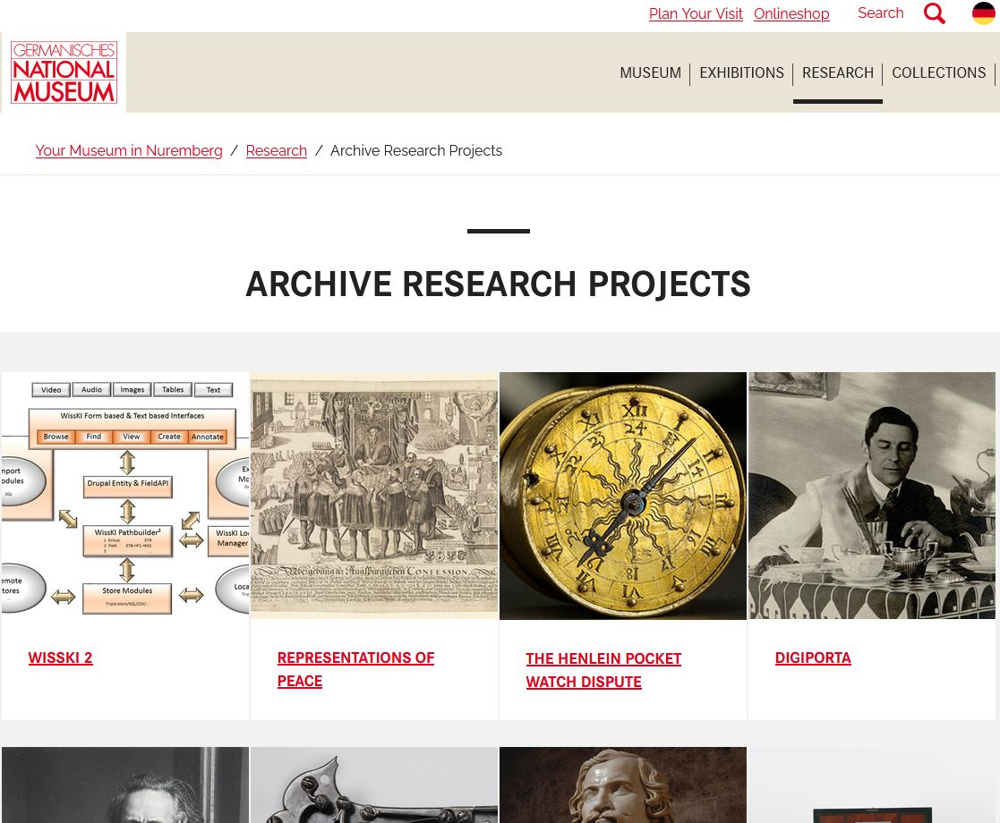
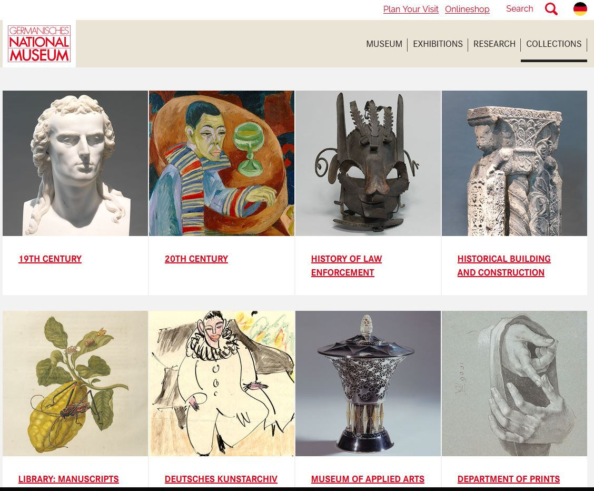
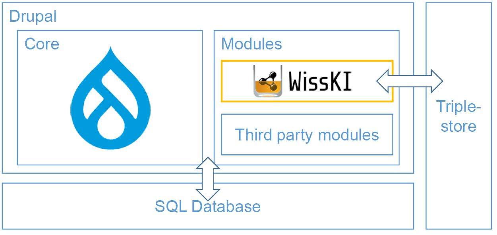
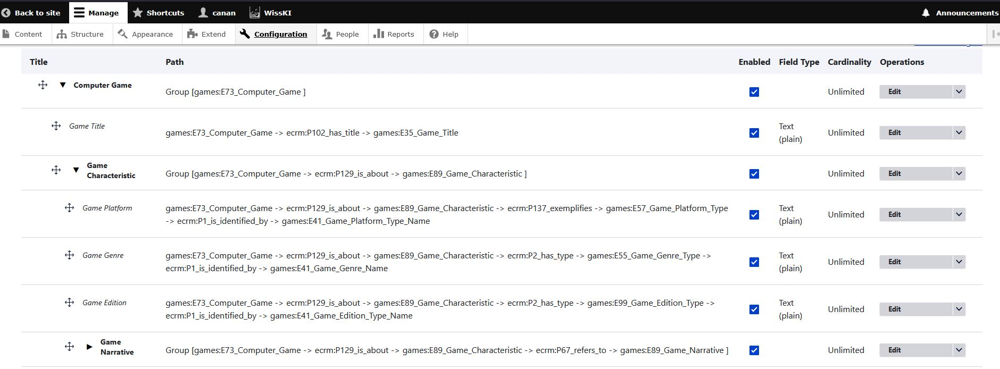
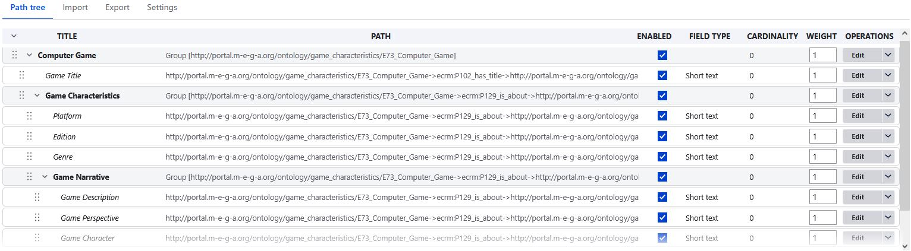

<!--

author: Canan Hastik (0000-0003-1729-4642)

author: Gudrun Schwenk (0009-0002-3156-8339)

email: info@igsd-ev.de

version:  v1.0.0

language: de

icon: https://raw.githubusercontent.com/soda-collections-objects-data-literacy/WissKIBits_How-to-Tutorial/refs/heads/main/assets/SODa-Logo_Wort-Bild_RGB.png

link: https://raw.githubusercontent.com/soda-collections-objects-data-literacy/WissKIBits_How-to-Tutorial/refs/heads/main/soda.css

license: CC BY 4.0 <https://creativecommons.org/licenses/by/4.0/>

comment: Dieses Modul ist Teil des How-to-Tutorials „Ontologiegestützte Modellierung von Forschungsdaten“. Das Tutorial vermittelt am Beispiel einer Computerspielsammlung schrittweise die Entwicklung eines semantischen Datenmodells auf Grundlage des CIDOC CRM und dessen Umsetzung mit WissKI.

title: WissKI Bits: Ontologiebasierte Modellierung von Forschungsdaten

module: Von der Sammlung über Modellierentscheidungen zum Diagramm – verstehen und erklären

unit: FAIR-Konformität mit WissKI

description: Das SODa How-to-Tutorial vermittelt am Beispiel einer Computerspielsammlung Grundlagen und praktische Arbeitsschritte der ontologiegestützten Modellierung von Forschungsdaten. Die Lernenden entwickeln ein semantisches Datenmodell auf Grundlage des CIDOC CRM und setzen dieses schrittweise mit Protégé, Draw.io und WissKI um.

keywords: WissKI, CIDOC CRM, Ontologie, Domänenontologie, semantische Modellierung, Forschungsdaten, Forschungsdatenmanagement, OER

community: Wissenschaftliche Kommunikationsinfrastruktur (WissKI) und Sammlungen, Objekte, Datenkompetenzen (SODa)

PublicationDate: 2026-11-05

LearningResourceType: How-to-Tutorial

-->

# WissKI Bits: Ontologiebasierte Modellierung von Forschungsdaten

**DATENMODELL ENTWICKELN UND IMPLEMENTIEREN AM BEISPIEL** 

Modul (M1): **Von der Sammlung über Modellierentscheidungen zum Diagramm – verstehen und erklären**

Einheit (E4): **FAIR-Konformität mit WissKI**  

**Dauer:** ~ 15 Min.

**Lernziele:**

Teilnehmende können...

- für das sammlungsbezogene Forschungsdatenmanagement (FDM) relevante (inter-)nationale IT-Infrastrukturen erläutern. (LZ-ID SODa\_01\_010\_0203)
- geeignete Technologien zur Unterstützung der Anwendung der FAIR-Prinzipien benennen. (LZ-ID 01\_007\_0121)
- FAIR Prinzipien benennen. (LZ-ID 01\_007\_0117)
- das 5-Sterne-Modell für offene Daten benennen. (LZ-ID SODa\_01\_008\_0158a)
- formale Beschreibungssprache W3C Web Ontology Language (OWL) benennen. (LZ-ID SODa\_03\_007\_0842)
- Erlangen CRM / OWL als OWL-Implementierung des Referenzmodells CIDOC CRM benennen. (LZ-ID SODa\_03\_007\_0841)
- die spezifischen Funktionen und Anwendungsbereiche der Wissenschaftlichen Kommunikationsinfrastruktur WissKI benennen. (LZ-ID SODa\_01\_010\_0191a)
- die spezifischen Funktionen und Anwendungsbereiche der Wissenschaftlichen Kommunikationsinfrastruktur WissKI erläutern. (LZ-ID SODa\_01\_010\_0192a)
- Leistungsfähigkeit und Effizienz von IT-Infrastrukturen für das sammlungsbezogene Forschungsdatenmanagement (FDM) mit der Wissenschaftlichen Kommunikationsinfrastuktur WissKI benennen. (LZ-ID SODa\_01\_010\_0202)
- WissKI Pathbuilder als Werkzeug zur Definition einer Ontologiestruktur bennenen. (LZ-ID SODa\_03\_007\_0803)
- WissKI Pathbuilder als Werkzeug zur Definition einer Ontologiestruktur erläutern. (LZ-ID SODa\_03\_007\_0804)
- ereigniszentriertes Modellierungsprinzip mit CIDOC CRM am Beispiel erläutern. (LZ-ID SODa\_03\_007\_0850)
- Resource Description Framework (RDF) als Standard zur Beschreibung von Ressourcen benennen. (LZ-ID SODa\_03\_007\_0843)
- Nutzen der Wissenschaftlichen Kommunikationsinfrastruktur WissKI benennen (LZ-ID SODa\_01\_010\_0204)

---

## WissKI in Kürze

**WissKI** (Wissenschaftliche Kommunikationsinfrastruktur) ist (WissKI, n.d.-a):

- eine freie, quelloffene virtuelle Forschungsumgebung
- entwickelt für Kulturerbe- und Forschungsdaten
- basierend auf Semantic-Web-Technologien
- modular aufgebaut und standardorientiert.

> **Was ist WissKI?**
>
> WissKI (Wissenschaftliche Kommunikationsinfrastruktur) ist eine freie, quelloffene virtuelle Forschungsumgebung für Kulturerbe- und Forschungsdaten.
>
> WissKI verbindet:
>
> - ontologiebasierte Modellierung
> - Semantic-Web-Technologien
> - Forschungsdatenmanagement.
>
> WissKI ermöglicht es, Forschungs- und Sammlungsdaten nach ihrer Bedeutung und ihren Beziehungen zu strukturieren, anstatt sie lediglich in vordefinierten Tabellen zu speichern.

---

## FAIR-Konformität von WissKI

> **Wie unterstützt WissKI FAIR-Daten?**
>
> Die FAIR-Prinzipien zielen darauf ab, Forschungsdaten **auffindbar (Findable) · zugänglich (Accessible) · interoperabel (Interoperable) · nachnutzbar (Reusable)** zu machen.
>
> WissKI kann diese Ziele unterstützen, indem es strukturiertes Datenmanagement mit ontologiebasierten semantischen Beschreibungen verbindet. Beispielsweise können explizit definierte Klassen und Properties dazu beitragen, die Bedeutung von Forschungsdaten transparenter zu machen und die Interoperabilität zwischen Datensätzen zu fördern.
>
> **Wichtig:** Die Nutzung von WissKI macht Forschungsdaten jedoch nicht automatisch FAIR. Die FAIR-Konformität hängt auch davon ab, wie Daten identifiziert, dokumentiert, zugänglich gemacht, lizenziert und langfristig gepflegt werden.
>
> In diesem Tutorial konzentrieren wir uns insbesondere auf den Beitrag der semantischen Modellierung zur **Interoperabilität** und **Nachnutzbarkeit**.

---

WissKI ist **nicht nur** eine Sammlungsdatenbank.

Als **semantisches Datenmanagementsystem** unterstützt es Linked Open Data (LOD) und damit die FAIR-Prinzipien: **Findable, Accessible, Interoperable und Reusable** (WissKI, n.d.-b).

Die Website [**How to FAIR**](https://howtofair.dk/what-is-fair/) (Harm et al., 2022) erläutert die **FAIR-Prinzipien** und zeigt konkrete Handlungsfelder für ihre Umsetzung in Forschungsprojekten auf (Reichert & Hastik, 2025).

Einen Einstieg in LOD bietet das [**5-Sterne-Modell** für offene Daten](https://5stardata.info/de/), das den Weg von digitalen Dokumenten zu vernetzten, maschinenlesbaren Daten beschreibt (Hausenblas, 2012).

Technologien wie das [Resource Description Framework (RDF)](https://www.w3.org/RDF/) (W3C, 2014) und die vom W3C standardisierte [**Web Ontology Language (OWL)**](https://www.w3.org/OWL/) (W3C, 2001) ermöglichen es, Wissen formal und maschinenlesbar darzustellen sowie Daten semantisch zu verknüpfen.

WissKI verwendet als Teil seiner technischen Grundlage die aktuelle Version des **[Erlangen CRM / OWL](https://erlangen-crm.org/current-version)** (Schiemann, 2024), eine OWL-Implementierung der aktuellen Version des CIDOC Conceptual Reference Model (CIDOC CRM) (CIDOC, 2024a).

WissKI kann aber auch andere Ontologien einbinden, sofern sie in einem maschinenlesbaren Format, z. B. RDF oder OWL, vorliegen.

So entstehen interoperable und nachnutzbare Wissensbestände. Ihre konkrete FAIR-Konformität hängt zusätzlich von der Modellierung, Lizenzierung und Bereitstellung ab.

---

## WissKI am GNM

WissKI wird u. a. am [**Germanischen Nationalmuseum (GNM)**](https://www.gnm.de/) in Nürnberg eingesetzt –

- dem größten kulturhistorischen Museum im deutschsprachigen Raum,
- das Maßstäbe für digitale Forschungsinfrastrukturen setzt.

WissKI wird am Germanischen Nationalmuseum (GNM) in Nürnberg als Teil seiner digitalen Forschungsinfrastruktur eingesetzt. Dies veranschaulicht, wie semantische Technologien das Management von Forschungs- und Sammlungsdaten in einem institutionellen Kontext unterstützen können.

> **Abbildung:** [Überblicksseite der Forschungsprojekte Archiv am GNM](https://www.gnm.de/forschung/forschungsprojekte-archiv) (GNM, n.d.-a)

> **Abbildung:** [Überblicksseite Sammlungen am GNM](https://www.gnm.de/sammlungen/ueberblick-sammlungen) (GNM, n.d.-b)

---

## WissKI und Drupal

WissKI ist **keine eigenständige Software**, sondern ein Set an Modulen (knurg, 2025), die das Content-Management-System [**Drupal**](https://new.drupal.org/) um Funktionen für das ontologiebasierte Forschungsdatenmanagement semantisch erweitern (Drupal, 2024).

> **Abbildung:** WissKI-Integration in Drupal (Fichtner et al., 2023, S. 2)

Drupal stellt das zugrunde liegende Webanwendungs-Framework bereit, während WissKI die Verwendung semantischer Modelle zur Strukturierung und Verwaltung von Forschungsdaten unterstützt.

Entscheidend ist, dass WissKI ein semantisches Modell mit der Art und Weise verbindet, wie Forschungsinformationen im System organisiert und bearbeitet werden.

### Zusammenspiel: Drupal stellt das Anwendungs-Framework bereit, WissKI ergänzt die semantische Datenebene.

**Drupal stellt bereit …**

- Benutzer-, Rollen- und Rechteverwaltung
- Zugriffskontrolle
- modulare Systemarchitektur (Framework)
- Benutzeroberfläche (GUI) und Schnittstellen für den Datenaustausch (REST/JSON)
- mehrsprachige Unterstützung

**WissKI ergänzt …**

- ontologiebasierte Modellierung und semantische Datenstrukturierung
- Pathbuilder, ein Werkzeug zur Definition semantischer Pfade
- RDF-Triple-Store zur Speicherung der semantischen Daten
- SPARQL-Endpunkt für Abfragen und Zugriff
- Publikation als Linked Open Data (LOD)

---

## Der WissKI Pathbuilder

> **Was macht der Pathbuilder?**
>
> Der WissKI Pathbuilder verbindet Elemente einer Ontologie mit der Struktur, über die Informationen in WissKI organisiert und bearbeitet werden.
>
> Er verwendet **Gruppen** und **Pfade** innerhalb der Ontologie, um die für bestimmte Datenstrukturen relevanten Klassen und Properties festzulegen. Dadurch ermöglicht er eine strukturierte Datenerfassung:
>
> **Gruppen** organisieren semantische Entitäten, beispielsweise Objekte, Personen, Orte oder Ereignisse.
>
> **Pfade** definieren semantische Beziehungen zwischen diesen Entitäten.
>
> **Widgets / Felder** stellen nutzerfreundliche Oberflächen bereit, um Daten auf Grundlage dieser Strukturen einzugeben und zu verwalten.
>
> Für den Moment genügt es zu verstehen, dass der Pathbuilder auf einem bestehenden semantischen Modell aufbaut. Er ersetzt nicht den Prozess, dieses Modell zu entwickeln oder zu definieren.

---

Der **Pathbuilder** ist das **Herzstück von WissKI**.

Die im Pathbuilder modellierten semantischen Strukturen werden in WissKI technisch als RDF-Wissensgraph gespeichert. Damit verbindet WissKI die nutzerfreundliche Modellierung mit den Standards des Semantic Web.

Der Pathbuilder definiert:

- **Gruppen** → semantische Entitäten, z. B. Objekt, Person, Ort, Ereignis
- **Pfade** → Beziehungen zwischen diesen Entitäten, z. B. Objekt → wurde geschaffen von → Person
- **Widgets** → automatisch generierte Eingabeformulare, deren Struktur aus der Semantik abgeleitet wird

So ist es möglich, in WissKI **nicht mit Tabellen**, sondern mit **ontologiebasierten Strukturen** zu arbeiten.

Gleichzeitig bleibt WissKI flexibel, ermöglicht semantische Konsistenz und unterstützt die Nutzenden bestmöglich bei der Datenpflege.

> **Abbildung:** Pathbuilder in WissKI mit Pfadgruppen, Pfaden und Feldeinstellungen zur semantischen Modellierung der Domäne Computerspiele bis WissKI (version 8.x-3.16) und Drupal (version 11.3.13).

> **Abbildung:** Pathbuilder in WissKI mit Pfadgruppen, Pfaden und Feldeinstellungen zur semantischen Modellierung der Domäne Computerspiele ab WissKI (version 8.X-4.9) und ab Drupal (version 11.4.11). 

---

## Semantisches Modellieren auf *WissKI-Art*

In WissKI werden **nicht nur Daten** gespeichert und erfasst, sondern **Bedeutung** modelliert.

Das bedeutet, dass Forschungsdaten nicht einfach als isolierte Informationen erfasst werden. Ihre Bedeutung und ihre Beziehungen zueinander werden mithilfe eines semantischen Modells beschrieben.

Die Leitfragen lauten:

- **Wie hängen die Dinge, die wir beschreiben möchten, miteinander zusammen?**
- **Welche realen Beziehungen bestehen zwischen diesen Dingen?**

!?[Video](../assets/semanticModelling.mp4)

> **Video:** Wie Aussagen über Personen, Objekte, Orte und Ereignisse in WissKI ein Netzwerk miteinander verknüpfter Informationen bilden.

Betrachten wir das Beispiel der Person **Albrecht Dürer**. Informationen über ihn können unter anderem Folgendes umfassen:

- seine Geburt in → **Nürnberg** (Ort)
- sein Geburtsdatum → **ein bestimmter Zeitpunkt** (Datum)
- seine Beziehung zu seiner Mutter → **Barbara Dürer** (Person)
- die Schaffung eines → **Selbstbildnisses** (Objekt)
- den in einer historischen **Quelle** dokumentierten **Entstehungszeitpunkt** (Datum und Objekt)
- während → **seiner künstlerischen Schaffensperiode** (Zeitraum)
- und den Entstehungsort → **Nürnberg** (Ort)

Anstatt diese Angaben als voneinander unabhängige Fakten zu behandeln, macht die semantische Modellierung ihre Beziehungen explizit.

Grundlage dafür ist das **ereigniszentrierte Modellierungsprinzip des CIDOC CRM**.

Objekte werden nicht isoliert beschrieben, sondern über **Ereignisse** (z. B. Herstellung, Nutzung, Erwerb) und die daran beteiligten Akteur:innen, Orte und Zeiten in einen nachvollziehbaren Zusammenhang gesetzt.

Technisch basiert dieser Wissensgraph auf dem Resource Description Framework (RDF). Informationen werden dabei als sogenannte Tripel gespeichert:

- **Subjekt** – die beschriebene Ressource
- **Prädikat** – ihre Eigenschaft oder Beziehung
- **Objekt** – ein Wert oder eine weitere Ressource

Eine Aussage wie:

> „Das Selbstbildnis wurde von Albrecht Dürer geschaffen.“

wird so als einzelne, eindeutig referenzierbare Beziehung gespeichert. Viele solcher Aussagen verbinden sich zu einem gerichteten Graphen, der komplexe Zusammenhänge maschinenlesbar abbildet.

Gemeinsam bilden diese Tripel den Wissensgraphen, den WissKI verwaltet.

Der WissKI Pathbuilder überführt dabei auf CIDOC CRM basierende ontologische Modelle in entsprechende RDF-Strukturen.

Pfadgruppen entsprechen dabei Entitäten, Pfade definieren Beziehungen und die daraus generierten Formulare ermöglichen es, bei der Datenerfassung konsistente Aussagen im Wissensgraphen zu erzeugen.

---

## Ereigniszentrierte Modellierung mit CIDOC CRM

Ein zentrales Prinzip des CIDOC CRM ist die ereigniszentrierte Modellierung.

Objekte, Personen und Orte werden nicht nur anhand isolierter Eigenschaften beschrieben. Stattdessen bieten **Ereignisse und Aktivitäten** – beispielsweise Geburt, Herstellung, Nutzung oder Erwerb – einen Kontext, in dem Akteur:innen, Objekte, Orte und Zeiten miteinander in Beziehung gesetzt werden können.

So kann die Entstehung eines Selbstbildnisses von Albrecht Dürer als Herstellungsereignis modelliert werden, an dem der Künstler und das Kunstwerk beteiligt sind und dem ein Zeitraum zugeordnet ist.

Dieser Ansatz hilft uns, nicht nur zu beschreiben, **was** über ein Objekt bekannt ist, sondern auch, **wie** es mit anderen Entitäten zusammenhängt.

---

## Von semantischen Beziehungen zum Wissensgraphen

Die in einem semantischen Modell definierten Beziehungen können mithilfe des Resource Description Framework (RDF) in maschinenlesbarer Form dargestellt werden.

RDF beschreibt Informationen als Aussagen, die aus drei Bestandteilen bestehen und als Tripel bezeichnet werden:

- **Subjekt** – die beschriebene Ressource
- **Prädikat** – ihre Eigenschaft oder Beziehung
- **Objekt** – ein Wert oder eine weitere Ressource

Eine Aussage wie **„Albrecht Dürer schuf ein Selbstbildnis.“** kann beispielsweise als Beziehung zwischen dem Künstler und dem Kunstwerk ausgedrückt werden.

In einem ereigniszentrierten CIDOC-CRM-Modell lässt sich diese Beziehung präziser über ein **Herstellungsereignis** beschreiben, das den Künstler mit dem Kunstwerk verbindet.

Viele miteinander verknüpfte RDF-Aussagen bilden einen **Wissensgraphen**. Dieser macht Beziehungen zwischen Ressourcen explizit und ermöglicht es, Informationen miteinander zu verknüpfen und softwaregestützt zu verarbeiten.

---

### Wie WissKI diese Beziehungen nutzt

WissKI verwendet ein ontologiebasiertes semantisches Modell, um die im System erfassten Informationen zu strukturieren.

Der **WissKI Pathbuilder** definiert Pfade durch die Ontologie, mit denen die Dateneingabe organisiert und Informationen miteinander verknüpft werden können.

Pfadgruppen organisieren zusammengehörige Pfade, während einzelne Pfade Abfolgen von Klassen und Properties festlegen. Auf Grundlage dieser Konfigurationen können in WissKI Strukturen für die Dateneingabe generiert werden.

Wenn Nutzende Informationen über diese Strukturen eingeben, kann WissKI die daraus entstehenden Aussagen entsprechend dem konfigurierten semantischen Modell als RDF-Daten speichern.

In **Modul 3** werden Sie erkunden, wie sich ein Diagramm mit ausgewählten Ontologiepfaden in eine WissKI-Pathbuilder-Konfiguration überführen lässt.

---

## Relevanz von WissKI

WissKI …

- ermöglicht **wissensbasierte Modellierung** statt starrer Tabellenschemata
- stellt **Interoperabilität** durch etablierte Ontologien wie **CIDOC CRM** sicher
- unterstützt die **FAIR-Prinzipien**
- generiert **Eingabeformulare automatisch** auf Basis semantischer Pfade
- publiziert Daten als **Linked Open Data**
- bietet **leistungsfähige SPARQL-Abfragen**
- verbindet **konzeptionelle Klarheit** mit **technischer Umsetzung**.

> **Warum ist WissKI relevant?**
>
> WissKI verbindet konzeptionelle Modellierung mit technischer Umsetzung.
>
> Es unterstützt:
>
> - ontologiebasierte Datenstrukturen anstelle rein tabellenbasierter Datenstrukturen,
> - semantische Konsistenz durch gemeinsame Ontologien,
> - strukturierte Dateneingabe auf Grundlage semantischer Pfade,
> - maschinenlesbare Daten und semantische Abfragen sowie
> - interoperable und nachnutzbare Forschungsdaten.

---

## Die Semantik ist zentral für WissKI

Von der Semantik zu nutzbaren Forschungsdaten:

- **CIDOC CRM** definiert Klassen (Entities) und Eigenschaften (Properties)
- **Semantische Pfade** übersetzen das Modell in eine nutzbare Datenstruktur
- **Formulare** sichern konsistente Dateneingabe und reduzieren Interpretationsspielräume
- **RDF-Wissensgraph** ermöglicht Austausch, Nachnutzung und LOD-Publikation

Dadurch werden Sammlungsdaten nicht nur dokumentiert, sondern semantisch so strukturiert, dass sie langfristig verständlich, interoperabel und maschinenlesbar auswertbar sind.

---

## Informationen zu WissKI und WissKI Community (Stand: August 2026)

- **News, Informationen und WissKI-Dokumentation auf der WissKI-Homepage:** https://wiss-ki.eu/de

- **Einführungen in WissKI-Features:**
  - YouTube-Kanal WissKIProjekt: https://www.youtube.com/@wisskiproject
  - YouTube-Kanal WissKI: https://www.youtube.com/@wisski5763

- **WissKI-Dokumentation:**
  - WissKI-Dokumentation mit Tutorials, How-tos, Guides und einem Glossar: https://project.pages.drupalcode.org/wisski/
  - WissKI-Moduldokumentation: https://www.drupal.org/docs/extending-drupal/contributed-modules/contributed-module-documentation/wisski

- **News und Community:**
  - Mattermost: https://chat.wiss-ki.eu/wisski/channels/town-square
  - Mastodon: @wisski@fedihum.org
  - Facebook: https://www.facebook.com/wisskiproject/
  - Webseite WissKICommunity der Universitätsbibliothek Heidelberg: https://sempub.ub.uni-heidelberg.de/wisski_projekte/de

- **WissKI-Anwender*innentreffen:** https://wiss-ki.eu/taxonomy/term/63  
  **Jährliche Zusammenkunft der WissKI-Community** am Germanischen Nationalmuseum Nürnberg (GNM), um gemeinsam über Projekte und Themen zu diskutieren, sich über aktuelle Entwicklungen zu informieren und gemeinsam **Lösungen für Herausforderungen rund um die Weiterentwicklung und Nutzung von WissKI** zu finden (WissKI, n.d.-a; WissKI, 2026).

---

## Ausblick

**WissKI** bietet eine technische Umgebung, in der semantische Datenmodelle umgesetzt und für die Arbeit mit Sammlungs- und Forschungsdaten nutzbar gemacht werden können.

In der folgenden Einheit wird dieser **Modellierungsprozess anhand eines konkreten Beispiels praktisch nachvollzogen**. Ausgangspunkt ist ein **Beispielobjekt aus der Domäne Computerspiele**, das schrittweise semantisch modelliert wird. Dabei werden die bisher im Modul vorgestellten Schritte zusammengeführt: von der **konzeptuellen Wissensmodellierung** und der Entwicklung einer **Modellskizze** über die **formalisierte Darstellung** der relevanten Konzepte, Eigenschaften und Beziehungen mit **CIDOC CRM** bis hin zum daraus resultierenden **Domänenmodell** auf Grundlage des CIDOC CRM.

Die Praxiseinheit zeigt damit, wie ausgehend von einem konkreten Sammlungsobjekt eine formale semantische Modellierung entwickelt und anschließend in einen strukturierten Modellierungsansatz überführt werden kann.

> **Wie geht es weiter?**
>
> Sie haben nun gesehen, wie WissKI die semantische Modellierung mit dem technischen Forschungsdatenmanagement verbindet.
>
> In der folgenden Praxiseinheit kehren Sie zu Ihrem Beispielobjekt zurück und entwickeln dessen semantisches Domänenmodell Schritt für Schritt mithilfe der in diesem Modul vorgestellten Konzepte.

---

## Bibliografie

(CIDOC, 2024a) CIDOC CRM Special Interest Group. (2024a). Definition of the CIDOC Conceptual Reference Model: Version 7.1.3. https://cidoc-crm.org/Version/version-7.1.3

(Drupal, 2024) Drupal Association (2024) Drupal 11.4.5 Drupal Core. https://www.drupal.org/project/drupal/releases/11.4.5

(Fichtner et al., 2023) Fichtner, M., Nasarek, R., & Wiesing, T. (2023). WissKI: A Virtual Research Environment Based on Drupal. *Proceedings of the Conference on Research Data Infrastructure*, 1. https://doi.org/10.52825/cordi.v1i.353

(GNM, n.d.-a) Germanisches Nationalmuseum (GNM) (n.d.-a). Forschungsprojekte-Archiv. https://www.gnm.de/forschung/forschungsprojekte-archiv

(GNM, n.d.-b) Germanisches Nationalmuseum (GNM) (n.d.-b). Sammlungen. Von der Archäologie bis ins 20. Jahrhundert. https://www.gnm.de/sammlungen/ueberblick-sammlungen

(Harm, et al., 2022) Harm Buss, M. C., Bayle Deutz, D., Flindt Holmstrand, K., Væring Larsen, A., & Vlachos E. (2022). How to FAIR. https://howtofair.dk/what-is-fair/

(Hausenblas, 2012) Hausenblas, M. (2012, Januar 22). *5-star open data* (M. Findeisen, Übers.). https://5stardata.info/de/

(knurg, 2025) knurg (2025). Drupal Modul WissKI. https://www.drupal.org/project/wisski

(W3C, 2001) OWL Working Group. (2012, Dezemberg 11). OWL - Web Ontology Language (OWL). World Wide Web Consortium. https://www.w3.org/OWL/

(W3C, 2014) RDF Working Group. (2014, Februar 25). RDF - Resource Description Framework (RDF). World Wide Web Consortium. https://www.w3.org/RDF/

(Reichert & Hastik, 2025) Reichert, R., & Hastik, C. (2025, August 7). *SODa Basiskurs zu Erschließung und Forschungsdatenmanagement in Universitätssammlungen. Modul 1*. Zenodo. https://doi.org/10.5281/zenodo.16761352

(WissKI, n.d.-a) WissKI. (n.d.-a). WissKI Events. https://wiss-ki.eu/events

(WissKI, n.d.-b) WissKI. (n.d.-b). WissKI Features. https://wiss-ki.eu/features

(WissKI, 2026) WissKI. (2026). WissKI Anwender*innentreffen (WAT). https://wiss-ki.eu/taxonomy/term/63

