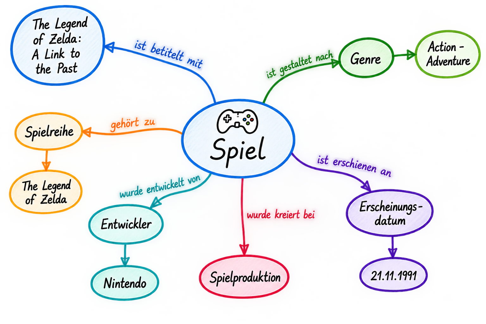
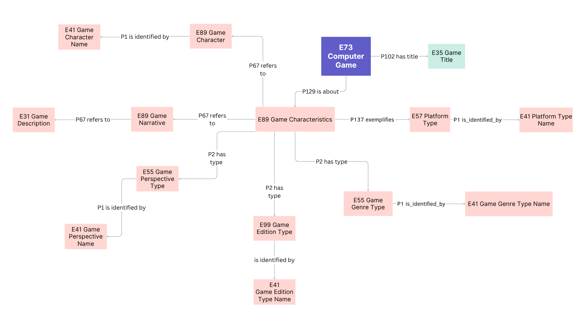

<!--

author: Canan Hastik (0000-0003-1729-4642)

author: Gudrun Schwenk (0009-0002-3156-8339)

email: info@igsd-ev.de

version:  v1.0.0

language: de

icon: https://raw.githubusercontent.com/soda-collections-objects-data-literacy/WissKIBits_How-to-Tutorial/refs/heads/main/assets/SODa-Logo_Wort-Bild_RGB.png

link: https://raw.githubusercontent.com/soda-collections-objects-data-literacy/WissKIBits_How-to-Tutorial/refs/heads/main/soda.css

license: CC BY 4.0 <https://creativecommons.org/licenses/by/4.0/>

comment: Dieses Modul ist Teil des How-to-Tutorials „Ontologiegestützte Modellierung von Forschungsdaten“. Das Tutorial vermittelt am Beispiel einer Computerspielsammlung schrittweise die Entwicklung eines semantischen Datenmodells auf Grundlage des CIDOC CRM und dessen Umsetzung mit WissKI.

title: WissKI Bits: Ontologiebasierte Modellierung von Forschungsdaten

module: Von der Sammlung über Modellierentscheidungen zum Diagramm – verstehen und erklären

unit: CIDOC CRM Formalisierung

description: Das SODa How-to-Tutorial vermittelt am Beispiel einer Computerspielsammlung Grundlagen und praktische Arbeitsschritte der ontologiegestützten Modellierung von Forschungsdaten. Die Lernenden entwickeln ein semantisches Datenmodell auf Grundlage des CIDOC CRM und setzen dieses schrittweise mit Protégé, Draw.io und WissKI um.

keywords: WissKI, CIDOC CRM, Ontologie, Domänenontologie, semantische Modellierung, Forschungsdaten, Forschungsdatenmanagement, OER

community: Wissenschaftliche Kommunikationsinfrastruktur (WissKI) und Sammlungen, Objekte, Datenkompetenzen (SODa)

PublicationDate: 2026-11-05

LearningResourceType: How-to-Tutorial

-->

# WissKI Bits: Ontologiebasierte Modellierung von Forschungsdaten

**DATENMODELL ENTWICKELN UND IMPLEMENTIEREN AM BEISPIEL** 

Modul (M1): **Von der Sammlung über Modellierentscheidungen zum Diagramm – verstehen und erklären**

Übungseinheit (EÜ): **CIDOC CRM Formalisierung**  

**Dauer:** ~ 20 Min.

**Lernziele:**

Teilnehmende können...

- Kernentitäten (Objekt/Person/Ort/Zeit/Ereignis) einer Objektsammlung anwenden. (LZ-ID SODa\_03\_007\_0811)
- Datentyp-Eigenschaften des Referenzmodells CIDOC CRM benennen. (LZ-ID SODa\_03\_007\_0808) 

*Redaktioneller Hinweis: Die Zuordnung dieser kompetenzorientierten Lernziele zu den bestehenden SODa-Lernziel-IDs ist noch abzustimmen. Das ursprüngliche Lernziel zu Datentyp-Eigenschaften wird hier nicht geprüft und sollte einer späteren Einheit zugeordnet werden.*

---

## Ziel und Szenario

In dieser **abschließenden Praxisübung von Modul 1** greifen Sie Ihre konzeptuelle Modellskizze aus der [Aktivierungsübung M1E0A](https://liascript.github.io/course/?https://raw.githubusercontent.com/soda-collections-objects-data-literacy/WissKIBits_How-to-Tutorial/refs/heads/main/WissKIBits_Modul1/de/M1E0A_Mindmap_Objekt.md#1) wieder auf.

Sie untersuchen am Beispiel von **The Legend of Zelda: A Link to the Past**, wie ausgewählte Konzepte und Ereignisse mithilfe des **CIDOC CRM** beschrieben werden könnten. Dabei geht es noch nicht darum, eine vollständige Ontologie zu erstellen oder technische Pfade zu implementieren. Vielmehr soll sichtbar werden, dass die Überführung von Domänenwissen in ein Referenzmodell **Modellierungsentscheidungen** erfordert.

> **Transfer:** Von der konzeptuellen Modellskizze zum CIDOC CRM-basierten formalisierten Modell
>
> **Leitfrage:**
>
> Was meinen wir mit einem Begriff – und welche CIDOC-CRM-Klasse beschreibt diese Bedeutung möglichst passend?
>
> Wählen Sie **zwei Elemente** aus Ihrer Modellskizze aus, prüfen Sie mögliche Klassen anhand der **Scope Notes** und begründen Sie Ihre Entscheidungen.
>
> Ziel ist eine **erste, überprüfbare CIDOC-CRM-orientierte Erweiterung** Ihrer Modellskizze.

---

## Ausgangspunkt: Modellskizze zu „Zelda“

Verwenden Sie Ihre eigene Modellskizze aus M1E0A oder die dort bereitgestellte Musterlösung.

In der Aktivierungsübung haben Sie Konzepte, Ereignisse und Beziehungen zunächst in eigenen Worten festgehalten. 

---

### Mapping auf CIDOC CRM

Nun betrachten Sie diese aus Sicht eines **Referenzmodells**, dem CIDOC CRM.

> **Von der eigenen Bezeichnung zur Bedeutung**
>
> Orientieren Sie sich an folgenden Fragen:
>
> - Bezeichnet „Spiel“ den **Informationsinhalt**, eine **bestimmte Fassung** oder ein **physisches Spieleexemplar**?
> - Handelt es sich bei „Titel“ um eine **Benennung** oder bei einer Inventarnummer um einen **Identifikator**?
> - Beschreibt „Genre“ eine **Klassifikation**?
> - Welche Zuordnungen lassen sich anhand einer **Scope Note** begründen?
> - Wo sind mehrere Modellierungen denkbar?

**Merke:** Eine ähnlich klingende Klassenbezeichnung ist noch kein Beleg dafür, dass die Klasse die gemeinte Bedeutung trifft.

---

## Warum CIDOC CRM?

Das **CIDOC Conceptual Reference Model (CIDOC CRM)** stellt Klassen und Eigenschaften für die semantische Beschreibung von Kulturerbeinformationen bereit. Es hilft, Begriffe aus unterschiedlichen Sammlungen und Forschungszusammenhängen auf nachvollziehbare Weise zu interpretieren.

Die Zuordnung folgt einem einfachen Denkweg:

**Domänenbegriff → gemeinte Bedeutung klären → CIDOC-CRM-Klasse nachschlagen → Scope Note prüfen → Entscheidung begründen**

Ein Beispiel zeigt, warum das wichtig ist:

| Gemeinte Bedeutung | Mögliche CIDOC-CRM-Klasse |
|---|---|
| Eine allgemeine Benennung | **E41 Appellation** |
| Der Titel eines Spiels | **E35 Title** |
| Eine Inventarnummer eines Sammlungsexemplars | **E42 Identifier** |

**E35 Title** und **E42 Identifier** sind speziellere Formen von **E41 Appellation**. Ein Titel ist jedoch nicht mit dem Spiel selbst gleichzusetzen. Welche Entität den Titel trägt und über welche Property sie damit verbunden ist, wird in den folgenden Modulen genauer modelliert.

---

## Schwerpunkt dieser Praxisübung

Arbeiten Sie mit den drei Bereichen weiter, die Sie aus der Aktivierungsübung kennen:

- **Spieletitel:** Benennungen und mögliche Titelvarianten;
- **Spieleigenschaften:** beispielsweise Genre (Action-Adventure) und Plattform (Super Nintendo Entertainment System, SNES);
- **Narrative Elemente:** beispielsweise Handlung, Spielwelt und Spielfiguren wie Zelda.

Sie können auch Personen, Organisationen, Ereignisse oder physische Sammlungsobjekte aus Ihrer Skizze auswählen. Entscheidend ist, dass Sie **zwei Elemente** hinsichtlich ihrer Bedeutung genau untersuchen und nicht möglichst viele Klassen sammeln.

> **Modellierungsentscheidung vorbereiten und Bedeutung festlegen**
>
> Prüfen Sie bei jedem Element:
>
> - Was genau bezeichnet der Begriff im Kontext der Sammlung?
> - Ist ein Objekt, Informationsinhalt, Akteur, Ereignis, eine Benennung oder ein Typ gemeint?
> - Welche Klasse kommt infrage?
> - Passt ihre Scope Note zu dieser Bedeutung?
> - Welche Frage bleibt offen?

---

## Praxisübung – Modellieren mit CIDOC CRM

**Arbeitsformat:** Einzelarbeit oder Kleingruppen (2–5 Personen); anschließend kurzer Vergleich oder Selbstreflexion

**Material:** Eigene Modellskizze aus M1E0A oder Musterlösung, Zugang zur CIDOC-CRM-Dokumentation, Papier/Stift oder digitales Whiteboard

**Zeit:**20 Minuten 

> **Vorbereitung**
>
> 1. Öffnen Sie Ihre konzeptuelle Modellskizze oder die [Musterlösung aus M1E0A](https://liascript.github.io/course/?https://raw.githubusercontent.com/soda-collections-objects-data-literacy/WissKIBits_How-to-Tutorial/refs/heads/main/WissKIBits_Modul1/de/M1E0A_Mindmap_Objekt.md#10).
> 2. Öffnen Sie die [CIDOC-CRM-Dokumentation (Version 7.1.3)](https://cidoc-crm.org/html/cidoc_crm_v7.1.3.html). Optional können Sie die [CIDOC CRM Periodic Table](https://remogrillo.github.io/cidoc-crm_periodic_table) zur Orientierung nutzen.

**Aufgabe:**  Erste CIDOC-CRM-Zuordnungen untersuchen und begründen

Untersuchen Sie **zwei Konzepte oder Ereignisse** aus Ihrer Modellskizze. Ordnen Sie ihnen **vorläufig** geeignete CIDOC-CRM-Klassen zu und begründen Sie Ihre Wahl mithilfe der Scope Notes.

---

### Schritt 1 · Auswählen und Bedeutung klären

Wählen Sie **zwei Elemente** aus Ihrer Modellskizze aus. Beschreiben Sie jeweils in einem Satz, **was genau gemeint ist**.

Beispiel: „Spieletitel“ bezeichnet die Benennung des Spiels, **nicht** das physische Spielemodul.

---

### Schritt 2 · Zuordnen und überprüfen

Suchen Sie für jedes Element eine mögliche CIDOC-CRM-Klasse und lesen Sie ihre **Scope Note**.

Als erste Orientierung können folgende Klassen dienen:

| CIDOC-CRM-Klasse | Möglicher Anwendungsfall |
|---|---|
| **E73 Information Object** | Spiel als identifizierbarer Informationsinhalt |
| **E22 Human-Made Object** | Konkretes physisches Spieleexemplar |
| **E21 Person** | Beteiligte Einzelperson |
| **E74 Group** | Organisation oder Entwicklergruppe |
| **E12 Production** | Herstellung eines materiellen Exemplars |
| **E35 Title** | Spieletitel als Benennung |
| **E42 Identifier** | Inventarnummer oder anderer Identifikator |
| **E55 Type** | Genre als Klassifikation |

**Wichtig:** Diese Beispiele sind **Prüfkandidaten, keine Musterlösung**. 

Die Entwicklung eines digitalen Spiels ist nicht automatisch eine **E12 Production**. Auch eine „Plattform“ kann einen Typ, eine technische Umgebung oder ein konkretes Gerät meinen; **E55 Type** ist daher nicht immer passend.

Nutzen Sie dazu folgende Ressourcen:

- **Offizielle CIDOC-CRM-Dokumentation, Version 7.1.3:** Das Dokument enthält die maßgeblichen Definitionen, Scope Notes, Klassenhierarchien und Eigenschaften. [Link](https://cidoc-crm.org/sites/default/files/cidoc_crm_version_7.1.3.pdf) (CIDOC, 2024a)
- **Webbasierter HTML-Navigator für CIDOC CRM:** Die offizielle Darstellung der **Version 7.1.3** eignet sich zum gezielten Nachschlagen. [Link](https://cidoc-crm.org/html/cidoc_crm_v7.1.3.html) (CIDOC, 2024b)
- **CIDOC CRM Periodic Table:** Eine visuelle Orientierungshilfe, um Klassen, Eigenschaften und ihre Beziehungen zu erkunden. [Link](https://remogrillo.github.io/cidoc-crm_periodic_table) (RemoGrillo & claude, 2026)

---

### Schritt 3 · Begründen und dokumentieren**

Dokumentieren Sie Ihre Modellierungsentscheidungen:

| Domänenkonzept | Gemeinte Bedeutung | Mögliche CIDOC-CRM-Klasse | Begründung anhand der Scope Note | Offene Frage |
|---|---|---|---|---|
| 1. … | … | E… | … | … |
| 2. … | … | E… | … | … |

Ergänzen Sie die Klassenkandidaten in Ihrer Modellskizze. Markieren Sie unsichere Zuordnungen mit einem **Fragezeichen (?)**.

---

### Schritt 4 · Vergleichen und überarbeiten**

Vergleichen Sie Ihre Ergebnisse mit denen anderer Teilnehmender oder mit dem Musterbeispiel und überprüfen Sie sie nochmals anhand der Scope Notes.

> **Abbildung:** Beispiel eines CIDOC CRM Mappings zum Computerspiel **„The Legend of Zelda: A Link to the Past“**. Die Darstellung dient als Ausgangspunkt für die Diskussion von Modellierungsentscheidungen und ist nicht als die einzig richtige Lösung zu verstehen.

Fragen Sie sich:

- Haben wir bei einem ähnlichen Begriff **dieselbe Bedeutung** vorausgesetzt?
- Welche Aussage der **Scope Note** stützt unsere Entscheidung?
- Wäre bei einer anderen Interpretation eine **andere Klasse** geeigneter?
- Welche Beziehungen unserer Modellskizze müssen später noch genauer geprüft werden?

Überarbeiten Sie bei Bedarf Ihre Begründungen. Es ist ausdrücklich erlaubt, eine Zuordnung als **vorläufig** zu kennzeichnen.

**Tipp:** Entscheidend ist nicht die Anzahl der zugeordneten Klassen, sondern die Nachvollziehbarkeit und Begründung Ihrer Modellierungsentscheidungen. Sie sollten Ihre Modellierung und die getroffenen Entscheidungen erklären und begründen können.

---

## Ergebnis

Sie haben Ihre konzeptuelle Modellskizze aus der Aktivierungsübung in ein mit CIDOC CRM **formalisiertes Modell** überführt.

Ihre Skizze und Ihre Dokumentation enthalten nun:

- **zwei ausgewählte Domänenkonzepte oder Ereignisse** mit geklärter Bedeutung,
- **zwei vorläufige CIDOC-CRM-Klassenzuordnungen**,
- **kurze Begründungen** anhand der jeweiligen Scope Notes und
- gegebenenfalls **offene Fragen oder alternative Zuordnungen**.

> **Selbstcheck · Bedeutung statt bloßer Bezeichnung**
>
> Können Sie für beide Elemente erklären, **was** Sie modellieren möchten, **warum** die ausgewählte Klasse passt und **welche Frage** noch offen ist?
>
> Die Skizze ist **noch keine vollständig formalisierte OWL-Ontologie**.

---

## Ausblick

> **Wie geht es weiter?**
>
> Speichern Sie Ihre überarbeitete Modellskizze und die dokumentierten Entscheidungen. Sie bilden den Ausgangspunkt für die weitere Modellierung.
>
> In **Modul 2: Modellieren mit CIDOC CRM – verstehen und anwenden** prüfen und präzisieren Sie Ihre Zuordnungen und formalisieren einen kleinen Ontologieausschnitt in Protégé.
>
> In **Modul 3: Vom Diagramm zu Pfaden – erläutern und anwenden** nutzen Sie die Klassen und Beziehungen zur Vorbereitung eines Diagramms und einer WissKI-Pathbuilder-Konfiguration.

---

## Bibliografie

(CIDOC, 2024a) CIDOC CRM Special Interest Group. (2024). *Definition of the CIDOC Conceptual Reference Model: Version 7.1.3.* https://cidoc-crm.org/Version/version-7.1.3

(CIDOC, 2024b) CIDOC CRM Special Interest Group. (2024). *Classes & Properties Declarations of CIDOC-CRM version: 7.1.3.* https://cidoc-crm.org/html/cidoc_crm_v7.1.3.html

(RemoGrillo & claude, 2026) RemoGrillo & claude. (2026). *cidoc-crm_periodic_table.* https://github.com/RemoGrillo/cidoc-crm_periodic_table
