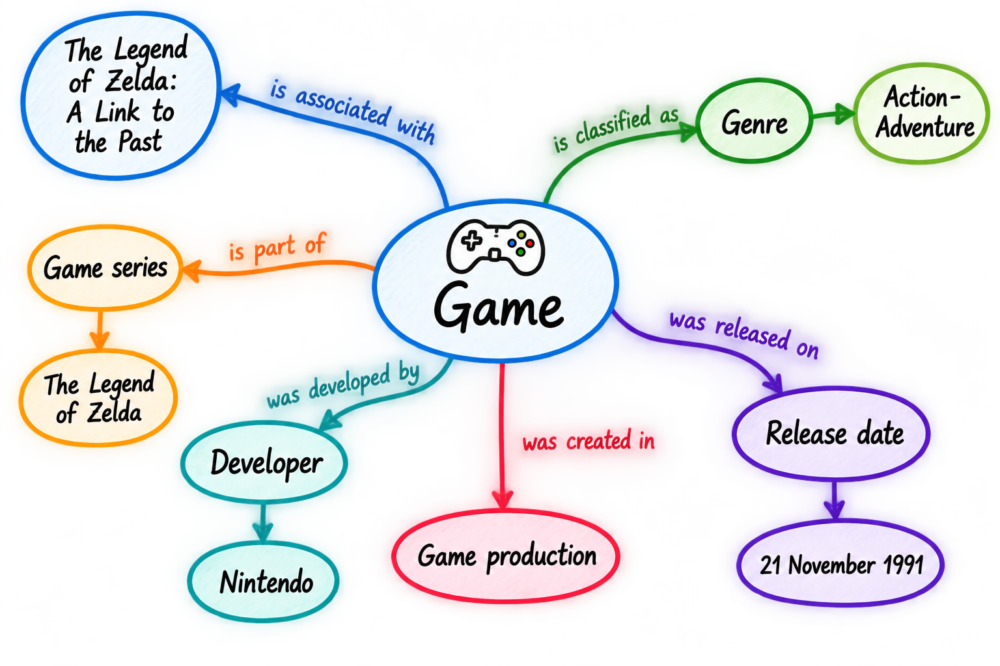

<!--

author: Canan Hastik (0000-0003-1729-4642)

author: Gudrun Schwenk (0009-0002-3156-8339)

email: info@igsd-ev.de

version:  v1.0.0

language: en

icon: https://raw.githubusercontent.com/soda-collections-objects-data-literacy/WissKIBits_How-to-Tutorial/refs/heads/main/assets/SODa-Logo_Wort-Bild_RGB.png

link: https://raw.githubusercontent.com/soda-collections-objects-data-literacy/WissKIBits_How-to-Tutorial/refs/heads/main/soda.css

license: CC BY 4.0 <https://creativecommons.org/licenses/by/4.0/>

comment: This module is part of the how-to tutorial “Ontology-Based Modelling of Research Data”. Using a computer game collection as an example, the tutorial teaches the step-by-step development of a semantic data model based on CIDOC CRM and its implementation with WissKI.

title: WissKI Bits Ontology-Based Modelling of Research Data

module: From collection to modelling decisions to diagram – understand and explain

unit: Collection Object "Zelda"

description: The SODa how-to tutorial uses a computer game collection as an example to teach the fundamentals and practical steps of ontology-based modelling of research data. Learners develop a semantic data model based on CIDOC CRM and implement it step by step using Protégé, Draw.io, and WissKI.

keywords: WissKI, CIDOC CRM, ontology, domain ontology, semantic modelling, research data, research data management, OER

community: Scientific Communication Infrastructure (WissKI) and Collections, Objects, Data Literacy (SODa)

PublicationDate: 2026-11-05

LearningResourceType: How-to-Tutorial

-->

# WissKI Bits: Ontology-Based Modelling of Research Data

**DEVELOPING AND IMPLEMENTING A DATA MODEL USING AN EXAMPLE** 

Module 1 (M1): **From Collection to Modelling Decisions to Diagram – Understand and Explain**

Activation Unit (U0A): **Collection Object "Zelda"**  

**Duration:** ~ 15 min.

**Learning Objectives:**

Participants will be able to...

- apply the core entities (object/person/place/time/event) of an object collection. (LO-ID SODa\_03\_007\_0811)
- apply the method of conceptual knowledge modelling to describe a research object. (LO-ID SODa\_03\_007\_0856)

---

## Goal and Scenario

In this activation exercise, you begin with a **concrete collection object** before working with formal ontology concepts or CIDOC CRM.

Your task is to explore what knowledge is relevant for describing the object and how this knowledge is connected.

> **Activation: From object to conceptual model**
>
> Your guiding question is:
>
> **What do you need to know about this object – and how is this knowledge connected?**
>
> Using **The Legend of Zelda: A Link to the Past** as an example, you identify relevant **concepts, events, and relationships**.
>
> The goal is not yet to use CIDOC CRM, but to create a **first conceptual model sketch of the domain**.

--- 

## Starting Point: Example Object “Zelda”

Your starting point is the computer game [**The Legend of Zelda: A Link to the Past**](https://en.wikipedia.org/wiki/The_Legend_of_Zelda:_A_Link_to_the_Past).

Use the available information about the object and its context to decide **what should become part of your conceptual model**.

> **Starting from the object**
>
> First, familiarise yourself with the object and its domain-specific context.
>
> Start with the domain itself:
>
> - **Object:** What kind of object is it?
> - **Characteristics and Properties:** What distinctive characteristics and properties does the object have?
> - **Relationships:** Which people, organizations, or other objects are associated with it?
> - **Events:** Which events are significant for the object?
> - **Place and Time:** Which locations and dates are relevant to describing the object?
> - **Connections:** How are these elements related to one another?

The aim is to develop a basic understanding of the object and its domain-specific context and, on this basis, to create an **initial sketch of a conceptual model for the domain of computer games**.

The model should:

- identify and distinguish key concepts and events,
- visualize the relationships between these elements, and
- serve as a basis for subsequent modeling with CIDOC CRM.

---

## The Domain Computer Games

Computer games are a useful example for conceptual modelling because they can be described from several perspectives. 

Depending on the research question, a collection may focus on a **physical game copy**, the game as **digital content**, its **production** and **publication history**, or its **narrative** and technical **characteristics**.

The following information may be relevant, for example:

- **Objects:** physical storage media, packaging, and digital games
- **Actors:** developers, publishers, and other individuals or organizations involved
- **Events:** development, release, porting, or re-release
- **Versions and Editions:** different releases, platforms, and versions of a game
- **Names and Identifiers:** title variants and product codes
- **Places and Times:** development locations, countries of release, and dates
- **Content and Properties:** genre, storyline, game world, and technical characteristics

Which of these aspects are included in a conceptual model depends on **which questions the collection data are intended to answer**.

Computer games thus provide an illustrative starting point for recognising different perspectives on a collection object, selecting relevant information, and deriving initial **modeling decisions**.

---

## Focus of this Activation Exercise

For the conceptual model sketch, you consider selected information about the example object. You focus on three areas:

- **Game title** (Names and possible title variants of the game)
- **Game characteristics** (e.g. genre, such as action-adventure or RPG, and platform, such as Nintendo 64, PlayStation, PC)
- **Narrative elements** (e.g. description, perspective, such as first-person, third-person, and characters such as Zelda)

These areas serve as the starting point for recognising different types of **concepts and events** and formulating their **relationships**.

> **Think about the object**
>
> The aim is to structure the information and make the relationships between its elements visible.
>
> Use the following questions as a guide:
>
> - What **title** does the game have?
> - Which **genre** or **platform** is it assigned to?
> - Which **persons or organisations** were involved?
> - Which **events** are relevant to the game?
> - At which **places** and at what **times** did these events take place?

---

## Activation Puzzle – Create a Sketch Model of "Zelda"

**Working format:** Individual work or small groups (2–5 people); breakout rooms may be used in facilitated online sessions

**Material:** Draw.io (diagrams.net) and puzzle template

**Time:** 10 min.

> **Preparation**
>
> 1. Open [Draw.io](https://app.diagrams.net/) in your browser.
> 2. Right-click the link to the [**Puzzle Template**](../assets/puzzle.drawio_en.xml) and select **"Save link as…"** to download the provided puzzle file.
> 3. Then open the downloaded puzzle file in Draw.io.
> 4. Familiarize yourself with the provided elements (concepts, events, and relationships).
>
> **Task:**
>
> Use the puzzle template to create an initial conceptual model sketch of the example object **The Legend of Zelda: A Link to the Past**.

---

### Step 1 · Identify

> Identify relevant concepts and events related to the example object domain.
> 
> These may include person or organisation, place, time, or event and more. 

---

### Step 2 · Connect

Connect the relevant elements using meaningful relationships.
 
Use each connection to formulate a meaningful statement about the example object, such as...

**Examples**
 
- Game → has → Title
- Nintendo → participated in → Development
- Development → created → Game

---

### Step 3 · Check

Read connections as statements and ask: 

- **Does each connection express what you actually want to describe?**
- **Is the relationship clear and meaningful?**
- **Which statements are supported by the available information about the object?**
- **Which connections are assumptions or possible interpretations?**

Mark uncertain connections with a question mark (?).

At this stage, you do not need to resolve every uncertainty. You will return to these questions when you explore semantic modelling and **CIDOC CRM**.

**Tip:** Less is more. Focus on a few elements and relationships that are particularly relevant to understanding the object.

---

## Result

You now have a first conceptual model sketch containing:

- relevant concepts,
- events, and
- meaningful relationships.

> **Figure:** The figure shows a sample example of the step-by-step conceptual analysis of a collection or research object using the game “The Legend of Zelda: A Link to the Past” as an example. Original illustration created with ChatGPT (OpenAI), 2026.

---

## Outlook

> **Next:**
>
> Keep your conceptual model sketch. In [**Basic concepts of conceptual knowledge modelling**](https://liascript.github.io/course/?https://raw.githubusercontent.com/soda-collections-objects-data-literacy/WissKIBits_How-to-Tutorial/refs/heads/main/WissKIBits_Modul1/en/M1U1_Basics-Conceptual-Modelling_en.md#1), you will use the terminology of conceptual knowledge modelling to examine what you have just modelled: **concepts, events, and relationships**.
>
> You will return to this sketch later when you explore **CIDOC CRM**.

