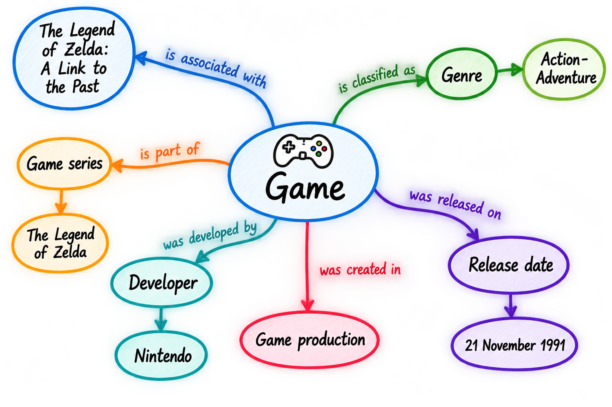
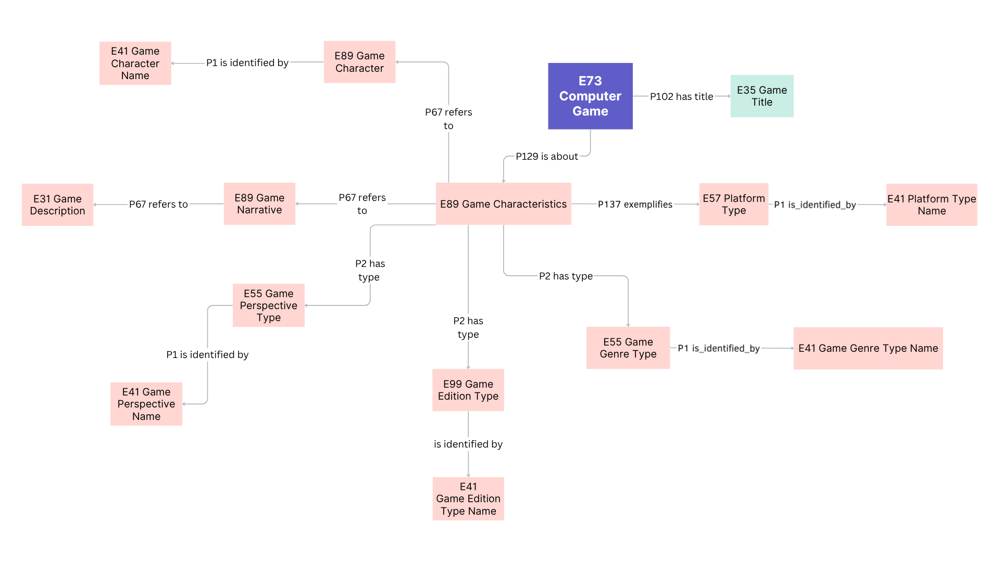

<!--

author: Canan Hastik (0000-0003-1729-4642)

author: Gudrun Schwenk (0009-0002-3156-8339)

email: info@igsd-ev.de

version:  v1.0.0

language: en

icon: https://raw.githubusercontent.com/soda-collections-objects-data-literacy/WissKIBits_How-to-Tutorial/refs/heads/main/assets/SODa-Logo_Wort-Bild_RGB.png

link: https://raw.githubusercontent.com/soda-collections-objects-data-literacy/WissKIBits_How-to-Tutorial/refs/heads/main/soda.css

license: CC BY 4.0 <https://creativecommons.org/licenses/by/4.0/>

comment: This module is part of the how-to tutorial “Ontology-Based Modelling of Research Data”. Using a computer game collection as an example, the tutorial teaches the step-by-step development of a semantic data model based on CIDOC CRM and its implementation with WissKI.

title: WissKI Bits Ontology-Based Modelling of Research Data

module: From collection to modelling decisions to diagram – understand and explain

unit: CIDOC CRM Formalisation

description: The SODa how-to tutorial uses a computer game collection as an example to teach the fundamentals and practical steps of ontology-based modelling of research data. Learners develop a semantic data model based on CIDOC CRM and implement it step by step using Protégé, Draw.io, and WissKI.

keywords: WissKI, CIDOC CRM, ontology, domain ontology, semantic modelling, research data, research data management, OER

community: Scientific Communication Infrastructure (WissKI) and Collections, Objects, Data Literacy (SODa)

PublicationDate: 2026-11-05

LearningResourceType: How-to-Tutorial

-->

# WissKI Bits: Ontology-Based Modelling of Research Data

**DEVELOPING AND IMPLEMENTING A DATA MODEL USING AN EXAMPLE** 

Module 1 (M1): **From Collection to Modelling Decisions to Diagram – Understand and Explain**

Unit Exercise (UE): **CIDOC CRM Formalisation**  

**Duration:** ~ 20 min.

**Learning Objectives:**

Participants will be able to...

- apply the core entities (object/person/place/time/event) of an object collection. (LO-ID SODa\_03\_007\_0811)
- name datatype properties of the CIDOC CRM reference model. (LO-ID SODa\_03\_007\_0808) 

---

## Aim and Scenario

In this **final practical exercise of Module 1**, you will revisit your conceptual model sketch from the [Activation Unit M1U0A](https://liascript.github.io/course/?https://raw.githubusercontent.com/soda-collections-objects-data-literacy/WissKIBits_How-to-Tutorial/refs/heads/main/WissKIBits_Modul1/en/M1U0A_Mindmap_Object_en.md#1).

Using **The Legend of Zelda: A Link to the Past** as an example, you will explore how selected concepts and events can be described using **CIDOC CRM**. At this stage, the aim is not to create a complete ontology or implement technical paths. Instead, the exercise is intended to demonstrate that translating domain knowledge into a reference model requires **modelling decisions**.

> **Transfer:** From the conceptual model sketch to a formalised model based on CIDOC CRM
>
> **Guiding Question:**
>
> What do we mean by a particular term – and which CIDOC CRM class best represents that meaning?
>
> Select **two elements** from your model sketch, examine possible classes using their **scope notes**, and justify your decisions.
>
> The aim is to develop an **initial, verifiable formalisation based on CIDOC CRM** of your model sketch.

---

## Starting Point: Model Sketch of "Zelda"

Use your own model sketch from M1E0A or the sample solution provided there.

In the introductory exercise, you initially identified concepts, events and relationships in your own words.
---

## CIDOC CRM as a Reference Model

CIDOC CRM provides general classes and properties for describing cultural heritage information as a guide.

For modelling, this means:

Domain concept → Clarify meaning → Check CIDOC CRM → Make modelling decision

The name of a class alone is not sufficient for selection. The decisive factor is whether its scope note aligns with the intended meaning of the domain concept.

---

### Mapping to CIDOC CRM

Now examine these elements from the perspective of a **reference model**, CIDOC CRM.

> **From Your Own Terms to Their Meaning**
>
> Use the following questions as a guide:
>
> - Does "game" refer to the **information content**, a **specific version**, or a **physical copy of the game**?
> - Is "title" a **name**, while an inventory number is an **identifier**?
> - Does "genre" represent a **classification**?
> - Which class assignments can be justified based on a **scope note**?
> - Where are multiple modelling approaches possible?

**Remember:** A class name that sounds similar to your term does not necessarily mean that the class accurately represents the intended meaning.

---

## Why CIDOC CRM?

The **CIDOC Conceptual Reference Model (CIDOC CRM)** provides classes and properties for the semantic description of cultural heritage information. It helps to interpret terms from different collections and research contexts in a transparent and understandable way.

The mapping process follows a simple sequence of steps:

**Domain term → clarify the intended meaning → look up the CIDOC CRM class → examine the scope note → justify the decision**

The following example illustrates why this is important:

| Intended Meaning | Possible CIDOC CRM Class |
|---|---|
| A general designation | **E41 Appellation** |
| The title of a game | **E35 Title** |
| An inventory number of a collection item | **E42 Identifier** |

**E35 Title** and **E42 Identifier** are more specific forms of **E41 Appellation**. However, a title is not the same as the game itself. Which entity bears the title and which property connects them will be modelled in greater detail in the following modules.

---

## Focus of This Practical Exercise

Continue working with the three areas you are already familiar with from the introductory exercise:

- **Game Title:** names and possible title variants;
- **Game Properties:** for example, genre (action-adventure) and platform (Super Nintendo Entertainment System, SNES);
- **Narrative Elements:** for example, storyline, game world and characters such as Zelda.

You may also select people, organisations, events or physical collection objects from your sketch. The important thing is to examine the meaning of **two elements** in detail rather than trying to identify as many classes as possible.

> **Preparing a Modelling Decision and Defining the Intended Meaning**
>
> For each element, consider:
>
> - What exactly does the term refer to in the context of the collection?
> - Does it refer to an object, information content, an actor, an event, a name or a type?
> - Which class might be appropriate?
> - Does its scope note match the intended meaning?
> - What questions remain unanswered?

---

## Practical Exercise – Modelling with CIDOC CRM

**Working format:** Individual work or small groups (2–5 people), followed by a brief comparison or self-reflection

**Materials:** Your own model sketch from M1E0A or the model solution, access to the CIDOC CRM documentation, pen and paper or a digital whiteboard

**Time:** ~ 20 min.

> **Preparation**
>
> 1. Open your conceptual model sketch or the [model solution from M1U0A](https://liascript.github.io/course/?https://raw.githubusercontent.com/soda-collections-objects-data-literacy/WissKIBits_How-to-Tutorial/refs/heads/main/WissKIBits_Modul1/en/M1U0A_Mindmap_Object_en.md#1)
> 2. Open the [CIDOC CRM documentation (version 7.1.3)](https://cidoc-crm.org/html/cidoc_crm_v7.1.3.html). You may also use the [CIDOC CRM Periodic Table](https://remogrillo.github.io/cidoc-crm_periodic_table) for guidance.

**Task:**  Explore and justify initial CIDOC CRM mappings

Examine **two concepts or events** from your model sketch. Assign suitable CIDOC CRM classes to them **provisionally** and justify your choices using the Scope Notes.

---

### Step 1 · Select and clarify the meaning

Select **two elements** from your model sketch. For each element, describe in one sentence **exactly what is meant**.

Example: "Game title" refers to the name of the game, **not** the physical game cartridge.

---

### Step 2 · Map and verify

Find a possible CIDOC CRM class for each element and read its **Scope Note**.

The following classes may serve as an initial guide:

| CIDOC CRM class | Possible use case |
---|---|
| **E73 Information Object** | Game as identifiable information content |
| **E22 Human-Made Object** | A specific physical copy of a game |
| **E21 Person** | Individual person involved |
| **E74 Group** | Organisation or development team |
| **E12 Production** | Production of a physical copy |
| **E35 Title** | Game title as a name |
| **E42 Identifier** | Inventory number or other identifier |
| **E55 Type** | Genre as a classification |

**Important:** These examples are **candidates for consideration, not a model solution**.&#x20;

The development of a digital game is not automatically an instance of **E12 Production**. Similarly, a "platform" may refer to a type, a technical environment or a specific device; **E55 Type** is therefore not always appropriate.

Use the following resources:

- **Official CIDOC CRM documentation, version 7.1.3:** This document contains the authoritative definitions, Scope Notes, class hierarchies and properties. [**Link**]([https://cidoc-crm.org/sites/default/files/cidoc_crm_version_7.1.3.pdf](https://cidoc-crm.org/sites/default/files/cidoc_crm_version_7.1.3.pdf)) (CIDOC, 2024a)
- **Web-based HTML navigator for CIDOC CRM:** The official presentation of **version 7.1.3** is suitable for looking up specific information. [**Link**]([https://cidoc-crm.org/html/cidoc_crm_v7.1.3.html](https://cidoc-crm.org/html/cidoc_crm_v7.1.3.html)) (CIDOC, 2024b)
- **CIDOC CRM Periodic Table:** A visual reference tool for exploring classes, properties and their relationships. [**Link**]([https://remogrillo.github.io/cidoc-crm_periodic_table](https://remogrillo.github.io/cidoc-crm_periodic_table)) (RemoGrillo & claude, 2026)

---

### Step 3 · Justify and document

Document your modelling decisions:

| Domain concept | Intended meaning | Possible CIDOC CRM class | Justification based on the Scope Note | Open question |
|---|---|---|---|---|
| 1. … | … | E… | … | … |
| 2. … | … | E… | … | … |

Add the candidate classes to your model sketch. Mark uncertain mappings with a **question mark (?)**.

---

### Step 4 · Compare and revise

Compare your results with those of other participants or with the model example, and check them again against the Scope Notes.

> **Figure:** Example of a CIDOC CRM mapping for the video game **"The Legend of Zelda: A Link to the Past"**. The diagram is intended as a starting point for discussing modelling decisions and should not be regarded as the only correct solution.

Ask yourselves:

- Have we assumed **the same meaning** for similar terms?
- Which statement in the **Scope Note** supports our decision?
- Would **a different class** be more appropriate if the element were interpreted differently?
- Which relationships in our model sketch will need to be examined more closely at a later stage?

Revise your justifications if necessary. You are explicitly encouraged to mark a mapping as **provisional** where appropriate.

**Tip:** What matters is not the number of classes assigned, but how clearly your modelling decisions can be understood and justified. You should be able to explain and justify your model and the decisions you have made.

---

## Result

You have translated your conceptual model sketch from the introductory exercise into a **model formalised using CIDOC CRM**.

Your sketch and documentation now include:

- **two selected domain concepts or events** with clearly defined meanings,
- **two provisional CIDOC CRM class assignments**,
- **brief justifications** based on the respective scope notes, and
- where applicable, **open questions or alternative class assignments**.

> **Self-Check · Meaning Rather Than Just Labels**
>
> Can you explain for both elements **what** you want to model, **why** the selected class is appropriate and **which question** remains unanswered?
>
> The sketch is **not yet a fully formalised OWL ontology**.

---

## Outlook

> **What's Next?**
>
> Save your revised model sketch and the documented decisions. They will serve as the starting point for further modelling.
>
> In **Module 2: Modelling with CIDOC CRM – Understanding and Applying**, you will review and refine your class assignments and formalise a small section of an ontology in Protégé.
>
> In **Module 3: From Diagrams to Paths – Explaining and Applying**, you will use the classes and relationships to prepare a diagram and a WissKI Pathbuilder configuration.

---

## Bibliography

(CIDOC, 2024a) CIDOC CRM Special Interest Group. (2024a). Definition of the CIDOC Conceptual Reference Model: Version 7.1.3. https://cidoc-crm.org/Version/version-7.1.3

(CIDOC, 2024b) CIDOC CRM Special Interest Group. (2024b). Classes & Properties Declarations of CIDOC-CRM version: 7.1.3. https://cidoc-crm.org/html/cidoc_crm_v7.1.3.html

(RemoGrillo & claude, 2026). RemoGrillo & claude (2026). cidoc-crm_periodic_table. https://github.com/RemoGrillo/cidoc-crm_periodic_table

