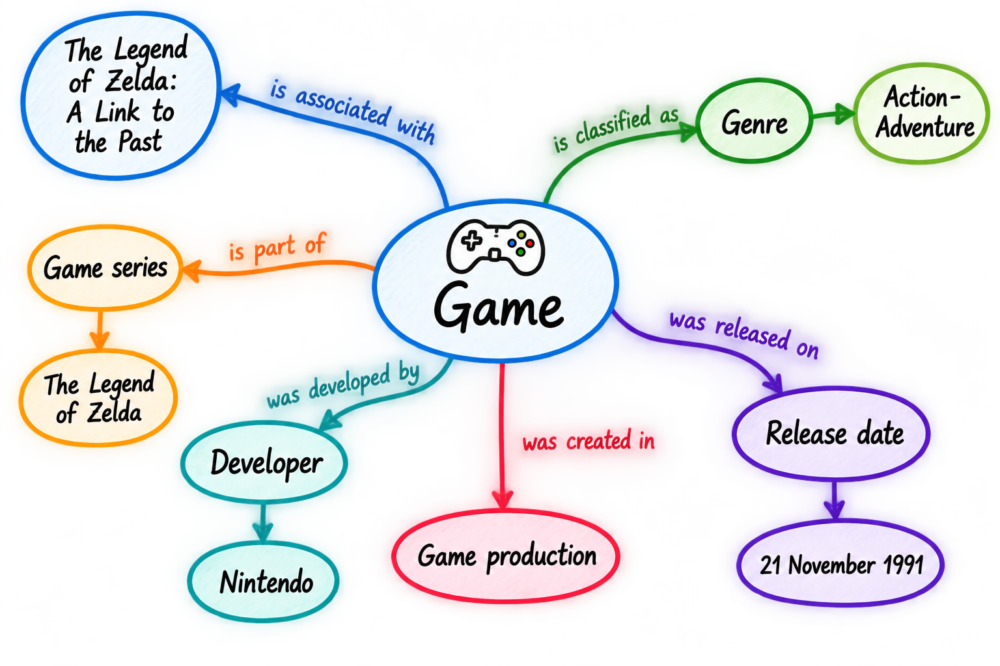

<!--

author: Canan Hastik (0000-0003-1729-4642)

author: Gudrun Schwenk (0009-0002-3156-8339)

email: info@igsd-ev.de

version:  v1.0.0

language: de

icon: https://raw.githubusercontent.com/soda-collections-objects-data-literacy/WissKIBits_How-to-Tutorial/refs/heads/main/assets/SODa-Logo_Wort-Bild_RGB.png

link: https://raw.githubusercontent.com/soda-collections-objects-data-literacy/WissKIBits_How-to-Tutorial/refs/heads/main/soda.css

license: CC BY 4.0 <https://creativecommons.org/licenses/by/4.0/>

comment: Dieses Modul ist Teil des How-to-Tutorials „Ontologiegestützte Modellierung von Forschungsdaten“. Das Tutorial vermittelt am Beispiel einer Computerspielsammlung schrittweise die Entwicklung eines semantischen Datenmodells auf Grundlage des CIDOC CRM und dessen Umsetzung mit WissKI.

title: WissKI Bits Ontologiegestützte Modellierung von Forschungsdaten

module: Modellieren mit CIDOC CRM – verstehen und anwenden

unit: Semantische Modellierung mit CIDOC CRM

description: Das SODa How-to-Tutorial vermittelt am Beispiel einer Computerspielsammlung Grundlagen und praktische Arbeitsschritte der ontologiegestützten Modellierung von Forschungsdaten. Die Lernenden entwickeln ein semantisches Datenmodell auf Grundlage des CIDOC CRM und setzen dieses schrittweise mit Protégé, Draw.io und WissKI um.

keywords: WissKI, CIDOC CRM, Ontologie, Domänenontologie, semantische Modellierung, Forschungsdaten, Forschungsdatenmanagement, OER

community: Wissenschaftliche Kommunikationsinfrastruktur (WissKI) und Sammlungen, Objekte, Datenkompetenzen (SODa)

PublicationDate: 2026-11-05

LearningResourceType: How-to-Tutorial

-->

# SODa WissKI Bits: Ontologiegestützte Modellierung von Forschungsdaten

**DATENMODELL ENTWICKELN UND IMPLEMENTIEREN AM BEISPIEL** 

Modul 2: **Modllieren mit CIDCO CRM – verstehen und anwenden**

Übungseinheit (EÜ): **Semantische Modellierung mit CIDOC CRM**  

**Dauer:** ~ 55 Min.

**Lernziele:**

Teilnehmende können...

- Ontologie zur Beschreibung von Ressourcen anwenden. (LZ-ID 03\_007\_0780)
- Methoden zur Entwicklung von Ontologien anwenden. (LZ-ID SODa\_03\_007\_0854)
- einen Workflow für die semantische Modellierung als Datendokumentation anwenden (LZ-ID SODa\_03\_001\_0627)
- unter Anleitung Methoden zur Modellierung einer Domänenontologie mit dem Referenzmodell CIDOC CRM anwenden. (LZ-ID SODa\_03\_007\_0786a) 
- Software zur Erstellung von Ontologien anwenden. (LZ-ID SODa_03_007_0840)
- Erlangen CRM / OWL als OWL-Implementierung des Referenzmodells CIDOC CRM anwenden. (LZ-ID SODa_03_007_0855)
- Scope Notes des Referenzmodells CIDOC CRM zur Beschreibung von Ressourcen anwenden. (LZ-ID SODa\_03\_007\_0780a)
  
---

## Zielsetzung und Szenario

In dieser Übung arbeiten Sie mit der **konzeptuellen Modellskizze** weiter, die Sie in Modul 1 entwickelt haben. Sie gehen schrittweise von dieser Skizze aus und überführen ausgewählte Elemente in eine **formale Ontologiestruktur**.

Am Beispiel von **„The Legend of Zelda: A Link to the Past“** überprüfen Sie ausgewählte Zuordnungen zu CIDOC CRM und setzen einen kleinen Ausschnitt des Domänenmodells in Protégé um.

Dazu untersuchen Sie relevante Klassen und Eigenschaften, ziehen deren Scope Notes heran und entscheiden, ob die bestehenden Ontologieelemente ausreichen oder domänenspezifische Erweiterungen erforderlich sind.

Ihr Ziel ist es, einen kleinen Modellausschnitt in OWL formal abzubilden und zu dokumentieren – nicht, eine vollständige Ontologie für die Domäne der Computerspiele zu entwickeln.

---

## Ausgangspunkt

Greifen Sie auf die konzeptuelle Modellskizze und die ersten Zuordnungen zu CIDOC CRM zurück, die Sie in Modul 1 erarbeitet haben.

> **Abbildung:** Die Grafik zeigt die konzeptuelle Modellskizze eines Ausschnitts der Beispieldomäne.

In dieser Übung untersuchen Sie, wie sich ausgewählte Elemente der Skizze in einer OWL-Ontologie abbilden lassen.

Halten Sie Ihre bisherigen Modellierungsentscheidungen bereit, damit Sie diese mit der formalen Struktur vergleichen können, die Sie in Protégé entwickeln.

---

## Lösungsvorschlag

Das folgende Beispiel veranschaulicht **eine mögliche Zuordnung** ausgewählter Konzepte und Beziehungen aus der Domäne der Computerspiele zu CIDOC CRM.

Vergleichen Sie diesen Vorschlag mit Ihren eigenen Modellierungsentscheidungen. Achten Sie dabei insbesondere auf die ausgewählten Klassen, die Beziehungen zwischen ihnen und mögliche Unterschiede bei der Interpretation der Domänenkonzepte.

> **Abbildung:** Die Grafik zeigt die Zuordnung zu den übergeordneten Klassen von CIDOC CRM sowie die Aussagen zur Beschreibung der Domäne.

Das Beispiel dient als Grundlage für den Vergleich und die Diskussion und stellt nicht die einzig gültige Modellierungslösung dar.

---

## Vom konzeptuellen Modell zur formalen Ontologie

Betrachten Sie die folgenden Aussagen aus dem konzeptuellen Modell:

> Computerspiel → **hat Titel** → Spieletitel
>
> Computerspiel → **hat Typ** → Genre
>
> Computerspiel → **hat Typ** → Plattformtyp

Um diese Aussagen formal abzubilden, müssen Sie zwischen drei Ebenen unterscheiden:

| Ebene | Beispiel |
|---|---|
| Domänenaussage | Computerspiel hat Titel |
| CIDOC-CRM-Zuordnung / Semantisches Modell | E73 Information Object – P102 has title – E35 Title |
| Formale OWL-Ontologiestruktur | Domänenspezifische Erweiterungen, die in OWL abgebildet werden |

Entscheidend ist, dass diese Ebenen unterschiedliche Zwecke erfüllen.

Die **Domänenaussage** beschreibt, was Sie über den Forschungsgegenstand aussagen möchten.

Die **CIDOC-CRM-Zuordnung** identifiziert bestehende Ontologieelemente, mit denen sich die beabsichtigte Bedeutung möglicherweise abbilden lässt.

Die **formale OWL-Ontologiestruktur** stellt die ausgewählte Modellierungsentscheidung in maschinenlesbarer Form dar.

Diese Ebenen hängen zusammen, sind aber nicht miteinander gleichzusetzen.

---

## Übung – Das Modell in Protégé umsetzen

**Format:** Einzelarbeit

**Materialien:** Computer mit Protégé Desktop oder WebProtégé, bereitgestellte Erlangen-CRM-OWL-Datei, Modellskizze aus Modul 1

**Zeit:** ca. 45 Min.

**Aufgabe: Einen Ausschnitt des Domänenmodells in Protégé formalisieren**

**Voraussetzung:**

Für die Arbeit mit Protégé (Stanford, 2026b) muss entweder

- die Desktop-Anwendung ([**Protégé Desktop**](https://protege.stanford.edu/software/#desktop-protege)) installiert oder
- ein Benutzerkonto für den webbasierten Editor ([**WebProtégé**](https://protege.stanford.edu/software/#web-protege)) eingerichtet sein.

Beide Varianten sind über die [**offizielle Protégé-Webseite**](https://protege.stanford.edu/) zugänglich. (Stanford, 2026a)

---

**Schritt 1: Erlangen CRM laden**

Öffnen Sie Ihre Protégé-Arbeitsumgebung und laden Sie die bereitgestellte OWL-Implementierung von CIDOC CRM:

[**Erlangen CRM / OWL**](https://erlangen-crm.org/ontology/ecrm/ecrm_240307.owl): https://erlangen-crm.org/ontology/ecrm/ecrm_240307.owl (Schiemann, 2024)

> **Hinweis:** Orientieren Sie sich an den in M2E3 gezeigten Arbeitsschritten und dem zugehörigen Video:

!?[Videodemonstration: Erste Schritte mit Protégé](../assets/Short_Protege_Intro.mp4)

> **Video:** Das Video demonstriert die ersten Schritte in Protégé und zeigt, wie Erlangen CRM / OWL geladen wird.

---

**Schritt 2: Relevante CIDOC-CRM-Klassen erkunden**

Suchen Sie die folgenden Klassen in der Klassenhierarchie:

- **E41 Appellation**
- **E35 Title**
- **E55 Type**
- **E73 Information Object**

Untersuchen Sie für jede Klasse:

- ihre Position in der Klassenhierarchie,
- ihre Ober- und Unterklassen,
- ihre Beschreibung und Annotationen,
- sowie die Informationen in ihrer Scope Note.

> **Hinweis:**
>
> Achten Sie insbesondere auf **E41 Appellation** und **E35 Title**.
>
> **E35 Title** ist eine Unterklasse von **E41 Appellation**.
>
> Die Klassenhierarchie zeigt damit, wie ein spezifischeres Konzept innerhalb einer allgemeineren Begriffsstruktur eingeordnet werden kann.

---

**Schritt 3: Konzepte vergleichen und dokumentieren**

Kehren Sie nun zu Ihrem konzeptuellen Modell und den ersten semantischen Zuordnungen zurück.

Betrachten Sie die folgenden möglichen Zuordnungen:

| Domänenkonzept | Mögliche CIDOC-CRM-Klasse | Begründung anhand der Scope Note | Offene Frage |
|---|---|---|---|
| Spieletitel | E35 Title | Der Begriff bezeichnet einen Titel, der zur Identifizierung des Spiels verwendet wird. | Welcher Entität wird der Titel zugeordnet? |
| Ihr eigenes Konzept | Ihre vorgeschlagene Klasse | Ihre Begründung | Verbleibende Unsicherheiten |
| Plattformtyp des Spiels | E55 Type | Eine Klassifikation, die den Plattformtyp angibt. | Was genau wird klassifiziert? |
| Spielgenre | E55 Type | Eine Klassifikation des Spiels, beispielsweise als Action-Adventure. | Welche Entität wird klassifiziert? |

Überprüfen Sie Ihre vorgeschlagenen Zuordnungen anhand der relevanten CIDOC-CRM-Scope-Notes.

Fragen Sie sich:

- Stimmt die Klassendefinition mit der beabsichtigten Bedeutung Ihres Domänenkonzepts überein?
- Was spricht für Ihre Zuordnung, und sind alternative Zuordnungen möglich?

> **Merken Sie sich:** Ob eine Klasse geeignet ist, hängt von ihrer **Bedeutung innerhalb des Referenzmodells** ab und nicht allein von der Ähnlichkeit der Bezeichnungen.

---

**Schritt 4: Domänenspezifische Subklassen anlegen**

Entsprechend der in M2U1 vorgestellten Strategie zur schlanken Erweiterung legen Sie nun domänenspezifische Subklassen in Protégé an.

**Beispiel:** Domänenspezifische Subklassen

E73 Information Object

└── Computer_Game

E35 Title

└── Game_Title

E55 Type

├── Game_Genre_Type

└── Game_Platform_Type

**Beispiel:** CIDOC-CRM-Eigenschaften wiederverwenden

Um Beziehungen zwischen diesen Konzepten auszudrücken, verwenden Sie bestehende CIDOC-CRM-Eigenschaften:

- **P102 has title** – verbindet ein Computerspiel mit seinem Titel.
- **P2 has type** – verbindet ein Computerspiel mit einer Genre- oder Plattformklassifikation.

Dokumentieren Sie Ihre Begründung für die Zuordnungen kurz, wie in der folgenden Tabelle dargestellt.

| Ausgangsklasse | Eigenschaft | Zielklasse | Beabsichtigte Aussage |
|---|---|---|---|
| Computer_Game | P102 has title | Game_Title | Ein Computerspiel hat einen Titel. |
| Computer_Game | P2 has type | Game_Genre_Type | Ein Computerspiel wird einem Genretyp zugeordnet. |
| Computer_Game | P2 has type | Game_Platform_Type | Ein Computerspiel wird einem Plattformtyp zugeordnet. |

> **Merken Sie sich:** In diesem Tutorial **erweitern Sie CIDOC CRM ausschließlich durch das Anlegen von Subklassen**. Sie verwenden bestehende CIDOC-CRM-Eigenschaften wieder und führen keine neuen Eigenschaften ein.

---

**Schritt 5: Das Modell überprüfen**

Untersuchen Sie die Ontologiestruktur, die Sie in Protégé erstellt haben.

**Überprüfen Sie, ob**

- die ausgewählten Klassen die beabsichtigten Domänenkonzepte ausdrücken,
- die domänenspezifischen Subklassen geeigneten Oberklassen zugeordnet sind,
- die wiederverwendeten Eigenschaften den beabsichtigten Beziehungen entsprechen,
- unnötige Erweiterungen vermieden wurden,
- und offene Modellierungsfragen dokumentiert sind.

Vergleichen Sie den formalisierten Modellausschnitt mit Ihrer ursprünglichen konzeptuellen Modellskizze.

Überarbeiten Sie die Ontologie bei Bedarf.

---

**Schritt 6: Das Modell dokumentieren und speichern**

Dokumentieren Sie die Modellierungsentscheidungen, die Sie während der Übung getroffen haben.

| Frage | Antwort |
|---|---|
| Welchen Domänenbegriff modellieren Sie? | |
| Welche CIDOC-CRM-Klasse oder -Eigenschaft verwenden Sie? | |
| Welche Bedeutung möchten Sie ausdrücken? | |
| Was sagt die Scope Note darüber aus? | |
| Warum halten Sie die Zuordnung für geeignet? | |

Halten Sie für jede domänenspezifische Erweiterung ihre beabsichtigte Bedeutung, ihre Beziehung zu CIDOC CRM und den Grund für ihre Einführung fest.

**Das Ziel besteht nicht darin, eine einzige „richtige“ Lösung zu finden.** Entscheidend ist, dass die Modellierungsentscheidung aus fachlicher Sicht nachvollziehbar und mit dem verwendeten Referenzmodell vereinbar ist.

Speichern Sie Ihre Ontologie im OWL-Format und stellen Sie sicher, dass Sie die Datei erneut öffnen können.

**Erwartetes Ergebnis:** Ein kleiner, dokumentierter OWL-Modellausschnitt auf Basis von CIDOC CRM, der für die weitere Verwendung in Modul 3 vorbereitet ist.

---

## Beispiellösung

Das folgende Beispiel veranschaulicht **eine mögliche Umsetzung** ausgewählter Konzepte und Beziehungen aus der **Domäne der Computerspiele auf Basis von CIDOC CRM**.

[**Game Characteristics Domain Ontology – RDF**](https://games.m-e-g-a.org/ontology/game_characteristics/1.0/Game_characteristics_v1.0.3.rdf)

Vergleichen Sie Ihr eigenes Modell **erst nach Abschluss der Aufgabe** mit der Beispiellösung.

Achten Sie dabei insbesondere auf:

- die Einordnung domänenspezifischer Klassen,
- die Wiederverwendung von CIDOC-CRM-Eigenschaften,
- mögliche Unterschiede zu Ihren eigenen Modellierungsentscheidungen.

Das Beispiel soll die Reflexion unterstützen. Es stellt nicht notwendigerweise die einzig gültige Modellierungslösung dar.

---

## Ergebnis

Am Ende dieser Übung haben Sie einen kleinen, formal umgesetzten Ausschnitt des **Domänenmodells für Computerspiele** erstellt.

Sie haben:

- **domänenspezifische Subklassen** von CIDOC CRM angelegt,
- **CIDOC-CRM-Eigenschaften** zur Beschreibung von Beziehungen wiederverwendet,
- Ihre Modellierungsentscheidungen anhand der **CIDOC-CRM-Scope-Notes** begründet,
- und Ihre erweiterte Ontologie als **OWL-Datei** gespeichert.

Das Ergebnis ist ein **partielles Modell** und keine vollständige Ontologie der Computerspieldomäne. Es zeigt, wie eine konzeptuelle Modellskizze zu einer maschinenlesbaren Ontologiestruktur weiterentwickelt werden kann.

---

## Ausblick

> **Wie geht es weiter?**
>
> In Modul 3 visualisieren Sie ausgewählte Teile Ihrer Ontologie, bereiten diese für die Transformation vor und verwenden die daraus entstehenden Strukturen, um **semantische Pfade und Pfadgruppen im WissKI Pathbuilder** zu konfigurieren.

---

## Bibliografie

(Schiemann, 2024) Schiemann, B., Oischinger, M., Götz, G., Merges, J., Fichtner, M., & Scholz, M. (o. D.). Erlangen CRM / OWL. Retrieved 15 October 2026, from https://erlangen-crm.org/

(Stanford, 2026a) Stanford Center for Biomedical Informatics Research. (2026a). Protégé. Retrieved 15 October 2026, from https://protege.stanford.edu/

(Stanford, 2026b) Stanford Center for Biomedical Informatics Research. (2026c). Software Protégé. Retrieved 15 October 2026, from https://protege.stanford.edu/software/
