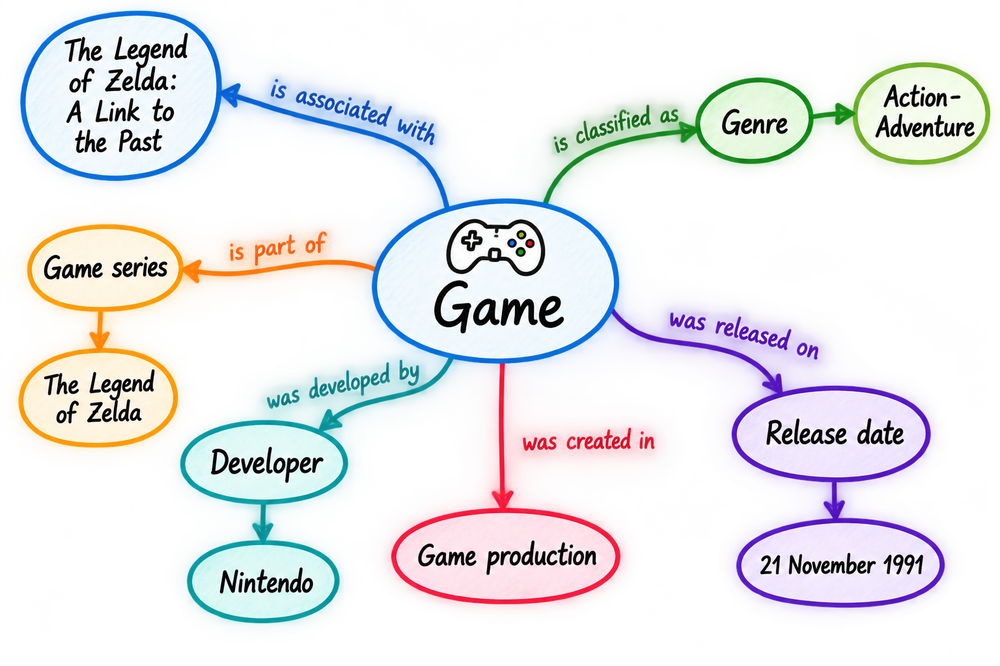

<!--

author: Canan Hastik (0000-0003-1729-4642)

author: Gudrun Schwenk (0009-0002-3156-8339)

email: info@igsd-ev.de

version:  v1.0.0

language: en

icon: https://raw.githubusercontent.com/soda-collections-objects-data-literacy/WissKIBits_How-to-Tutorial/refs/heads/main/assets/SODa-Logo_Wort-Bild_RGB.png

link: https://raw.githubusercontent.com/soda-collections-objects-data-literacy/WissKIBits_How-to-Tutorial/refs/heads/main/soda.css

license: CC BY 4.0 <https://creativecommons.org/licenses/by/4.0/>

comment: This module is part of the how-to tutorial “Ontology-Based Modelling of Research Data”. Using a computer game collection as an example, the tutorial teaches the step-by-step development of a semantic data model based on CIDOC CRM and its implementation with WissKI.

title: WissKI Bits Ontology-Based Modelling of Research Data

module: Modelling with CIDOC CRM – Understand and Apply

unit: Semantic Modelling with CIDOC CRM

description: The SODa how-to tutorial uses a computer game collection as an example to teach the fundamentals and practical steps of ontology-based modelling of research data. Learners develop a semantic data model based on CIDOC CRM and implement it step by step using Protégé, Draw.io, and WissKI.

keywords: WissKI, CIDOC CRM, ontology, domain ontology, semantic modelling, research data, research data management, OER

community: Scientific Communication Infrastructure (WissKI) and Collections, Objects, Data Literacy (SODa)

PublicationDate: 2026-11-05

LearningResourceType: How-to-Tutorial

-->

# SODa WissKI Bits: Ontology-Based Modelling of Research Data

**DEVELOPING AND IMPLEMENTING A DATA MODEL USING AN EXAMPLE** 

Module 2 (M2): **Modelling with CIDOC CRM – Understand and Apply**

Unit Exercise (UE): **Semantic Modelling with CIDOC CRM**  

**Duration:** ~ 55 min.

**Learning Objectives:**

Participants will be able to...

- apply ontologies to describe resources. (LO-ID 03\_007\_0780)
- apply methods for developing ontologies. (LO-ID SODa\_03\_007\_0854)
- apply a workflow for semantic modelling as data documentation. (LO-ID SODa\_03\_001\_0627)
- apply methods for modelling a domain ontology using the CIDOC CRM reference model under guidance. (LO-ID SODa\_03\_007\_0786a)
- apply software used for creating ontologies. (LO-ID SODa_03_007_0840)
- apply Erlangen CRM / OWL as an OWL implementation of the CIDOC CRM reference model. (LO-ID SODa_03_007_0855)
- apply the Scope Notes of the CIDOC CRM reference model to describe resources. (LO-ID SODa\_03\_007\_0780a)

---

## Objective and Scenario

In this exercise, you will continue working with the **conceptual model sketch** developed in Module 1. Starting from this sketch, you will gradually transform selected elements into a **formal ontology structure**.

Using **“The Legend of Zelda: A Link to the Past”** as an example, you will review selected mappings to CIDOC CRM and implement a small section of the domain model in Protégé.

You will examine relevant classes and properties, consult their scope notes, and decide whether the existing ontology elements are sufficient or whether domain-specific extensions are required.

Your goal is to **formally represent and document a small section of the model in OWL**, not to develop a complete ontology for the computer games domain.

---

## Starting Point

Return to the conceptual model sketch and the initial mappings to CIDOC CRM that you developed in Module 1.



> **Figure:** The graphic shows the conceptual model sketch of a section of the example domain.

In this exercise, you will examine how selected elements from the sketch can be represented in an OWL ontology.

Keep your previous modelling decisions available so that you can compare them with the formal structure you develop in Protégé.

---

## Suggested Solution

The following example illustrates **one possible mapping** of selected concepts and relationships from the computer games domain to CIDOC CRM.

Compare this proposal with your own modelling decisions. Pay particular attention to the selected classes, the relationships between them, and possible differences in the interpretation of the domain concepts.


> **Figure:** The graphic shows the mapping to higher-level CIDOC CRM classes and the statements describing the domain.

The example provides a basis for comparison and discussion. It is not the only valid modelling solution.

---

## From the Conceptual Model to a Formal Ontology

Consider the following statements from the conceptual model:

> Computer game → **has title** → Game title
>
> Computer game → **has type** → Genre
>
> Computer game → **has type** → Platform type

To represent these statements formally, you need to distinguish between three levels:

| Level | Example |
|---|---|
| Domain statement | Computer game has title |
| CIDOC CRM mapping / Semantic model | E73 Information Object – P102 has title – E35 Title |
| Formal OWL ontology structure | Domain-specific extensions represented in OWL |

The important point is that these levels serve different purposes.

The **domain statement** expresses what you want to say about the research object.

The **CIDOC CRM mapping** identifies existing ontology elements that may represent the intended meaning.

The **formal OWL ontology structure** provides a machine-readable representation of the selected modelling decision.

These levels are related, but they are not interchangeable.

---

## Exercise – Implementing the Model in Protégé

**Format:** Individual work

**Materials:** Computer with Protégé Desktop or WebProtégé, provided Erlangen CRM OWL file, model sketch from Module 1

**Time:** approx. 45 min.

**Task: Formalise a section of the domain model in Protégé**

**Prerequisite:**

To work with Protégé (Stanford, 2026b), you need either:

- the desktop application ([**Protégé Desktop**](https://protege.stanford.edu/software/#desktop-protege)) installed, or
- a user account for the web-based editor ([**WebProtégé**](https://protege.stanford.edu/software/#web-protege)).

Both are available via the [**official Protégé website**](https://protege.stanford.edu/) (Stanford, 2026a).

---

**Step 1: Load Erlangen CRM**

Open your Protégé working environment and load the provided OWL implementation of CIDOC CRM:

[**Erlangen CRM / OWL**](https://erlangen-crm.org/ontology/ecrm/ecrm_240307.owl): https://erlangen-crm.org/ontology/ecrm/ecrm_240307.owl (Schiemann, 2024)

> **Note:** Follow the steps shown in M2U2 and the corresponding video:

!?[Video Demonstration: Getting Started with Protégé](../assets/Short_Protege_Intro.mp4)

> **Video:** The video demonstrates the first steps in Protégé and shows how to load Erlangen CRM / OWL.

---

**Step 2: Explore Relevant CIDOC CRM Classes**

Locate the following classes in the class hierarchy:

- **E41 Appellation**
- **E35 Title**
- **E55 Type**
- **E73 Information Object**

For each class, examine:

- its position in the class hierarchy,
- its superclasses and subclasses,
- its description and annotations, and
- the information provided in its scope note.

> **Note:**
>
> Pay particular attention to **E41 Appellation** and **E35 Title**.
>
> **E35 Title** is a subclass of **E41 Appellation**.
>
> The class hierarchy therefore shows how a more specific concept can be placed within a more general conceptual structure.

---

**Step 3: Compare and Document Concepts**

Now return to your conceptual model and the initial semantic mappings.

Consider the following possible mappings:

| Domain concept | Possible CIDOC CRM class | Justification based on the scope note | Open question |
|---|---|---|---|
| Game title | E35 Title | The term refers to a title used to identify the game. | Which entity is the title assigned to? |
| Your own concept | Your proposed class | Your justification | Remaining uncertainties |
| Game platform type | E55 Type | A classification indicating the platform type. | What exactly is being classified? |
| Game genre | E55 Type | A classification of the game, for example, as action-adventure. | Which entity is being classified? |

Review your proposed mappings using the relevant CIDOC CRM scope notes.

Ask yourself:

- Does the class definition match the intended meaning of your domain concept?
- What supports your mapping, and are alternative mappings possible?

> **Remember:** Whether a class is suitable depends on its **meaning within the reference model**, not simply on similar names.

---

**Step 4: Create Domain-Specific Subclasses**

Following the lightweight extension strategy introduced in M2U1, you will now create domain-specific subclasses in Protégé.

**Example:** Domain-specific subclasses

```text
E73 Information Object
└── Computer_Game

E35 Title
└── Game_Title

E55 Type
├── Game_Genre_Type
└── Game_Platform_Type
```

**Example:** Reusing CIDOC CRM properties

To express relationships between these concepts, use existing CIDOC CRM properties:

- **P102 has title** – connects a computer game with its title.
- **P2 has type** – connects a computer game with a genre or platform classification.

Briefly document your reasoning for the mappings, as illustrated in the following table.

| Source class | Property | Target class | Intended statement |
|---|---|---|---|
| Computer_Game | P102 has title | Game_Title | A computer game has a title. |
| Computer_Game | P2 has type | Game_Genre_Type | A computer game is assigned to a genre type. |
| Computer_Game | P2 has type | Game_Platform_Type | A computer game is assigned to a platform type. |

> **Remember:** In this tutorial, you **extend CIDOC CRM by creating subclasses only**. You reuse existing CIDOC CRM properties and do not introduce new properties.

---

**Step 5: Review the Model**

Examine the ontology structure you have created in Protégé.

**Check whether**

- the selected classes express the intended domain concepts,
- the domain-specific subclasses are placed under appropriate superclasses,
- the reused properties correspond to the intended relationships,
- unnecessary extensions have been avoided, and
- unresolved modelling questions have been documented.

Compare the formalised model section with your original conceptual model sketch.

Revise the ontology where needed.

---

**Step 6: Document and Save the Model**

Document the modelling decisions you made during the exercise.

| Question | Answer |
|---|---|
| Which domain term are you modelling? | |
| Which CIDOC CRM class or property are you using? | |
| What meaning do you want to express? | |
| What does the scope note say about it? | |
| Why do you consider the mapping appropriate? | |

For each domain-specific extension, record its intended meaning, its relationship to CIDOC CRM, and the reason for introducing it.

> **The aim is not to find a single “correct” solution.** What matters is that the modelling decision is understandable from a domain perspective and compatible with the reference model being used.
>
> Save your ontology in OWL format and make sure that you can reopen the file.
>
> **Expected outcome:** A small, documented OWL model section based on CIDOC CRM, prepared for further use in Module 3.

---

## Sample Solution

The following example illustrates **one possible implementation** of selected concepts and relationships from the **computer games domain based on CIDOC CRM**.

[**Game Characteristics Domain Ontology – RDF**](https://games.m-e-g-a.org/ontology/game_characteristics/1.0/Game_characteristics_v1.0.3.rdf)

Compare your own model with the sample solution **only after completing the task**.

Pay particular attention to:

- the placement of domain-specific classes,
- the reuse of CIDOC CRM properties, and
- possible differences from your own modelling decisions.

The example is intended to support reflection. It is not necessarily the only valid modelling solution.

---

## Outcome

At the end of this exercise, you have created a small, formally implemented section of the **computer games domain model**.

You have:

- created **domain-specific subclasses** of CIDOC CRM,
- reused **CIDOC CRM properties** to describe relationships,
- justified your modelling decisions using **CIDOC CRM scope notes**, and
- saved your extended ontology as an **OWL file**.

The result is a **partial model**, not a complete ontology of the computer games domain. It shows how a conceptual model sketch can be developed into a machine-readable ontology structure.

---

## Outlook

> **What comes next?**
>
> In Module 3, you will visualise selected parts of your ontology, prepare them for transformation, and use the resulting structures to configure **semantic paths and path groups in the WissKI Pathbuilder**.

---

## Bibliography

(Schiemann, 2024) Schiemann, B., Oischinger, M., Götz, G., Merges, J., Fichtner, M., & Scholz, M. (n.d.). Erlangen CRM / OWL. Retrieved 15 October 2026, from https://erlangen-crm.org/

(Stanford, 2026a) Stanford Center for Biomedical Informatics Research. (2026a). Protégé. Retrieved 15 October 2026, from https://protege.stanford.edu/

(Stanford, 2026b) Stanford Center for Biomedical Informatics Research. (2026b). Software Protégé. Retrieved 15 October 2026, from https://protege.stanford.edu/software/
