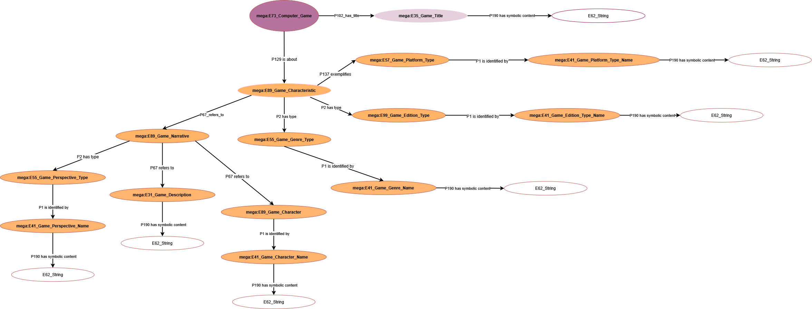
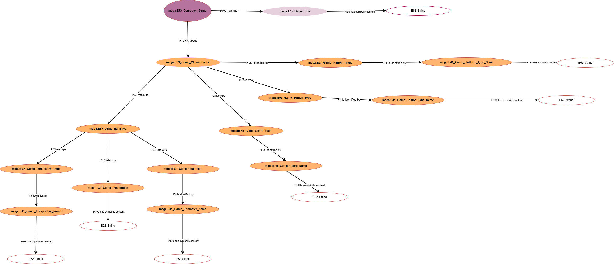

<!--

author: Canan Hastik (0000-0003-1729-4642)

author: Gudrun Schwenk (0009-0002-3156-8339)

email: info@igsd-ev.de

version:  v1.0.0

language: de

icon: https://raw.githubusercontent.com/soda-collections-objects-data-literacy/WissKIBits_How-to-Tutorial/refs/heads/main/assets/SODa-Logo_Wort-Bild_RGB.png

link: https://raw.githubusercontent.com/soda-collections-objects-data-literacy/WissKIBits_How-to-Tutorial/refs/heads/main/soda.css

license: CC BY 4.0 <https://creativecommons.org/licenses/by/4.0/>

comment: Dieses Modul ist Teil des How-to-Tutorials „Ontologiegestützte Modellierung von Forschungsdaten“. Das Tutorial vermittelt am Beispiel einer Computerspielsammlung schrittweise die Entwicklung eines semantischen Datenmodells auf Grundlage des CIDOC CRM und dessen Umsetzung mit WissKI.

title: WissKI Bits: Ontologiebasierte Modellierung von Forschungsdaten

module: Vom Diagramm zu Pfaden – erläutern und anwenden

unit: Semantische Domänenontologie visualisieren

description: Das SODa How-to-Tutorial vermittelt am Beispiel einer Computerspielsammlung Grundlagen und praktische Arbeitsschritte der ontologiegestützten Modellierung von Forschungsdaten. Die Lernenden entwickeln ein semantisches Datenmodell auf Grundlage des CIDOC CRM und setzen dieses schrittweise mit Protégé, Draw.io und WissKI um.

keywords: WissKI, CIDOC CRM, Ontologie, Domänenontologie, semantische Modellierung, Forschungsdaten, Forschungsdatenmanagement, OER

community: Wissenschaftliche Kommunikationsinfrastruktur (WissKI) und Sammlungen, Objekte, Datenkompetenzen (SODa)

PublicationDate: 2026-11-05

LearningResourceType: How-to-Tutorial

-->

# WissKI Bits: Ontologiebasierte Modellierung von Forschungsdaten

**DATENMODELL ENTWICKELN UND IMPLEMENTIEREN AM BEISPIEL** 

Modul 3 (M3): **Vom Diagramm zu Pfaden – Erläutern und anwenden**

Übungseinheit (EÜ1): **Semantische Domänenontologie visualisieren**  

**Dauer:** ~ 35 Min.

**Lernziele:**

Teilnehmende können...

- Software zur Visualisierung einer Domänenontologie benennen. (LZ-ID SODa\_03\_007\_0812)
- Software zur Visualisierung einer Domänenontologie erläutern. (LZ-ID SODa\_03\_007\_0813)
- Begriff Visualisierung erläutern. (LZ-ID SODa\_03\_007\_0851)
- Nutzen von Visualisierungen erläutern. (LZ-ID SODa\_03\_007\_0852)
- Nutzen einer Software zur Visualisierung einer Domänenontologie benennen. (LZ-ID SODa\_03\_007\_0814) 
- unter Anleitung Software zur Visualisierung einer Domänenontologie anwenden. (LZ-ID SODa\_03\_007\_0815)
- Kernentitäten (Objekt/Person/Ort/Zeit/Ereignis) einer Objektsammlung benennen. (LZ-ID SODa\_03\_007\_0806)
- Kernentitäten (Objekt/Person/Ort/Zeit/Ereignis) einer Objektsammlung anwenden. (LZ-ID SODa\_03\_007\_0811)
- Regeln zur Modellierung einer Domänenontologie mit einer Visualisierungssoftware benennen. (LZ-ID SODa\_03\_007\_0820)
- Regeln zur Modellierung einer Domänenontologie mit einer Visualisierungssoftware anwenden. (LZ-ID SODa\_03\_007\_0816)
- Attributwerte an vordefinierten Klassen der Domänenontologie in einer Visualisierungssoftware anwenden. (LZ-ID SODa\_03\_007\_0817)

---

## Visualisierung einer Domänenontologie als Diagramm mit Draw.io

In dieser Einheit wird das in [Modul 1: Von der Sammlung über Modellierentscheidungen zum Diagramm – verstehen und erklären](https://liascript.github.io/course/?https://raw.githubusercontent.com/soda-collections-objects-data-literacy/WissKIBits_How-to-Tutorial/refs/heads/main/WissKIBits_Modul1/de/M1E00_Ablauf-Zielsetzung.md#1) und [Modul 2: Modellieren mit CIDOC CRM – verstehen und anwenden](https://liascript.github.io/course/?https://raw.githubusercontent.com/soda-collections-objects-data-literacy/WissKIBits_How-to-Tutorial/refs/heads/main/WissKIBits_Modul2/de/M2E00_Ablauf-Zielsetzung.md#1) entwickelte Datenmodell als Diagramm in Draw.io (Draw.io LTD., 2026) visualisiert. 

Das entwickelte Draw.io-Diagramm bildet die **Voraussetzung für die (halb-)automatisierte Pipeline** zur Erstellung eines **WissKI Pathbuilders**.

Das Visualisieren in Draw.io ist somit nicht nur eine **Visualisierungsübung**, sondern gleichzeitig ein **expliziter Modellierungsschritt**, um **Modellierungsentscheidungen zu kommunizieren, auszuhandeln und ein gemeinsames Verständnis über semantische Strukturen zu ermöglichen und zu fördern.**

---

## Begriffsdefinition

**Visualisierung**

Visualisierungen sind bildliche Darstellungen von Sachverhalten, die deren Verständnis befördern sollen. 

"In den Geisteswissenschaften werden Visualisierungen als Illustrationen, als Gedächtnisstützen für bekannte Sachverhalte, bei der Organisation von Wissen, sowie als Erkenntnismittel in der Vermittlung und Erzeugung von (neuem) Wissen eingesetzt." (Freyberg, 2023) 

"Zum Lernen sind Visualisierungen insbesondere dann geeignet, wenn der zu vermittelnde Gegenstand verbal nur schwer vermittelbare Eigenschaften aufweist." (Scheiter, 2021)

Sie werden daher begleitend zum  Wissenserwerb eingesetzt, um Inhalte konkreter und besser verständlich zu machen und Strukturen zu verdeutlichen. (Levin et al., 1987)

---

## Nutzen von Draw.io

Draw.io wird eingesetzt um...

- **Klassen (Entities) und ihre Beziehungen (Properties)** klar zu definieren,
- eine **Domänenlogik mit ihren semantischen Zusammenhängen** sichtbar und diskutierbar zu machen,  
- Domänenmodelle **kollaborativ und transparent** zu entwickeln,  
- eine **Domänenontologie vor dem Import in WissKI** zu prüfen,  
- **semantische Modellierungsentscheidungen** zu reflektieren und abzusichern.

Besonders in kollaborativen Projekten erleichtert Draw.io die **Abstimmung zwischen Fachexpert\*innen, Datenmodellierenden und Entwickler\*innen**, da semantische Entscheidungen visuell nachvollziehbar und dokumentierbar sind und bleiben.

---

## Beispiel

Die bisherigen Fragen haben verdeutlicht, welche zentralen Konzepte der Beispieldomäne relevant sind und wie sie fachlich eingeordnet werden können.

Im nächsten Schritt geht es nicht mehr um das Erkennen oder Benennen dieser zentralen Konzepte, sondern darum, diese Auswahl in eine **formalisierte Pfadstruktur** zu überführen:

- Wie werden die zentralen Konzepte semantisch korrekt miteinander verknüpft?
- Wie entsteht daraus eine formalisierte Pfadstruktur, die in Form von **Pfaden und Pfadgruppen im WissKI Pathbuilder** nutzbar ist?

Dazu wird das konzeptionelle Domänenmodell nun **visuell und formal in Draw.io** umgesetzt.  

<table>
  <tr>
    <td></td>
  </tr>
</table>

> **Abbildung:** Die Grafik zeigt, wie der Ausschnitt der Beispieldomäne in CIDOC CRM umgesetzt werden kann.

---

## Quiz

Welche zentralen Konzepte sind im Kontext von Spielemerkmalen und narrativen Elemeten für das Beispielobjekt relevant?

Die folgenden Fragen dienen dazu, die zentralen Konzepte der Domäne noch einmal zu aktivieren und helfen die anschließende Modellierungsaufgabe besser einzuordnen:

### Welches Beispielobjekt wird im Modul verwendet? 

* [( )] Ein PC-Spiel: *Minecraft*
* [(x)] Ein SNES-Spiel: *The Legend of Zelda: A Link to the Past*
* [( )] Eine PlayStation-Konsole: *PS1*
* [( )] Ein Arcade-Automat: *Pac-Man*

### Welche semantische Annahme wird im Beispiel explizit gemacht?

* [( )] Das Spiel ist „Open World“
* [(x)] Der Titel des Objekts wird als *The Legend of Zelda: A Link to the Past* festgelegt
* [( )] Das Spiel ist eine „Collector’s Edition“
* [( )] Die Plattform ist „PC“

### Welche der folgenden Konzepte zählen zu den **Spielmerkmalen**?

* [[ ]] Perspektive
* [[X]] Genre
* [[X]] Edition
* [[X]] Plattform
* [[ ]] Hersteller

### Welche der folgenden Konzepte zählen zu den **narrativen Elementen**?

* [[X]] Perspektive
* [[X]] Spielbeschreibung
* [[X]] Charaktere
* [[ ]] Plattform
* [[ ]] Genre

----

## Aufgabe 

**Arbeitsform:** Einzelarbeit   

**Material:** eigenes Laptop

**Zeit:** 20 Min.

**Aufgabe:** Vervollständigen Sie das Diagramm, indem Sie die fehlenden **Knoten und Kanten** mit geeigneten Klassen (Entities) und passenden Beziehungen (Properties) ergänzen.

---

### Das vorbereitete Diagramm vervollständigen

> 1. Klicken Sie mit der rechten Maustaste auf den Link [**Draw.io-Lückendiagramm**](../assets/Gruppe_B.drawio.xml) und wählen Sie **„Ziel speichern unter …“**, um die vorbereitete Datei **Gruppe_B.drawio.xml** herunterzuladen.
> 2. Öffnen Sie die heruntergeladene XML-Datei in **[Draw.io](https://app.diagrams.net/)**.
> 3. Suchen Sie nach **vier** Platzhaltern `(???)`.
> 4. Ersetzen Sie diese Platzhalter `(???)` durch folgende Klassen und Beziehungen:
>    - `P102_has_title`,
>    - `P1 is identified by`,
>    - `P190 has symbolic content`,
>    - `mega:E41_Game_Character_Name`.
> 5. Prüfen Sie, ob die Klassen und Beziehungen **vollständige semantische Pfade** bilden, siehe hierfür **Modellierregeln in Draw.io**.
> 6. Untersuchen Sie die **Attribute** des zentralen Startknotens, der Gruppenknoten und Endknoten des Diagramm. Wählen Sie dazu jeweils einen Knoten aus und öffnen Sie mit **Strg + M** (Windows) den Attributdialog. Prüfen Sie die folgenden Attribute:
>    - `element_id`,
>    - `group_name` und
>    - `name`.
> 7. Setzen Sie die **Attributwerte**, z.B. die Attributwerte des **Gruppenknoten** mega:E89_Game_Characteristic wäre `Game_Characteristic`.
> 8. Exportieren Sie Ihr Diagramm als **Draw.io XML** und speichern Sie es lokal.

**Ergebnis:** Ein [Draw.io XML export](https://isl.ics.forth.gr/gnm_services/files/examples/diagrams_to_pathbuilders/WissKIBits.drawio.xml) basierend auf dem vervollständigten Draw.io-Diagramm:

---

### Modellierregeln in Draw.io

Die Transformation setzt voraus, dass die Verbindungen, Beschriftungen und Attributwerte im Ausgangsdiagramm konsistent sind.

> - Die Knoten und Kanten müssen korrekt verbunden sein.
> 
> - Die Kantenbeschriftung muss mit der Kante verbunden sein.
> 
> - Die Benennungen können, müssen aber nicht Unterstriche beinhalten.
> 
> - Es werden keine individuellen Instanzen abgebildet.
> 
> - Es werden die domänenspezifischen Subklassen aus der bereits erstellten Domänenontologie verwendet.
> 
> - Die Beziehungen aus dem CIDOC CRM werden nachgenutzt.
> 
> - Es sind vollständige Pfade zu erstellen. (z.B. mega:E73\_Computer\_Game -> P102\_has\_title -> mega:E35\_Game\_Title -> P190 has symbolic content -> E62\_String)
> 
> - Die Transformation kann nur Strukturen verarbeiten, die im Ausgangsdiagramm eindeutig und konsistent dargestellt sind

---

### Erforderliche Attributwerte prüfen

Die zentralen Startknoten, jeder Gruppenknoten und jeder Endknoten im Diagramm muss Attributwerte enthalten. Diese werden für die Konvertierung in eine WissKI-Pathbuilder-XML-Datei benötigt.

> Prüfen Sie für den zentralen Startknoten, jeden Gruppenknoten und jeden Endknoten die folgenden Attribute:
> 
> - **element_id**,
> - **group_name** und
> - **name**.
> 
> **Beispiel:**
> 
> - `element_id = Computer_Game`
> - `group_name = Computer_Game`
> - `name = Computer_Game`

---

### Ressourcen und Ergebnis

> - Domänenontologie: [https://games.m-e-g-a.org/ontology/game_characteristics/1.0/Game_characteristics_v1.0.3.rdf](https://games.m-e-g-a.org/ontology/game_characteristics/1.0/Game_characteristics_v1.0.3.rdf]
> 
> - Die offizielle CIDOC CRM Dokumentation (.pdf-Datei): [https://cidoc-crm.org/sites/default/files/cidoc_crm_version_7.1.3.pdf](https://cidoc-crm.org/sites/default/files/cidoc_crm_version_7.1.3.pdf)
>
> - Offizielle CIDOC-CRM-Dokumentation als HTML-Darstellung: [CIDOC CRM – Classes & Properties, Version 7.1.3](https://cidoc-crm.org/html/cidoc_crm_v7.1.3.html)
> 
> - Visueller und explorativer Zugang: [CIDOC CRM Periodic Table Version 7.1](https://remogrillo.github.io/cidoc-crm_periodic_table/?code=E1)

**Ergebnis:** Ein [Draw.io XML export](https://isl.ics.forth.gr/gnm_services/files/examples/diagrams_to_pathbuilders/WissKIBits.drawio.xml) basierend auf dem vervollständigten Draw.io-Diagramm:

 

---

### Workflow

| Schritt | Aktion |
|---:|---|
| 1 | Das vorbereitete XML-Lücken-Diagramm runterladen|
| 2 | Die heruntergeladene Datei in Draw.io importieren|
| 3 | Das Domänenontologie-Diagramm vervollständigen  |
| 4 | Attributwerte an Startknoten, jedem Gruppenknoten und Endknoten prüfen |
| 5 | Die Knoten-Kanten-Verbindungen prüfen  |

---

## Ausblick

> **Wie geht es weiter?**
>
> In der nächsten Einheit [M3EÜ2: Transformation semantischer Modelle in WissKI-Pfade](https://liascript.github.io/course/?https://raw.githubusercontent.com/soda-collections-objects-data-literacy/WissKIBits_How-to-Tutorial/refs/heads/main/WissKIBits_Modul3/de/M3E%C3%9C2_Drawio-to-WissKI-Paths.md#1) wird das erstellte Draw.io-Diagramm automatisch in einen WissKI Pathbuilder konvertiert und die erzeugte Pfadstruktur in WissKI importiert.

---

## Bibliographie

(Freyberg, 2023) Freyberg, Linda (2023) Visualisierung. In: AG Digital Humanities Theorie des Verbandes Digital Humanities im deutschsprachigen Raum e. V. (Hg.): Begriffe der Digital Humanities. Ein diskursives Glossar (= Zeitschrift für digitale Geisteswissenschaften / Working Papers, 2). DOI: 10.17175/wp_2023_014_v2

(Scheiter, 2021) )Scheiter, Katharina (2021). Visualisierung. Dorsch - Lexikon der Psychologie. https://dorsch.hogrefe.com/stichwort/visualisierung

(Levin, 1087) Levin, J.R. , Anglin, G.J., & Carney, R.N. (1987). On empirically validating fuctions of pictures in prose. In D.M. Willows & H.A. Houghton (Hrsg.), The psychology of illustration. Vol. I Basic Research (S. c) New York: Springer.

(Draw.io LTD., 2026) Draw.io LTD. (2026). draw.io. https://www.drawio.com/

