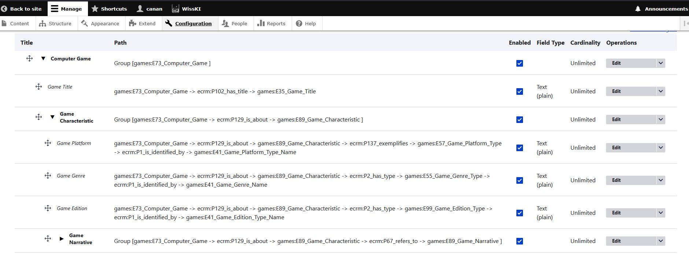
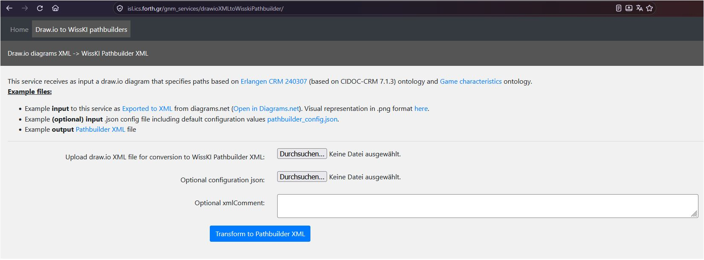
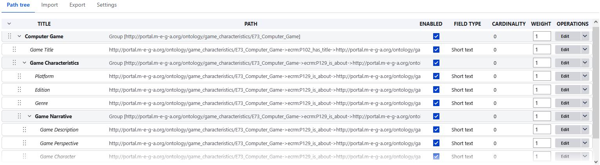

<!--

author: Canan Hastik (0000-0003-1729-4642)

author: Gudrun Schwenk (0009-0002-3156-8339)

email: info@igsd-ev.de

version:  v1.0.0

language: de

icon: https://raw.githubusercontent.com/soda-collections-objects-data-literacy/WissKIBits_How-to-Tutorial/refs/heads/main/assets/SODa-Logo_Wort-Bild_RGB.png

link: https://raw.githubusercontent.com/soda-collections-objects-data-literacy/WissKIBits_How-to-Tutorial/refs/heads/main/soda.css

license: CC BY 4.0 <https://creativecommons.org/licenses/by/4.0/>

comment: Dieses Modul ist Teil des How-to-Tutorials „Ontologiegestützte Modellierung von Forschungsdaten“. Das Tutorial vermittelt am Beispiel einer Computerspielsammlung schrittweise die Entwicklung eines semantischen Datenmodells auf Grundlage des CIDOC CRM und dessen Umsetzung mit WissKI.

title: WissKI Bits: Ontologiebasierte Modellierung von Forschungsdaten

module: Vom Diagramm zu Pfaden – erläutern und anwenden

unit: Transformation semantischer Modelle in WissKI-Pfade

description: Das SODa How-to-Tutorial vermittelt am Beispiel einer Computerspielsammlung Grundlagen und praktische Arbeitsschritte der ontologiegestützten Modellierung von Forschungsdaten. Die Lernenden entwickeln ein semantisches Datenmodell auf Grundlage des CIDOC CRM und setzen dieses schrittweise mit Protégé, Draw.io und WissKI um.

keywords: WissKI, CIDOC CRM, Ontologie, Domänenontologie, semantische Modellierung, Forschungsdaten, Forschungsdatenmanagement, OER

community: Wissenschaftliche Kommunikationsinfrastruktur (WissKI) und Sammlungen, Objekte, Datenkompetenzen (SODa)

PublicationDate: 2026-11-05

LearningResourceType: How-to-Tutorial

-->

# WissKI Bits: Ontologiebasierte Modellierung von Forschungsdaten

**DATENMODELL ENTWICKELN UND IMPLEMENTIEREN AM BEISPIEL** 

Modul 3 (M3): **Vom Diagramm zu Pfaden – Erläutern und anwenden**

Übungseinheit (EÜ2): **Transformation semantischer Modelle in WissKI-Pfade**  

**Dauer:** ~ 45 Min.

**Lernziele:**

Teilnehmende können...

- WissKI Pathbuilder als Werkzeug zur Defintion einer Ontologiestruktur erläutern. (LZ-ID SODa\_03\_007\_0804)
- unter Anleitung die Datenkonvertierung einer Visualisierungssoftware in ein nachnutzbares Dateiformat anwenden. (LZ-ID SODa\_02\_005\_0298a)
- unter Anleitung WissKI Pathbuilder als Werkzeug zum Import einer domänenspezifischen Ontologiestruktur (Pathbuilder-XML-Datei im WissKI-Pathbuilder) anwenden. (LZ-ID SODa\_03\_007\_0818)
- unter Anleitung die importierte domänenspezifische Ontologiestruktur im WissKI-Pathbuilder analysieren. (LZ-ID SODa\_03\_007\_0819)
- ein Werkzeug ("gnm-service: Draw.io diagrams to WissKI pathbuilders") zur Dateikonvertierung benennen. (LZ-ID SODa\_02\_005\_0317) 
- unter Anleitung ein Werkzeug ("gnm-service: Draw.io diagrams to WissKI pathbuilders") zur Dateikonvertierung anwenden. (LZ-ID SODa\_02\_005\_0318)

---

## Ziel und Szenario

Ausgangspunkt dieser Praxiseinheit ist das in **Einheit 1 vervollständigte Draw.io-Diagramm** der Domäne Computerspiele.

Nun wird das Diagramm technisch weiterverarbeitet: Mit dem **gnm-service** wird die Draw.io-XML-Datei in eine **WissKI Pathbuilder-XML-Datei** transformiert. Diese wird anschließend in WissKI importiert und im **Pathbuilder** untersucht.

> **Draw.io-Diagramm → gnm-service → Pathbuilder-XML → WissKI Pathbuilder**

---

## Ausgangspunkt: Vom semantischen Modell zum Pathbuilder

In der vorherigen Einheit wurde das mit CIDOC CRM formalisierte Domänenmodell als Draw.io-Diagramm visualisiert.

**Beispiel:**

> Eine Beziehung aus dem Modell kann folgendermaßen dargestellt sein:
>
> Computer Game → P102 has title → Game Title

Im WissKI Pathbuilder wird aus einer solchen Folge von Klassen (Entities) und Beziehungen (Properties) ein **semantischer Pfad**.

Dabei unterscheiden wir verschiedene Repräsentations- und Anwendungsebenen:

| Ebene | Repräsentation | Funktion |
|---|---|---|
| Semantische Grundlage | Domänenontologie | Formale Definition domänenspezifischer Klassen und ihrer Einordnung in CIDOC CRM |
| Visuelle Repräsentation | Draw.io-Diagramm | Darstellung ausgewählter Klassen, Properties und semantischer Pfade |
| Technisches Austauschformat | Pathbuilder-XML | Maschinenlesbare Konfiguration von Pfaden und Pfadgruppen |
| Konfiguration | WissKI Pathbuilder | Organisation semantischer Pfade und Pfadgruppen auf Grundlage der geladenen Ontologie |
| Anwendungsebene | Bundles und Fields | Strukturen für die Datenerfassung und -anzeige |
| Datenebene | Konkreter Datensatz | Erfassung von Daten zum Beispielobjekt |

Der Pathbuilder bildet damit die Verbindung zwischen der verwendeten Ontologie und den Strukturen, die WissKI für die Erfassung und Anzeige von Daten verwendet.

Die verschiedenen Repräsentationen erfüllen unterschiedliche Funktionen. Ein Draw.io-Diagramm ist beispielsweise keine formale OWL-Ontologie, und eine Pathbuilder-XML-Datei ersetzt nicht die zugrunde liegende Domänenontologie.

---

## Der WissKI Pathbuilder

Der Pathbuilder bildet die **Implementierungsschicht von WissKI**.

Der **WissKI Pathbuilder** verbindet die verwendete Ontologie mit der konkreten Datenstruktur in WissKI.

Semantische Beziehungsketten aus **Klassen (Entities) und Properties** werden dabei als **Pfade** abgebildet. Zusammengehörige Pfade können in **Gruppen** organisiert werden.

Ein Pathbuilder organisiert insbesondere

- **Pfade**, die Klassen und Properties als semantische Beziehungsketten abbilden,
- **Gruppen**, die zusammengehörige Pfade fachlich strukturieren,
- und die Zuordnung dieser Strukturen zu WissKI- beziehungsweise Drupal-Strukturen.

Auf dieser Grundlage können später **Bundles und Eingabefelder** für die Datenerfassung erzeugt werden.

> **Hinweis:** Der Pathbuilder definiert nicht die Ontologie selbst. Er verwendet Klassen und Properties der geladenen Ontologie, um die für WissKI benötigten Gruppen und semantischen Pfade festzulegen.

<table>
  <tr>
    <td></td>
  </tr>
</table>

> **Abbildung:**  Die Benutzeroberfläche des WissKI Pathbuilders zeigt die Organisation von Pfaden und Pfadgruppen - Die Ansicht kann je nach Version etwas abweichen.

---

### Begriffsdefinitionen

**Pfad (Path)**

Ein Pfad beschreibt eine Folge von Ontologieklassen und Properties, über die Informationen zu einer Entität semantisch repräsentiert werden.

**Pfadgruppe (Path Group)**

Eine Pfadgruppe organisiert zusammengehörige semantische Pfade und bildet eine Grundlage für die Strukturierung von Entitäten und Eingabeformularen in WissKI.

**Bundle**

Ein Bundle dient der Konfiguration eines Entitätstyps innerhalb der Drupal-basierten WissKI-Umgebung. Es fasst zugehörige Felder und deren Konfiguration zusammen.

**Field**

Ein Field ist ein konfiguriertes Feld zur Erfassung oder Anzeige von Daten. In WissKI können Fields mit semantischen Pfaden verknüpft werden.

---

## Der GNM-Service als Transformationswerkzeug

Der Webservice **„Draw.io diagrams to WissKI pathbuilders“** unterstützt die Überführung eines semantischen Draw.io-Diagramms in eine **WissKI Pathbuilder-XML-Datei**.

Damit bildet der Dienst eine technische Schnittstelle zwischen der grafischen Modellierung und der Implementierung des Modells im WissKI Pathbuilder.

Der grundlegende Transformationsprozess lautet:

**Draw.io-Diagramm → Draw.io-XML → gnm-service → Pathbuilder-XML → WissKI Pathbuilder**

Die Transformation ermöglicht:

- die **Nachnutzung** des bereits entwickelten semantischen Modells,
- die **Reduktion manueller Übertragungsarbeit**,
- und eine nachvollziehbare Verbindung zwischen Diagramm und Pathbuilder.

**Hinweis:** 

> Eine technisch erfolgreiche Transformation garantiert nicht automatisch die semantische Korrektheit der erzeugten Pfade.
>
> Die importierten Gruppen und Pfade müssen deshalb fachlich überprüft und mit dem Ausgangsdiagramm verglichen werden.

---

## Quiz: Die Transformation verstehen

### Frage 1: Was wird beim Import einer Pathbuilder-XML-Datei in WissKI importiert?

[( )] Eine neue Domänenontologie
[(X)] Eine Konfiguration semantischer Pfade und Pfadgruppen
[( )] Die konkreten Forschungsdaten zum Beispielobjekt

---

### Frage 2: Welche Voraussetzungen sind für die Nutzung der importierten Pfadstruktur in WissKI relevant?

[[X]] Die benötigte Domänenontologie ist in WissKI verfügbar.
[[X]] Die verwendeten Klassen und Properties sind eindeutig referenziert.
[[X]] Die Pfade und Pfadgruppen sind konsistent konfiguriert.
[[ ]] Sämtliche Forschungsdaten müssen bereits vor dem Import erfasst sein.

---

### Frage 3: Garantiert eine erfolgreiche technische Transformation die semantische Korrektheit der erzeugten Pfade?

[( )] Ja
[(X)] Nein

---

### Frage 4: Welchen Zusammenhang gibt es zwischen dem Pathbuilder und der Dateneingabe?

[(X)] Auf Grundlage der konfigurierten Pfade und Pfadgruppen können Bundles und Fields erzeugt werden.
[( )] Der Pathbuilder enthält bereits sämtliche Forschungsdaten.
[( )] Der Pathbuilder ersetzt die zugrunde liegende Domänenontologie.

---

## Aufgabe

**Arbeitsform:** Einzelarbeit 

**Material:** Laptop, Draw.io-XML-Datei, Zugang zu einer WissKI-Instanz

**Zeit:** 20 Min.

**Aufgabe:**

Transformieren Sie das in Übungseinheit 1 vervollständigte semantische Draw.io-Diagramm in eine WissKI-Pathbuilder-XML-Datei.

Importieren Sie die erzeugte Konfiguration in WissKI, untersuchen und überprüfen Sie die Pfadstruktur und erfassen Sie erste Daten zum Beispielobjekt.

> **Hinweis: Zugang zu WissKI**
>
> Sofern im Tutorial keine WissKI-Instanz zur Verfügung gestellt wird, können Sie eine WissKI-Umgebung im [SODa Semantic Co-Working Space (SCS)](https://manager.scs.sammlungen.io/) nutzen.
>
> Eine eigene WissKI-Installation ist nicht erforderlich.

> **Hinweis zur Aktualität der Werkzeuge**
>
> Die Benutzeroberflächen von Draw.io, WissKI und Drupal können sich durch Softwareupdates verändern. Daher können einzelne Menübezeichnungen, Schaltflächen und Ansichten von den Abbildungen und Videodemonstrationen in diesem Tutorial abweichen.

---

## Workflow vom Domänenontologie-Diagramm zu WissKI-Pfaden

Die folgende Übersicht zeigt die einzelnen Schritte, mit denen aus dem Diagramm ein nutzbarer WissKI Pathbuilder entsteht.

| Schritt | Aktion                                |
| -------- | ------------------------------------ |
| 1 | Draw.io-XML in Pathbuilder-XML transformieren |
| 2 | WissKI-Testinstanz vorbereiten |
| 3 | Games-Domänenontologie laden und SALZ-Adapter aktualisieren |
| 4 | WissKI Pathbuilder erstellen und XML importieren |
| 5 | Importierte Pfade und Pfadgruppen untersuchen |
| 6 | Pfadstruktur mit dem Ausgangsdiagramm vergleichen und dokumentieren |
| 7 | Eingabestrukturen prüfen und erste Daten erfassen |

Dieser Prozess überbrückt die Lücke zwischen der Modellierung einer Domänenontologie und der Erstellung des Pathbuilders in WissKI, indem das semantische draw.io-Modell über eine Transformationspipeline automatisch in WissKI-Pfade umgewandelt wird.

---

## Schritt 1: Draw.io-XML in Pathbuilder-XML transformieren

**Ausgangspunkt**

Sie arbeiten mit dem GNM-Service, um den Draw.io-XML-Export aus Übungseinheit 1 in eine **WissKI-Pathbuilder-XML-Konfiguration** umzuwandeln.

Sofern Ihnen das vervollständigte Diagramm noch nicht als XML-Datei vorliegt, exportieren Sie es zunächst aus Draw.io im XML-Format.

> **Abbildung:** Benutzeroberfläche des GNM-Service zur Transformation eines Draw.io-XML-Exports in eine WissKI-Pathbuilder-XML-Datei.

### Vorgehen

> 1. Öffnen Sie den [GNM-Service: Draw.io diagrams to WissKI pathbuilders](https://isl.ics.forth.gr/gnm_services/drawioXMLtoWisskiPathbuilder/) im Browser.
>
> 2. Laden Sie Ihren **Draw.io-XML-Export** oder die bereitgestellte Musterlösung [Exported to XML from diagrams.net](https://isl.ics.forth.gr/gnm_services/files/examples/diagrams_to_pathbuilders/WissKIBits.drawio.xml) über **Upload draw.io XML file for conversion to WissKI Pathbuilder XML** hoch.
>
> 3. Starten Sie die Transformation über **Transform to pathbuilder XML**.
>
> 4. Prüfen Sie den Status der Transformation.
>
> 5. Wenn die Transformation erfolgreich war, benötigen Sie für den späteren Import in WissKI:
>
>    - die kopierte URL Ihres **Pathbuilder XML Output: Download XML file** oder
>    - die kopierte URL der bereitgestellten Musterlösung [Example output Pathbuilder XML file](https://isl.ics.forth.gr/gnm_services/files/examples/diagrams_to_pathbuilders/DrawioPathBuilderExampleOutput_WissKIBits.xml).

**Hinweis:**

Um die bereitgestellten XML-Musterlösungen lokal zu speichern, klicken Sie mit der rechten Maustaste auf den jeweiligen Link und wählen Sie **„Link speichern unter …“**.

Speichern Sie nach Möglichkeit auch die selbst erzeugte Pathbuilder-XML-Datei lokal, damit Sie diese später erneut verwenden und dokumentieren können.

### Ergebnis

Eine WissKI-Pathbuilder-XML-Datei steht für den Import in WissKI zur Verfügung.

**Impulsfrage:**

> Welche Informationen aus dem Draw.io-Diagramm müssen bei der Transformation erhalten bleiben, damit die erzeugte Pfadstruktur das semantische Modell angemessen repräsentiert?

---

## Schritt 2: WissKI-Testinstanz vorbereiten

**Ausgangspunkt**

Sie arbeiten nun in Ihrer **WissKI-Testinstanz im SODa Semantic Co-Working Space (SCS)** weiter.

Wenn Sie noch keine eigene WissKI-Testinstanz haben, können Sie diese hier beantragen:

[SODa Semantic Co-Working Space](https://manager.scs.sammlungen.io/)

Melden Sie sich in Ihrer WissKI-Testinstanz an und prüfen Sie, ob bereits eine für diese Übung geeignete Konfiguration vorhanden ist.

### Optionale Rücksetzung der Testinstanz

> **Achtung:**
>
> Die folgenden Schritte sind ausschließlich für eine ausdrücklich dafür vorgesehene, entbehrliche Testinstanz bestimmt.
>
> Löschen Sie keine bestehenden Forschungsdaten oder Konfigurationen in produktiven oder gemeinsam genutzten WissKI-Instanzen.
>
> Ist Ihre WissKI-Testinstanz bereits für die Übung vorbereitet, überspringen Sie die Rücksetzung.

### Vorgehen

> 1. Navigieren Sie zu **Administration → Configuration → WissKI → Pathbuilders**.
>
>    - Löschen Sie den nicht mehr benötigten Pathbuilder.
>    - Prüfen Sie unter **Path usage** die zugehörigen Pfade.
>    - Wählen Sie **Delete checked paths**, sofern diese Pfade nicht anderweitig benötigt werden.
>
> 2. Navigieren Sie zu **Administration → Configuration → WissKI → Ontology**.
>
>    - Löschen Sie gegebenenfalls die nicht mehr benötigte Default-Ontologie.
>
> 3. Navigieren Sie zu **Administration → Structure → WissKI Entities and Bundles**.
>
>    - Wählen Sie **Delete all Bundles**, sofern die vollständige Rücksetzung der Testinstanz erforderlich ist.
>
> 4. Navigieren Sie zu **Administration → Configuration → Development → Performance**.
>
>    - Wählen Sie **Clear all Caches**.

### Videodemonstration

Das folgende Video zeigt die Rücksetzung einer WissKI-Testinstanz.

!?[Video: WissKI-Testinstanz zurücksetzen](../assets/Delete-all.mp4)

### Ergebnis

Eine für die folgenden Arbeitsschritte geeignete WissKI-Testinstanz steht zur Verfügung.

---

## Schritt 3: Games-Domänenontologie in WissKI laden und SALZ-Adapter aktualisieren

**Ausgangspunkt**

Damit WissKI die importierten Pfade und Pfadgruppen auf Grundlage der verwendeten Ontologie konfigurieren kann, muss die benötigte Domänenontologie in der WissKI-Umgebung verfügbar sein.

Für diese Übung verwenden Sie die bereitgestellte **Games-Domänenontologie**.

### Vorgehen

> 1. Melden Sie sich in Ihrer WissKI-Testinstanz an.
> 2. Navigieren Sie zu **Configuration → WissKI → WissKI Ontology**.
> 3. Prüfen Sie, ob die benötigte Domänenontologie bereits geladen ist.
> 4. Laden Sie gegebenenfalls die [Games-Domänenontologie](https://games.m-e-g-a.org/ontology/game_characteristics/1.0/Game_characteristics_v1.0.3.rdf) über ihre URL mit **Load Ontology**.
> 5. Aktualisieren Sie den **WissKI SALZ-Adapter**:
>
>    - Navigieren Sie zu **Configuration → WissKI → WissKI Salz Adapters**.
>    - Öffnen Sie den **Default Salz Adapter** über **Edit**.
>
> 6. Scrollen Sie zum Abschnitt **Compute Type and Property Hierarchy and Domains and Ranges**.
>
>    - Löschen Sie die bestehende Schlussfolgerungstabelle über **Delete reasoning tables**.
>    - Berechnen Sie die Schlussfolgerungstabelle über **Re-Compute results** und **Start Reasoning** neu.
>    - Aktualisieren Sie den Adapter über **Update adapter**.
>
> 7. Navigieren Sie zu **Tools → Flush all caches**.

**URL der Games-Domänenontologie:**

https://games.m-e-g-a.org/ontology/game_characteristics/1.0/Game_characteristics_v1.0.3.rdf

### Videodemonstration

Das folgende Video zeigt das Laden der Ontologie, die Aktualisierung des Adapters sowie das Erstellen und Importieren des Pathbuilders im anschließenden Schritt.

!?[Video: Ontologie laden und Pathbuilder in WissKI importieren](../assets/pathbuilder-in-WissKI.mp4)

### Warum ist dieser Schritt erforderlich?

Die importierte Pathbuilder-Konfiguration referenziert Klassen und Properties der zugrunde liegenden Ontologie.

Durch die Aktualisierung des Adapters werden die für die Arbeit mit der Ontologie benötigten Informationen zu Klassen- und Property-Hierarchien sowie zu Domain und Range neu berechnet.

**Beachten Sie:**

> Das Laden der Domänenontologie und das Importieren einer Pathbuilder-XML-Datei sind zwei unterschiedliche Arbeitsschritte.
>
> Die Domänenontologie stellt die semantische Grundlage bereit. Die Pathbuilder-XML-Datei enthält die Konfiguration der darauf aufbauenden Pfadstruktur.

### Ergebnis

Die benötigte Domänenontologie ist in WissKI verfügbar und der SALZ-Adapter wurde aktualisiert.

---

## Schritt 4: WissKI Pathbuilder erstellen und XML importieren

**Ausgangspunkt**

Die WissKI-Testinstanz ist vorbereitet, die benötigte Domänenontologie wurde geladen und der SALZ-Adapter aktualisiert.

Nun importieren Sie die in Schritt 1 erzeugte Pathbuilder-XML-Datei.

### Vorgehen

> 1. Navigieren Sie zu **Configuration → WissKI → Pathbuilders**.
> 2. Wählen Sie **Add Pathbuilder**.
>
>    - Vergeben Sie einen eindeutigen Namen.
>    - Speichern Sie den neuen Pathbuilder zunächst **without form generation**.
>
> 3. Öffnen Sie den neu erstellten Pathbuilder und navigieren Sie zu **Import Templates**.
>
>    - Fügen Sie unter **Pathbuilder Definition Import** die in Schritt 1 kopierte URL Ihrer erzeugten Pathbuilder-XML-Datei ein.
>    - Alternativ können Sie die URL der bereitgestellten [Musterlösung: DrawioPathBuilderExampleOutput_WissKIBits.xml](https://isl.ics.forth.gr/gnm_services/files/examples/diagrams_to_pathbuilders/DrawioPathBuilderExampleOutput_WissKIBits.xml) verwenden.
>    - Wählen Sie den Importmodus **Create new fields and bundles**.
>    - Klicken Sie auf **Import**.
>
> 4. Bei erfolgreichem Import sehen Sie die oberste Pfadgruppe **Computer Game** Ihres Pathbuilders.
> 5. Um den vollständigen Pathbuilder anzuzeigen, klicken Sie auf das Aufklappdreieck neben **Computer Game**.
> 6. Prüfen Sie die importierte Struktur und klicken Sie anschließend auf **Save and generate bundles and fields**.

> **Abbildung:** Importierte Pfade und Pfadgruppen im WissKI Pathbuilder. Die vollständige Struktur kann über die Aufklappdreiecke der jeweiligen Gruppen angezeigt werden.

### Ergebnis

Die Pathbuilder-Konfiguration wurde in WissKI importiert. Die zugehörigen Bundles und Fields wurden auf Grundlage der Konfiguration erzeugt.

---

## Schritt 5: Importierte Pfade und Pfadgruppen untersuchen

Untersuchen Sie den erzeugten **Pathbuilder** und vergleichen Sie ihn mit dem Ausgangsdiagramm.

Betrachten Sie dazu exemplarisch den folgenden Ausschnitt eines semantischen Pfades:

> `Computer_Game → P102 has title → Game_Title`

### Frage 1: Zu welcher Gruppe gehört der Pfad?

[(X)] Computer Game
[( )] Game Title
[( )] Der Pfad gehört zu keiner Gruppe.

---

### Frage 2: Welche Property verbindet Ausgangs- und Zielklasse?

[[P102 has title]]

---

### Frage 3: Entspricht dieser Pfadausschnitt dem Ausgangsdiagramm?

[(X)] Ja
[( )] Nein

Vergleichen Sie Ihre importierte Pfadstruktur mit der Musterlösung. Überprüfen Sie insbesondere die Ausgangsklasse, die Property und die Zielklasse.

Falls Ihre eigene Pfadstruktur von der Musterlösung abweicht, untersuchen Sie die Ursache der Abweichung.

---

### Frage 4: Ist mit dem dargestellten Pfadausschnitt bereits beschrieben, wie der konkrete Titelwert erfasst wird?

[( )] Ja
[(X)] Nein

Der dargestellte Pfadausschnitt verbindet das Computerspiel mit der Klasse für den Spieletitel. Für die Erfassung des konkreten Titelwertes ist zusätzlich die entsprechende Property zur Repräsentation des symbolischen Inhalts erforderlich.

---

## Schritt 6: Pfadstruktur mit dem Ausgangsdiagramm vergleichen und dokumentieren

Eine technisch erfolgreiche Transformation und ein erfolgreicher Import ersetzen nicht die fachliche Überprüfung der erzeugten Pfadstruktur.

Vergleichen Sie deshalb den importierten **WissKI Pathbuilder** mit dem **Draw.io-Diagramm**.

### Prüfkriterien

> - Sind die erwarteten Pfadgruppen vorhanden?
> - Sind die relevanten domänenspezifischen Klassen enthalten?
> - Werden die vorgesehenen CIDOC-CRM-Properties verwendet?
> - Entspricht die Reihenfolge der Klassen und Properties dem Ausgangsdiagramm?
> - Sind die semantischen Pfade vollständig?
> - Fehlen Pfade oder wurden Pfade falsch gruppiert?
> - Gibt es unerwartete Pfade oder Abweichungen?

### Dokumentation

Halten Sie Ihre Beobachtungen beispielsweise in der folgenden Tabelle fest:

| Prüfkriterium | Beobachtung / Abweichung |
|---|---|
| Erwartete Pfadgruppen | |
| Relevante Klassen | |
| Verwendete Properties | |
| Vollständigkeit der Pfade | |
| Fehlende oder unerwartete Pfade | |
| Erforderliche Korrekturen | |

Wenn Sie Abweichungen feststellen, prüfen Sie, ob diese bereits im Ausgangsdiagramm vorhanden sind, bei der Transformation entstanden sind oder mit der Konfiguration in WissKI zusammenhängen.

Archivieren Sie die relevanten Dateien:

- das vervollständigte Draw.io-Diagramm beziehungsweise dessen XML-Export,
- die erzeugte Pathbuilder-XML-Datei,
- Ihre Dokumentation der Überprüfung.

### Ergebnis

Eine erzeugte, importierte und **fachlich überprüfte WissKI-Pathbuilder-Konfiguration** auf Grundlage des semantischen Domänenmodells.

Dabei handelt es sich um einen **Konfigurationsimport**, nicht um einen Ontologieimport.

---

## Schritt 7: Eingabestrukturen prüfen und erste Daten erfassen

**Ausgangspunkt**

Nach der Überprüfung des Pathbuilders können Sie die erzeugten Bundles und Fields für die Datenerfassung nutzen.

### Bundles und Fields prüfen

> 1. Navigieren Sie zu **Structure → WissKI Entities and Bundles**.
> 2. Hier sollten die folgenden Bundles verfügbar sein:
>
>    - **Computer Game**
>    - **Game Characteristics**
>    - **Game Narrative**
>
> 3. Prüfen Sie die erzeugten Bundles und die zugehörigen Fields.
> 4. Wählen Sie **Recreate WissKI Menues and Views**.

### Daten erfassen

> 1. Navigieren Sie zu **WissKI → Create → Computer Game**.
> 2. Öffnen Sie das Eingabeformular.
> 3. Füllen Sie die Formularfelder mit ausgewählten Daten zum Beispielobjekt **The Legend of Zelda: A Link to the Past** aus.
> 4. Speichern Sie den Datensatz und überprüfen Sie die erzeugte Ansicht.

### Videodemonstration

Das folgende Video zeigt die erste Dateneingabe in WissKI.

!?[Video: Dateneingabe in WissKI](../assets/data-entry.mp4)

### Ergebnis

Ein erster Datensatz zum Beispielobjekt wurde auf Grundlage der erzeugten semantischen Pfadstruktur in WissKI erfasst.

---

## Vertiefung: Vom semantischen Pfad zum Eingabefeld

In den bisherigen Arbeitsschritten haben Sie unterschiedliche Repräsentationen desselben semantischen Modells kennengelernt.

Untersuchen Sie nun exemplarisch, wie sich eine Modellierungsentscheidung aus dem Draw.io-Diagramm bis zum Eingabeformular in WissKI nachvollziehen lässt.

**Zeit:** ~ 5 Min.

### Beispiel: Spieletitel

Betrachten Sie den bereits in Übungseinheit 1 verwendeten semantischen Pfad:

> `mega:E73_Computer_Game`
>
> → `P102_has_title`
>
> → `mega:E35_Game_Title`
>
> → `P190 has symbolic content`
>
> → `E62_String`

Dieser Pfad beschreibt im Ausgangsdiagramm die semantische Repräsentation des Spieletitels.

Der konkrete Titelwert des Beispielobjekts lautet:

**The Legend of Zelda: A Link to the Past**

### Aufgabe

> 1. Identifizieren Sie den Pfad im Draw.io-Diagramm.
> 2. Lokalisieren Sie den entsprechenden Pfad im WissKI Pathbuilder.
> 3. Vergleichen Sie die verwendeten Klassen und Properties.
> 4. Identifizieren Sie das zugehörige Eingabefeld in WissKI.
> 5. Vergleichen Sie den zuvor eingegebenen Titelwert mit der semantischen Pfadstruktur.

**Hinweis:**

Die technische Darstellung des Endwertes im Pathbuilder kann von der grafischen Darstellung im Draw.io-Diagramm abweichen. Prüfen Sie insbesondere, wie die Property zur Erfassung des symbolischen Inhalts in der Pathbuilder-Konfiguration umgesetzt wurde.

### Überprüfen Sie Ihr Verständnis

**Welcher Pfadgruppe ist der Spieletitel zugeordnet?**

[[Computer Game]]

**Welche Property verbindet das Computerspiel mit der Klasse für den Spieletitel?**

[[P102 has title]]

**Welche CIDOC-CRM-Klasse bildet die Grundlage für die domänenspezifische Klasse Game Title?**

[( )] E55 Type
[(X)] E35 Title
[( )] E21 Person

**Welche Property dient im Ausgangsdiagramm der Repräsentation des symbolischen Inhalts?**

[( )] P102 has title
[( )] P1 is identified by
[(X)] P190 has symbolic content

**Was wird im Eingabeformular als konkreter Titelwert erfasst?**

[( )] E35 Title
[( )] P102 has title
[(X)] The Legend of Zelda: A Link to the Past

---

### Reflexion

Vergleichen Sie das Draw.io-Diagramm, den WissKI Pathbuilder und das Eingabeformular.

- Welche semantischen Informationen sind im Eingabeformular unmittelbar sichtbar?
- Welche Informationen werden erst bei der Betrachtung des Pathbuilders beziehungsweise der zugrunde liegenden Ontologie nachvollziehbar?
- An welcher Stelle müssten Sie eine Änderung vornehmen, wenn Sie eine fachliche Modellierungsentscheidung revidieren möchten?

> **Impulsfrage:**
>
> Welchen Vorteil bietet die automatische Transformation gegenüber dem manuellen Anlegen der Pfade, und warum bleibt die fachliche Überprüfung trotzdem erforderlich?

---

## Zusammenfassung

In dieser Praxiseinheit wurde das in Übungseinheit 1 vervollständigte **semantische Draw.io-Diagramm** mit dem GNM-Service in eine **Pathbuilder-XML-Datei** transformiert und anschließend in WissKI importiert.

Dabei kamen verschiedene Werkzeuge und Repräsentationen zum Einsatz:

| Werkzeug / Repräsentation | Funktion |
|---|---|
| Domänenontologie | Semantische Grundlage der Modellierung |
| Draw.io-Diagramm | Visualisierung ausgewählter Klassen, Properties und semantischer Pfade |
| GNM-Service | Transformation des Draw.io-XML-Exports |
| Pathbuilder-XML | Austauschformat für die Pathbuilder-Konfiguration |
| WissKI Pathbuilder | Konfiguration semantischer Pfade und Pfadgruppen |
| Bundles und Fields | Strukturen für die Datenerfassung und -anzeige |

Die erzeugten Pfade und Pfadgruppen wurden fachlich überprüft und mit dem Ausgangsdiagramm verglichen.

Anschließend wurden die erzeugten Eingabestrukturen für eine erste Dateneingabe genutzt.

Damit wurde der Übergang von der semantischen Modellierung zur technischen Implementierung und Datenerfassung in WissKI nachvollzogen:

> **Semantisches Modell → Draw.io-Diagramm → Pathbuilder-XML → WissKI Pathbuilder → Bundles und Fields → Datenerfassung**

Als Ergebnis liegt eine importierte und überprüfte WissKI-Pathbuilder-Konfiguration sowie ein erster Datensatz zum Beispielobjekt vor.

---

## Abschlussreflexion

Sie haben nun den gesamten Lernweg von der Untersuchung eines Sammlungsobjekts über die konzeptionelle und formale Modellierung bis zur technischen Implementierung und Datenerfassung in WissKI durchlaufen.

Reflektieren Sie abschließend:

- Wie hat sich die Repräsentation der Domäne von der ersten konzeptionellen Modellskizze bis zur Datenerfassung in WissKI verändert?
- Welche Modellierungsentscheidungen lassen sich über die unterschiedlichen Repräsentationsebenen hinweg nachvollziehen?
- Welche Arbeitsschritte können automatisiert werden und an welchen Stellen ist fachliche Expertise erforderlich?
- Welcher Arbeitsschritt war für Sie besonders herausfordernd und warum?
- Wie können Sie den erarbeiteten Workflow auf eigene Forschungs- oder Sammlungsdaten übertragen?

---

## Ausblick

Mit dieser Übungseinheit ist das WissKI Bits How-to-Tutorial zur ontologiebasierten Modellierung von Forschungsdaten abgeschlossen.

> **Wie geht es weiter?**
>
> Sie können nun auf Grundlage des erarbeiteten Workflows:
> 
> - weitere Konzepte Ihrer Domäne modellieren,
> - die Domänenontologie erweitern,
> - zusätzliche semantische Pfade und Pfadgruppen konfigurieren,
> - die erzeugten Bundles und Fields anpassen,
> - eigene Forschungs- und Sammlungsdaten in WissKI erfassen.

Der erarbeitete Workflow kann auch auf andere Sammlungsdomänen übertragen werden. Die dafür erforderlichen Modellierungsentscheidungen müssen jeweils auf Grundlage der fachlichen Fragestellungen und der Bedeutung der zu erfassenden Daten getroffen werden.

---

## Ressourcen

### Werkzeuge und Arbeitsumgebung

- [Draw.io / diagrams.net](https://app.diagrams.net/)
- [GNM-Service: Draw.io diagrams to WissKI pathbuilders](https://isl.ics.forth.gr/gnm_services/drawioXMLtoWisskiPathbuilder/)
- [SODa Semantic Co-Working Space (SCS)](https://manager.scs.sammlungen.io/)

### Ontologien und Dokumentationen

- [Erlangen CRM 240307 (OWL)](https://erlangen-crm.org/ontology/ecrm/ecrm_240307.owl)
- [CIDOC CRM – Classes & Properties, Version 7.1.3](https://cidoc-crm.org/html/cidoc_crm_v7.1.3.html)
- [Games-Domänenontologie: Game_characteristics_v1.0.3.rdf](https://games.m-e-g-a.org/ontology/game_characteristics/1.0/Game_characteristics_v1.0.3.rdf)

### Musterlösungen

- [Draw.io-XML-Musterlösung: WissKIBits.drawio.xml](https://isl.ics.forth.gr/gnm_services/files/examples/diagrams_to_pathbuilders/WissKIBits.drawio.xml)
- [Pathbuilder-XML-Musterlösung: DrawioPathBuilderExampleOutput_WissKIBits.xml](https://isl.ics.forth.gr/gnm_services/files/examples/diagrams_to_pathbuilders/DrawioPathBuilderExampleOutput_WissKIBits.xml)

### Weiterführende WissKI-Dokumentation

- [WissKI Pathbuilder](https://wiss-ki.eu/documentation/data-modeling/pathbuilder) (rnsk, 2021)
- [Import or export your ontology](https://www.wiss-ki.eu/documentation/data-modeling/ontology-engineering/import-export-ontology)
- [Refine with pathbuilder](https://www.wiss-ki.eu/documentation/data-modeling/ontology-engineering/refine-the-pathbuilder)
- [WissKI – Paths and groups](https://project.pages.drupalcode.org/wisski/modules/wisski_pathbuilder/paths/)

### Beispielobjekt

- [The Legend of Zelda: A Link to the Past](https://de.wikipedia.org/w/index.php?title=The_Legend_of_Zelda:_A_Link_to_the_Past&oldid=268272133) (Wikipedia, 2026) 

---

## Bibliografie

(rnsk, 2021) rnsrk (2021). WissKI Documentation: Pathbuilder. Zuletzt abgerufen am 15. Oktober 2026 von https://wiss-ki.eu/documentation/data-modeling/pathbuilder

(Wikipedia, 2026) The Legend of Zelda: A Link to the Past. (2026). In Wikipedia. Zuletzt abgerufen am 15. Oktober 2026 von https://de.wikipedia.org/w/index.php?title=The_Legend_of_Zelda:_A_Link_to_the_Past&oldid=268272133