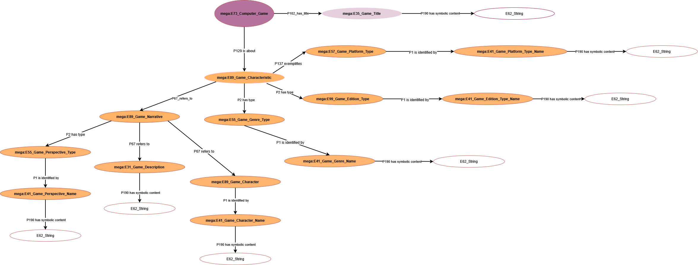
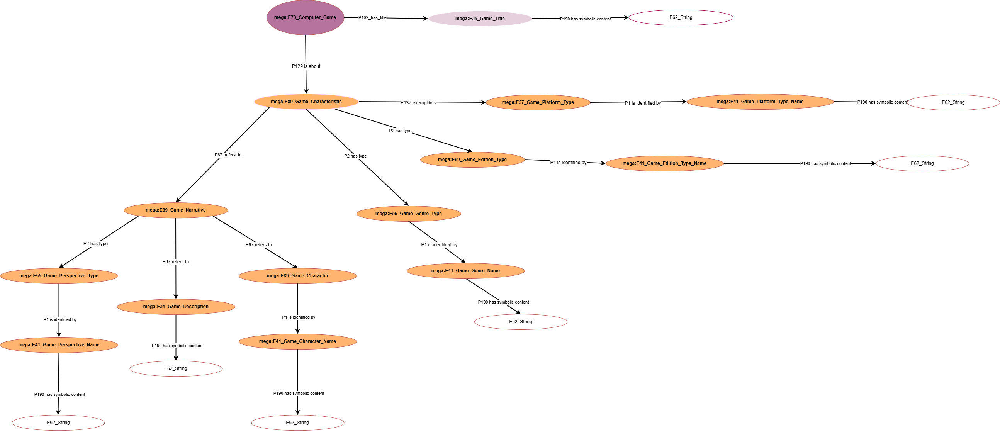

<!--

author: Canan Hastik (0000-0003-1729-4642)

author: Gudrun Schwenk (0009-0002-3156-8339)

email: info@igsd-ev.de

version:  v1.0.0

language: en

icon: https://raw.githubusercontent.com/soda-collections-objects-data-literacy/WissKIBits_How-to-Tutorial/refs/heads/main/assets/SODa-Logo_Wort-Bild_RGB.png

link: https://raw.githubusercontent.com/soda-collections-objects-data-literacy/WissKIBits_How-to-Tutorial/refs/heads/main/soda.css

license: CC BY 4.0 <https://creativecommons.org/licenses/by/4.0/>

comment: This module is part of the how-to tutorial “Ontology-Based Modelling of Research Data”. Using a computer game collection as an example, the tutorial teaches the step-by-step development of a semantic data model based on CIDOC CRM and its implementation with WissKI.

title: WissKI Bits Ontology-Based Modelling of Research Data

module: From Diagram to Paths – Explain and Apply

unit: Visualising a Semantic Domain Ontology

description: The SODa how-to tutorial uses a computer game collection as an example to teach the fundamentals and practical steps of ontology-based modelling of research data. Learners develop a semantic data model based on CIDOC CRM and implement it step by step using Protégé, Draw.io, and WissKI.

keywords: WissKI, CIDOC CRM, ontology, domain ontology, semantic modelling, research data, research data management, OER

community: Scientific Communication Infrastructure (WissKI) and Collections, Objects, Data Literacy (SODa)

PublicationDate: 2026-11-05

LearningResourceType: How-to-Tutorial

-->

# WissKI Bits: Ontology-Based Modelling of Research Data

**DEVELOPING AND IMPLEMENTING A DATA MODEL USING AN EXAMPLE** 

Module 3 (M3): **From Diagram to Paths – Explain and Apply**

Unit Exercise (UE1): **Visualising a Semantic Domain Ontology**  

**Duration:** ~ 35 min.

**Learning Objectives:**

Participants will be able to...

- name software for visualising a domain ontology. (LO-ID SODa\_03\_007\_0812)
- explain software for visualising a domain ontology. (LO-ID SODa\_03\_007\_0813)
- explain the concept of visualisation. (LO-ID SODa\_03\_007\_0851)
- explain the benefits of visualisations. (LO-ID SODa\_03\_007\_0852)
- name the benefits of software for visualising a domain ontology. (LO-ID SODa\_03\_007\_0814) 
- apply software for visualising a domain ontology with guidance. (LO-ID SODa\_03\_007\_0815)
- name the core entities (object/person/place/time/event) of an object collection. (LO-ID SODa\_03\_007\_0806)
- apply the core entities (object/person/place/time/event) of an object collection. (LO-ID SODa\_03\_007\_0811)
- name rules for modelling a domain ontology using visualisation software. (LO-ID SODa\_03\_007\_0820)
- apply rules for modelling a domain ontology using visualisation software. (LO-ID SODa\_03\_007\_0816)
- apply attribute values to predefined classes of the domain ontology in visualisation software. (LO-ID SODa\_03\_007\_0817)

---

## Visualising a Domain Ontology as a Diagram with Draw.io

In this unit, the data model developed in [From Collection to Modelling Decisions to Diagram – Understand and Explain](https://liascript.github.io/course/?https://raw.githubusercontent.com/soda-collections-objects-data-literacy/WissKIBits_How-to-Tutorial/refs/heads/main/WissKIBits_Modul1/en/M1U00_Structure-Objective_en.md#1) and Module 2 [Modelling with CIDOC CRM – Understand and Apply](https://liascript.github.io/course/?https://raw.githubusercontent.com/soda-collections-objects-data-literacy/WissKIBits_How-to-Tutorial/refs/heads/main/WissKIBits_Modul2/en/M2U00_Structure-Objective_en.md#1) is visualised as a diagram in Draw.io (Draw.io LTD., 2026).

The resulting Draw.io diagram forms the prerequisite for the (semi-)automated pipeline for creating a WissKI Pathbuilder.

Visualising in Draw.io is therefore not only a visualisation exercise, but also an explicit modelling step for communicating and negotiating modelling decisions and enabling and promoting a shared understanding of semantic structures.

---

## Definition

**Visualisation**

Visualisation refers to the graphical representation of information, concepts, or relationships to support understanding.

"In the humanities, visualisations are used as illustrations, as memory aids for known subject matter, in the organisation of knowledge, and as tools for insight in the communication and generation of (new) knowledge." (Freyberg, 2023)

"Visualisations are particularly suitable for learning when the subject to be conveyed has properties that are difficult to communicate verbally." (Scheiter, 2021)

Visualisations can therefore support knowledge acquisition by making abstract concepts more concrete and revealing structures and relationships that may be difficult to explain through text alone. (Levin et al., 1987)

---

## Benefits of Draw.io

Draw.io is used to...

- clearly define **classes (entities) and their relationships (properties)**,
- make domain logic and its semantic relationships visible and open to discussion,
- develop domain **models collaboratively and transparently**,
- check a domain ontology before importing it into WissKI, and
- reflect on and **validate semantic modelling decisions**.

Especially in collaborative projects, Draw.io facilitates coordination between **domain experts, data modellers and developers**, as semantic decisions can be visually understood and documented, and remain traceable.

---

## Example

The questions addressed so far have clarified which central concepts are relevant to the example domain and how they can be classified from a domain perspective.

The next step is no longer to identify or name these central concepts, but to translate this selection into a **formalised path structure**:

- How can the central concepts be connected in a semantically correct way?
- How can this produce a formalised path structure that can be used as paths and path groups in the WissKI Pathbuilder?

The conceptual domain model is now implemented visually and formally in Draw.io.

<table>
  <tr>
    <td></td>
  </tr>
</table>

> **Figure:** The diagram shows how the selected part of the example domain can be represented using CIDOC CRM.

---

## Quiz

Before working with the Draw.io diagram, review the example object and the central concepts of the computer games domain.

The following questions help you recall the concepts and classifications used in the modelling exercise.

### Which Example Object Is Used in This Tutorial?

* [( )] A PC game: *Minecraft*
* [(x)] An SNES game: *The Legend of Zelda: A Link to the Past*
* [( )] A PlayStation console: *PS1*
* [( )] An arcade machine: *Pac-Man*

### Which Title Is Assigned to the Example Game?

* [( )] The game is “Open World”
* [(x)] The title of the object is defined as *The Legend of Zelda: A Link to the Past*
* [( )] The game is a “Collector’s Edition”
* [( )] The platform is “PC”

### Which of the following Concepts are **Game Features**?

* [[ ]] Perspective
* [[X]] Genre
* [[X]] Edition
* [[X]] Platform
* [[ ]] Manufacturer

### Which of the following Concepts are **Narrative Elements**?

* [[X]] Perspective
* [[X]] Game description
* [[X]] Characters
* [[ ]] Platform
* [[ ]] Genre

----

## Task 

**Work format:** Individual work   

**Material:** Computer with internet access

**Time:** ~ 20 min.

**Task:** Complete the diagram by adding suitable classes (entities) and appropriate relationships (properties) to the missing nodes and edges.

---

### Completing the Prepared Diagram

> 1. Right-click the [**Draw.io XML gap diagram**](../assets/Gruppe_B.drawio.xml) link and select **“Save link as…”** to download the prepared file **Gruppe_B.drawio.xml**.
> 2. Open the downloaded XML file in **[Draw.io](https://app.diagrams.net/)**.
> 3. Find the **four** `(???)` placeholders.
> 4. Replace these `(???)` placeholders with the following classes and relationships:
>    - `P102_has_title`,
>    - `P1 is identified by`,
>    - `P190 has symbolic content`,
>    - `mega:E41_Game_Character_Name`.
> 5. Check that the classes and relationships form **complete semantic paths**; see **Modelling Rules in Draw.io** below.
> 6. Examine the **attributes** of the diagram’s central start node, group nodes and end nodes. Select each node and press **Ctrl + M** (Windows) to open the attribute dialogue. Check the following attributes:
>    - `element_id`,
>    - `group_name`, and
>    - `name`.
> 7. Set the **attribute values**. For example, the attribute values of the **group node** `mega:E89_Game_Characteristic` would be `Game_Characteristic`.
> 8. Export your diagram as **Draw.io XML** and save it locally.

**Result:** A [Draw.io XML export](https://isl.ics.forth.gr/gnm_services/files/examples/diagrams_to_pathbuilders/WissKIBits.drawio.xml) based on the completed Draw.io diagram:

---

### Modelling Rules in Draw.io

The transformation requires consistent connections, labels and attribute values in the source diagram.

> - The nodes and edges must be connected correctly.
>
> - Each edge label must be attached to its corresponding edge.
>
> - Names may contain underscores, but this is not mandatory.
>
> - No individual instances are represented.
>
> - Use the domain-specific subclasses from the domain ontology already created.
>
> - Reuse the relationships from CIDOC CRM.
>
> - Create complete paths, for example: `mega:E73_Computer_Game → P102_has_title → mega:E35_Game_Title → P190 has symbolic content → E62_String`.
>
> - The transformation can only process structures that are represented unambiguously and consistently in the source diagram.

---

### Checking the Required Attribute Values

The central start node, every group node and every end node in the diagram must contain attribute values. These are required for conversion into a WissKI Pathbuilder XML file.

> Check the following attributes for the central start node, every group node and every end node:
>
> - **element_id**,
> - **group_name**, and
> - **name**.
>
> **Example:**
>
> - `element_id = Computer_Game`
> - `group_name = Computer_Game`
> - `name = Computer_Game`

---

### Resources

> - Domain ontology: [https://games.m-e-g-a.org/ontology/game_characteristics/1.0/Game_characteristics_v1.0.3.rdf](https://games.m-e-g-a.org/ontology/game_characteristics/1.0/Game_characteristics_v1.0.3.rdf)
>
> - Official CIDOC CRM documentation (PDF): [https://cidoc-crm.org/sites/default/files/cidoc_crm_version_7.1.3.pdf](https://cidoc-crm.org/sites/default/files/cidoc_crm_version_7.1.3.pdf)
>
> - Official CIDOC CRM documentation in HTML: [CIDOC CRM – Classes & Properties, Version 7.1.3](https://cidoc-crm.org/html/cidoc_crm_v7.1.3.html)
>
> - Visual and exploratory access: [CIDOC CRM Periodic Table, Version 7.1](https://remogrillo.github.io/cidoc-crm_periodic_table/?code=E1)

---

### Workflow

| Step | Action |
|---:|---|
| 1 | Download the prepared XML gap diagram. |
| 2 | Import the downloaded file into Draw.io. |
| 3 | Complete the domain ontology diagram. |
| 4 | Check the attribute values of the start node, every group node and every end node. |
| 5 | Check the connections between nodes and edges. |

---

## Outlook

> **What comes next?**
>
> In the next unit, [M3UE2: Transforming Semantic Models into WissKI Paths](https://liascript.github.io/course/?https://raw.githubusercontent.com/soda-collections-objects-data-literacy/WissKIBits_How-to-Tutorial/refs/heads/main/WissKIBits_Modul3/en/M3UE2_Drawio-to-WissKI-Paths_en.md#1), the Draw.io diagram you have created will be automatically converted into a WissKI Pathbuilder, and the resulting path structure will be imported into WissKI.

---

## Bibliography

(Freyberg, 2023) Freyberg, Linda (2023). Visualisierung. In: AG Digital Humanities Theorie des Verbandes Digital Humanities im deutschsprachigen Raum e. V. (ed.): Begriffe der Digital Humanities. Ein diskursives Glossar (= Zeitschrift für digitale Geisteswissenschaften / Working Papers, 2). DOI: 10.17175/wp_2023_014_v2

(Scheiter, 2021) Scheiter, Katharina (2021). Visualisierung. Dorsch – Lexikon der Psychologie. https://dorsch.hogrefe.com/stichwort/visualisierung

(Levin et al., 1987) Levin, J. R., Anglin, G. J., & Carney, R. N. (1987). On empirically validating functions of pictures in prose. In D. M. Willows & H. A. Houghton (eds.), The psychology of illustration. Vol. I: Basic Research (pp. [page range to be verified]). New York: Springer.

(Draw.io LTD., 2026) Draw.io LTD. (2026). draw.io. https://www.drawio.com/

