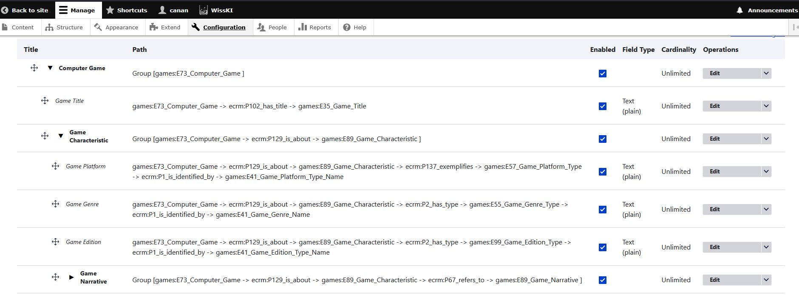
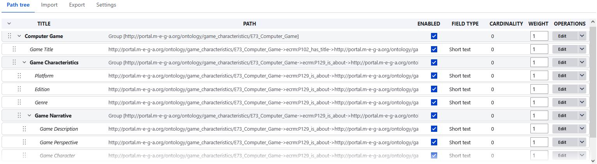
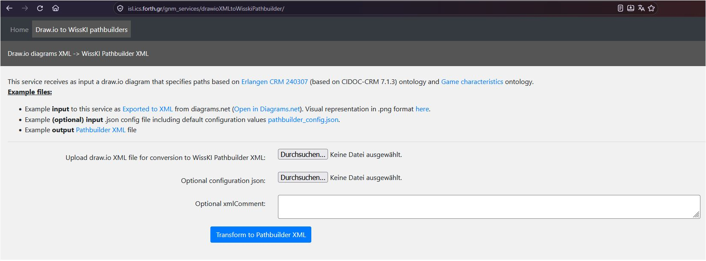

<!--

author: Canan Hastik (0000-0003-1729-4642)

author: Gudrun Schwenk (0009-0002-3156-8339)

email: info@igsd-ev.de

version:  v1.0.0

language: en

icon: https://raw.githubusercontent.com/soda-collections-objects-data-literacy/WissKIBits_How-to-Tutorial/refs/heads/main/assets/SODa-Logo_Wort-Bild_RGB.png

link: https://raw.githubusercontent.com/soda-collections-objects-data-literacy/WissKIBits_How-to-Tutorial/refs/heads/main/soda.css

license: CC BY 4.0 <https://creativecommons.org/licenses/by/4.0/>

comment: This module is part of the how-to tutorial “Ontology-Based Modelling of Research Data”. Using a computer game collection as an example, the tutorial teaches the step-by-step development of a semantic data model based on CIDOC CRM and its implementation with WissKI.

title: WissKI Bits Ontology-Based Modelling of Research Data

module: From Diagram to Paths – Explain and Apply

unit: Transforming Semantic Models into WissKI Paths

description: The SODa how-to tutorial uses a computer game collection as an example to teach the fundamentals and practical steps of ontology-based modelling of research data. Learners develop a semantic data model based on CIDOC CRM and implement it step by step using Protégé, Draw.io, and WissKI.

keywords: WissKI, CIDOC CRM, ontology, domain ontology, semantic modelling, research data, research data management, OER

community: Scientific Communication Infrastructure (WissKI) and Collections, Objects, Data Literacy (SODa)

PublicationDate: 2026-11-05

LearningResourceType: How-to-Tutorial

-->

# WissKI Bits: Ontology-Based Modelling of Research Data

**DEVELOPING AND IMPLEMENTING A DATA MODEL USING AN EXAMPLE** 

Module 3 (M3): **From Diagram to Paths – Explain and Apply**

Unit Exercise (UE2): **Transforming Semantic Models into WissKI Paths**  

**Duration:** ~ 45 min.

**Learning Objectives:**

Participants will be able to...

- explain WissKI Pathbuilder as a tool for defining an ontology structure. (LO-ID SODa\_03\_007\_0804)
- apply a conversion process starting from a diagram created with visualisation software into a reusable file format with guidance. (LO-ID SODa\_02\_005\_0298a)
- apply WissKI Pathbuilder as a tool for importing a Pathbuilder XML configuration into the WissKI Pathbuilder with guidance. (LO-ID SODa\_03\_007\_0818)
- analyse the imported domain-specific ontology structure in the WissKI Pathbuilder with guidance. (LO-ID SODa\_03\_007\_0819)
- name the gnm-service Draw.io diagrams to WissKI pathbuilders as a tool for file conversion. (LO-ID SODa\_02\_005\_0317) 
- apply the gnm-service to convert Draw.io XML into WissKI Pathbuilder XML with guidance. (LO-ID SODa\_02\_005\_0318)

---

## Objective and Scenario

The starting point for this practical unit is the Draw.io diagram of the computer games domain completed in [M3UE1 Visualising a Semantic Domain Ontology](https://liascript.github.io/course/?https://raw.githubusercontent.com/soda-collections-objects-data-literacy/WissKIBits_How-to-Tutorial/refs/heads/main/WissKIBits_Modul3/en/M3UE1_Domain-Ontologie-Diagram_en.md#15).

The diagram will now undergo further technical processing: the gnm-service is used to transform the Draw.io XML file into a WissKI Pathbuilder XML file. This is then imported into WissKI and examined in the Pathbuilder.

> **Draw.io diagram → Draw.io XML → gnm-service → Pathbuilder XML → WissKI Pathbuilder**

---

## Starting Point: From the Semantic Model to the Pathbuilder

In the previous unit, the domain model formalised using CIDOC CRM was visualised as a Draw.io diagram.

**Example:**

> A relationship from the model might be represented as follows:
>
> Computer Game → P102 has title → Game Title

In the WissKI Pathbuilder, such a sequence of classes (entities) and relationships (properties) forms a **semantic path**.

We distinguish between different levels of representation and application:

| Level | Representation | Function |
|---|---|---|
| Semantic foundation | Domain ontology | Formal definition of domain-specific classes and their classification within CIDOC CRM |
| Visual representation | Draw.io diagram | Representation of selected classes, properties and semantic paths |
| Technical exchange format | Pathbuilder XML | Machine-readable configuration of paths and path groups |
| Configuration | WissKI Pathbuilder | Organisation of semantic paths and path groups based on the loaded ontology |
| Application level | Bundles and fields | Structures for data entry and display |
| Data level | Individual record | Entry of data about the example object |

The Pathbuilder thus connects the ontology used with the structures that WissKI uses for data entry and display.

The different representations serve different functions. A Draw.io diagram, for example, is not a formal OWL ontology, and a Pathbuilder XML file does not replace the underlying domain ontology.

---

## The WissKI Pathbuilder

The Pathbuilder forms the **implementation layer of WissKI**.

The **WissKI Pathbuilder** connects the ontology used with the actual data structure in WissKI.

Semantic chains of relationships involving **classes (entities) and properties** are represented as **paths**. Related paths can be organised into **groups**.

In particular, a Pathbuilder organises:

- **paths**, which represent classes and properties as semantic chains of relationships,
- **groups**, which organise related paths according to their domain context,
- and the mapping of these structures to WissKI or Drupal structures.

On this basis, **bundles and input fields** can subsequently be generated for data entry.

> **Note:** The Pathbuilder does not define the ontology itself. It uses classes and properties from the loaded ontology to define the groups and semantic paths required for WissKI.

<table>
  <tr>
    <td></td>
  </tr>
</table>

> **Figure:** The WissKI Pathbuilder interface shows the organisation of paths and path groups. The view may vary slightly depending on the version.

---

### Definitions

**Path**

A path describes a sequence of ontology classes and properties through which information about an entity is represented semantically.

**Path Group**

A path group organises related semantic paths and provides a basis for structuring entities and input forms in WissKI.

**Bundle**

A bundle is used to configure an entity type within the Drupal-based WissKI environment. It brings together related fields and their configuration.

**Field**

A field is a configured field for entering or displaying data. In WissKI, fields can be linked to semantic paths.

---

## The GNM-Service as a Transformation Tool

The **“Draw.io diagrams to WissKI pathbuilders”** web service supports the transformation of a semantic Draw.io diagram into a **WissKI Pathbuilder XML file**.

The service thus provides a technical interface between graphical modelling and the implementation of the model in the WissKI Pathbuilder.

The basic transformation process is:

**Draw.io diagram → Draw.io XML → gnm-service → Pathbuilder XML → WissKI Pathbuilder**

The transformation enables:

- **reuse** of the semantic model already developed,
- **reduction of manual transfer work**,
- and a traceable connection between the diagram and the Pathbuilder.

**Note:**

> A technically successful transformation does not automatically guarantee the semantic correctness of the generated paths.
>
> The imported groups and paths must therefore be checked from a domain perspective and compared with the source diagram.

---

## Quiz: Understanding the Transformation

### Question 1: What Is Imported into WissKI When a Pathbuilder XML File Is Imported?

[( )] A new domain ontology
[(X)] A configuration of semantic paths and path groups
[( )] The actual research data about the example object

---

### Question 2: Which Prerequisites Are Relevant to Using the Imported Path Structure in WissKI?

[[X]] The required domain ontology is available in WissKI.
[[X]] The classes and properties used are referenced unambiguously.
[[X]] The paths and path groups are configured consistently.
[[ ]] All research data must already have been entered before the import.

---

### Question 3: Does a Successful Technical Transformation Guarantee the Semantic Correctness of the Generated Paths?

[( )] Yes
[(X)] No

---

### Question 4: What Is the Relationship between the Pathbuilder and Data Entry?

[(X)] Bundles and fields can be generated on the basis of the configured paths and path groups.
[( )] The Pathbuilder already contains all research data.
[( )] The Pathbuilder replaces the underlying domain ontology.

---

## Task

**Work format:** Individual work 

**Material:** Completed Draw.io XML file from unit 1, computer with internet access, and access to a WissKI instance

**Time:** ~ 20 min.

**Task:** Transform the semantic Draw.io diagram completed in exercise unit 1 into a WissKI Pathbuilder XML file. Import the generated configuration into WissKI, examine and verify the path structure, and enter initial data about the example object.

> **Note: Access to WissKI**
>
> If no WissKI instance is provided for the tutorial, you can use a WissKI environment in the [SODa Semantic Co-Working Space (SCS)](https://manager.scs.sammlungen.io/).
>
> You do not need your own WissKI installation.

> **Note on Changes to the Tools**
>
> The user interfaces of Draw.io, WissKI and Drupal may change as a result of software updates. Individual menu labels, buttons and views may therefore differ from the illustrations and video demonstrations in this tutorial.

---

## Workflow from the Domain Ontology Diagram to WissKI Paths

The following overview shows the individual steps for creating a usable WissKI Pathbuilder from the diagram.

| Step | Action |
|---|---|
| 1 | Transform Draw.io XML into Pathbuilder XML |
| 2 | Prepare the WissKI test instance |
| 3 | Load the Games domain ontology and update the SALZ adapter |
| 4 | Create a WissKI Pathbuilder and import the XML |
| 5 | Examine the imported paths and path groups |
| 6 | Compare the path structure with the source diagram and document the results |
| 7 | Check the data entry structures and enter initial data |

This process bridges the gap between modelling a domain ontology and creating the Pathbuilder in WissKI by automatically converting the semantic Draw.io model into WissKI paths through a transformation pipeline.

---

## Step 1: Transform Draw.io XML into Pathbuilder XML

**Starting Point**

You will use the GNM-Service to convert the Draw.io XML export from exercise unit 1 into a **WissKI Pathbuilder XML configuration**.

If you do not yet have the completed diagram as an XML file, first export it from Draw.io in XML format.

> **Figure:** GNM-Service user interface for transforming a Draw.io XML export into a WissKI Pathbuilder XML file.

### Procedure

> 1. Open the [GNM-Service: Draw.io diagrams to WissKI pathbuilders](https://isl.ics.forth.gr/gnm_services/drawioXMLtoWisskiPathbuilder/) in your browser.
>
> 2. Upload your **Draw.io XML export** or the provided model solution [Exported to XML from diagrams.net](https://isl.ics.forth.gr/gnm_services/files/examples/diagrams_to_pathbuilders/WissKIBits.drawio.xml) using **Upload draw.io XML file for conversion to WissKI Pathbuilder XML**.
>
> 3. Start the transformation using **Transform to pathbuilder XML**.
>
> 4. Check the transformation status.
>
> 5. If the transformation was successful, you will need one of the following for the subsequent import into WissKI:
>
>    - the copied URL of your **Pathbuilder XML Output: Download XML file**, or
>    - the copied URL of the provided model solution [Example output Pathbuilder XML file](https://isl.ics.forth.gr/gnm_services/files/examples/diagrams_to_pathbuilders/DrawioPathBuilderExampleOutput_WissKIBits.xml).

**Note:**

To save the provided XML model solutions locally, right-click the relevant link and select **“Save link as…”**.

Where possible, also save your own generated Pathbuilder XML file locally so that you can reuse and document it later.

### Result

A WissKI Pathbuilder XML file is available for import into WissKI.

**Prompt Question:**

> Which information from the Draw.io diagram must be preserved during the transformation so that the generated path structure adequately represents the semantic model?

---

## Step 2: Prepare the WissKI Test Instance

**Starting Point**

You will now continue working in your **WissKI test instance in the SODa Semantic Co-Working Space (SCS)**.

If you do not yet have your own WissKI test instance, you can request one here:

[SODa Semantic Co-Working Space](https://manager.scs.sammlungen.io/)

Log in to your WissKI test instance and check whether a suitable configuration for this exercise is already available.

### Optional Reset of the Test Instance

> **Warning:**
>
> The following steps are intended exclusively for a disposable test instance explicitly designated for this purpose.
>
> Do not delete existing research data or configurations in production or shared WissKI instances.
>
> If your WissKI test instance is already prepared for the exercise, skip the reset.

### Procedure

> 1. Navigate to **Administration → Configuration → WissKI → Pathbuilders**.
>
>    - Delete the Pathbuilder that is no longer needed.
>    - Check the associated paths under **Path usage**.
>    - Select **Delete checked paths** only if these paths are not required elsewhere.
>
> 2. Navigate to **Administration → Configuration → WissKI → Ontology**.
>
>    - If applicable, delete the default ontology that is no longer needed.
>
> 3. Navigate to **Administration → Structure → WissKI Entities and Bundles**.
>
>    - Select **Delete all Bundles** only if a complete reset of the test instance is required.
>
> 4. Navigate to **Administration → Configuration → Development → Performance**.
>
>    - Select **Clear all Caches**.

### Video Demonstration

The following video shows how to reset a WissKI test instance.

!?[Video: Resetting a WissKI test instance](../assets/Delete-all.mp4)

### Result

A WissKI test instance suitable for the following steps is available.

---

## Step 3: Load the Games Domain Ontology into WissKI and Update the SALZ Adapter

**Starting Point**

For WissKI to configure the imported paths and path groups on the basis of the ontology used, the required domain ontology must be available in the WissKI environment.

For this exercise, you will use the provided **Games domain ontology**.

### Procedure

> 1. Log in to your WissKI test instance.
> 2. Navigate to **Configuration → WissKI → WissKI Ontology**.
> 3. Check whether the required domain ontology has already been loaded.
> 4. If necessary, load the [Games domain ontology](https://games.m-e-g-a.org/ontology/game_characteristics/1.0/Game_characteristics_v1.0.3.rdf) from its URL using **Load Ontology**.
> 5. Update the **WissKI SALZ adapter**:
>
>    - Navigate to **Configuration → WissKI → WissKI Salz Adapters**.
>    - Open the **Default Salz Adapter** using **Edit**.
>
> 6. Scroll to the **Compute Type and Property Hierarchy and Domains and Ranges** section.
>
>    - Delete the existing reasoning tables using **Delete reasoning tables**.
>    - Recompute the reasoning tables using **Re-Compute results** and **Start Reasoning**.
>    - Update the adapter using **Update adapter**.
>
> 7. Navigate to **Tools → Flush all caches**.

**URL of the Games Domain Ontology:**

https://games.m-e-g-a.org/ontology/game_characteristics/1.0/Game_characteristics_v1.0.3.rdf

### Video Demonstration

The following video shows how to load the ontology, update the adapter, and create and import the Pathbuilder in the next step.

!?[Video: Loading the ontology and importing the Pathbuilder into WissKI](../assets/pathbuilder-in-WissKI.mp4)

### Why Is This Step Required?

The imported Pathbuilder configuration references classes and properties from the underlying ontology.

Updating the adapter recomputes the information on class and property hierarchies, domains and ranges required for working with the ontology.

**Please Note:**

> Loading the domain ontology and importing a Pathbuilder XML file are two separate steps.
>
> The domain ontology provides the semantic foundation. The Pathbuilder XML file contains the configuration of the path structure built on that foundation.

### Result

The required domain ontology is available in WissKI and the SALZ adapter has been updated.

---

## Step 4: Create a WissKI Pathbuilder and Import the XML

**Starting Point**

The WissKI test instance is prepared, the required domain ontology has been loaded, and the SALZ adapter has been updated.

You will now import the Pathbuilder XML file generated in step 1.

### Procedure

> 1. Navigate to **Configuration → WissKI → Pathbuilders**.
> 2. Select **Add Pathbuilder**.
>
>    - Assign a unique name.
>    - Initially save the new Pathbuilder **without form generation**.
>
> 3. Open the newly created Pathbuilder and navigate to **Import Templates**.
>
>    - Under **Pathbuilder Definition Import**, paste the URL of your generated Pathbuilder XML file copied in step 1.
>    - Alternatively, use the URL of the provided [model solution: DrawioPathBuilderExampleOutput_WissKIBits.xml](https://isl.ics.forth.gr/gnm_services/files/examples/diagrams_to_pathbuilders/DrawioPathBuilderExampleOutput_WissKIBits.xml).
>    - Select the import mode **Create new fields and bundles**.
>    - Click **Import**.
>
> 4. After a successful import, you will see the top-level path group **Computer Game** in your Pathbuilder.
> 5. To display the complete Pathbuilder, click the disclosure triangle next to **Computer Game**.
> 6. Check the imported structure, then click **Save and generate bundles and fields**.

> **Figure:** Imported paths and path groups in the WissKI Pathbuilder. The complete structure can be displayed using the disclosure triangles next to the respective groups.

### Result

The Pathbuilder configuration has been imported into WissKI. The associated bundles and fields have been generated on the basis of the configuration.

---

## Step 5: Examine the Imported Paths and Path Groups

Examine the generated **Pathbuilder** and compare it with the source diagram.

Use the following segment of a semantic path as an example:

> `Computer_Game → P102 has title → Game_Title`

### Question 1: Which Group Does the Path Belong To?

[(X)] Computer Game
[( )] Game Title
[( )] The path does not belong to any group.

---

### Question 2: Which Property Connects the Source and Target Classes?

[[P102 has title]]

---

### Question 3: Does This Path Segment Correspond to the Source Diagram?

[(X)] Yes
[( )] No

Compare your imported path structure with the model solution. In particular, check the source class, the property and the target class.

If your own path structure differs from the model solution, investigate the cause of the difference.

---

### Question 4: Does the Path Segment Shown Already Describe How the Actual Title Value Is Entered?

[( )] Yes
[(X)] No

The path segment shown connects the computer game with the class for the game title. Entering the actual title value additionally requires the appropriate property for representing the symbolic content.

---

## Step 6: Compare the Path Structure with the Source Diagram and Document the Results

A technically successful transformation and import do not replace verification of the generated path structure from a domain perspective.

Therefore, compare the imported **WissKI Pathbuilder** with the **Draw.io diagram**.

### Review Criteria

> - Are the expected path groups present?
> - Are the relevant domain-specific classes included?
> - Are the intended CIDOC CRM properties used?
> - Does the sequence of classes and properties correspond to the source diagram?
> - Are the semantic paths complete?
> - Are any paths missing or incorrectly grouped?
> - Are there any unexpected paths or discrepancies?

### Documentation

Record your observations, for example in the following table:

| Review Criterion | Observation / Discrepancy |
|---|---|
| Expected path groups | |
| Relevant classes | |
| Properties used | |
| Completeness of paths | |
| Missing or unexpected paths | |
| Required corrections | |

If you identify discrepancies, check whether they are already present in the source diagram, arose during transformation, or are related to the configuration in WissKI.

Archive the relevant files:

- the completed Draw.io diagram or its XML export,
- the generated Pathbuilder XML file,
- your review documentation.

### Result

A generated, imported and **domain-validated WissKI Pathbuilder configuration** based on the semantic domain model.

This is a **configuration import**, not an ontology import.

---

## Step 7: Check the Data Entry Structures and Enter Initial Data

**Starting Point**

After checking the Pathbuilder, you can use the generated bundles and fields for data entry.

### Checking Bundles and Fields

> 1. Navigate to **Structure → WissKI Entities and Bundles**.
> 2. The following bundles should be available:
>
>    - **Computer Game**
>    - **Game Characteristics**
>    - **Game Narrative**
>
> 3. Check the generated bundles and their associated fields.
> 4. Select **Recreate WissKI Menues and Views**.

### Entering Data

> 1. Navigate to **WissKI → Create → Computer Game**.
> 2. Open the input form.
> 3. Complete the form fields with selected data about the example object **The Legend of Zelda: A Link to the Past**.
> 4. Save the record and check the resulting view.

### Video Demonstration

The following video shows the initial data entry in WissKI.

!?[Video: Data entry in WissKI](../assets/data-entry.mp4)

### Result

An initial record about the example object has been entered in WissKI on the basis of the generated semantic path structure.

---

## Further Exploration: From the Semantic Path to the Input Field

In the preceding steps, you have encountered different representations of the same semantic model.

Now examine an example of how a modelling decision can be traced from the Draw.io diagram through to the input form in WissKI.

**Time:** ~ 5 min.

### Example: Game Title

Consider the semantic path already used in exercise unit 1:

> `mega:E73_Computer_Game`
>
> → `P102_has_title`
>
> → `mega:E35_Game_Title`
>
> → `P190 has symbolic content`
>
> → `E62_String`

In the source diagram, this path describes the semantic representation of the game title.

The actual title value of the example object is:

**The Legend of Zelda: A Link to the Past**

### Task

> 1. Identify the path in the Draw.io diagram.
> 2. Locate the corresponding path in the WissKI Pathbuilder.
> 3. Compare the classes and properties used.
> 4. Identify the associated input field in WissKI.
> 5. Compare the title value entered earlier with the semantic path structure.

**Note:**

The technical representation of the end value in the Pathbuilder may differ from its graphical representation in the Draw.io diagram. In particular, check how the property for entering the symbolic content has been implemented in the Pathbuilder configuration.

### Check Your Understanding

**Which Path Group Is the Game Title Assigned To?**

[[Computer Game]]

**Which Property Connects the Computer Game with the Class for the Game Title?**

[[P102 has title]]

**Which CIDOC CRM Class Forms the Basis for the Domain-Specific Class Game Title?**

[( )] E55 Type
[(X)] E35 Title
[( )] E21 Person

**Which Property Is Used in the Source Diagram to Represent the Symbolic Content?**

[( )] P102 has title
[( )] P1 is identified by
[(X)] P190 has symbolic content

**What Is Entered in the Input Form as the Actual Title Value?**

[( )] E35 Title
[( )] P102 has title
[(X)] The Legend of Zelda: A Link to the Past

---

### Reflection

Compare the Draw.io diagram, the WissKI Pathbuilder and the input form.

- Which semantic information is immediately visible in the input form?
- Which information only becomes apparent when examining the Pathbuilder or the underlying ontology?
- Where would you need to make a change if you wanted to revise a domain-specific modelling decision?

> **Prompt Question:**
>
> What advantage does automatic transformation offer over creating paths manually, and why is verification from a domain perspective still required?

---

## Summary

In this practical unit, the **semantic Draw.io diagram** completed in exercise unit 1 was transformed into a **Pathbuilder XML file** using the GNM-Service and then imported into WissKI.

Different tools and representations were used:

| Tool / Representation | Function |
|---|---|
| Domain ontology | Semantic foundation of the modelling |
| Draw.io diagram | Visualisation of selected classes, properties and semantic paths |
| GNM-Service | Transformation of the Draw.io XML export |
| Pathbuilder XML | Exchange format for the Pathbuilder configuration |
| WissKI Pathbuilder | Configuration of semantic paths and path groups |
| Bundles and fields | Structures for data entry and display |

The generated paths and path groups were checked from a domain perspective and compared with the source diagram.

The generated input structures were then used for initial data entry.

This demonstrated the transition from semantic modelling to technical implementation and data entry in WissKI:

> **Semantic model → Draw.io diagram → Pathbuilder XML → WissKI Pathbuilder → Bundles and fields → Data entry**

The result is an imported and verified WissKI Pathbuilder configuration and an initial record about the example object.

---

## Final Reflection

You have now completed the entire learning journey from examining a collection object through conceptual and formal modelling to technical implementation and data entry in WissKI.

Reflect on the following questions:

- How has the representation of the domain changed from the initial conceptual model sketch to data entry in WissKI?
- Which modelling decisions can be traced across the different levels of representation?
- Which steps can be automated, and where is domain expertise required?
- Which step was particularly challenging for you, and why?
- How can you apply the workflow you have developed to your own research or collection data?

---

## Outlook

This exercise unit concludes the WissKI Bits how-to tutorial on ontology-based modelling of research data.

> **What Comes Next?**
>
> Building on the workflow you have developed, you can now:
>
> - model further concepts in your domain,
> - extend the domain ontology,
> - configure additional semantic paths and path groups,
> - adapt the generated bundles and fields,
> - enter your own research and collection data in WissKI.

The workflow can also be applied to other collection domains. The modelling decisions required in each case must be based on the domain-specific questions and the meaning of the data to be recorded.

---

## Resources

### Tools and Working Environment

- [Draw.io / diagrams.net](https://app.diagrams.net/)
- [GNM-Service: Draw.io diagrams to WissKI pathbuilders](https://isl.ics.forth.gr/gnm_services/drawioXMLtoWisskiPathbuilder/)
- [SODa Semantic Co-Working Space (SCS)](https://manager.scs.sammlungen.io/)

### Ontologies and Documentation

- [Erlangen CRM 240307 (OWL)](https://erlangen-crm.org/ontology/ecrm/ecrm_240307.owl)
- [CIDOC CRM – Classes & Properties, Version 7.1.3](https://cidoc-crm.org/html/cidoc_crm_v7.1.3.html)
- [Games domain ontology: Game_characteristics_v1.0.3.rdf](https://games.m-e-g-a.org/ontology/game_characteristics/1.0/Game_characteristics_v1.0.3.rdf)

### Model Solutions

- [Draw.io XML model solution: WissKIBits.drawio.xml](https://isl.ics.forth.gr/gnm_services/files/examples/diagrams_to_pathbuilders/WissKIBits.drawio.xml)
- [Pathbuilder XML model solution: DrawioPathBuilderExampleOutput_WissKIBits.xml](https://isl.ics.forth.gr/gnm_services/files/examples/diagrams_to_pathbuilders/DrawioPathBuilderExampleOutput_WissKIBits.xml)

### Further WissKI Documentation

- [WissKI Pathbuilder](https://wiss-ki.eu/documentation/data-modeling/pathbuilder) (rnsrk, 2021)
- [Import or export your ontology](https://www.wiss-ki.eu/documentation/data-modeling/ontology-engineering/import-export-ontology)
- [Refine with pathbuilder](https://www.wiss-ki.eu/documentation/data-modeling/ontology-engineering/refine-the-pathbuilder)
- [WissKI – Paths and groups](https://project.pages.drupalcode.org/wisski/modules/wisski_pathbuilder/paths/)

### Example Object

- [The Legend of Zelda: A Link to the Past](https://de.wikipedia.org/w/index.php?title=The_Legend_of_Zelda:_A_Link_to_the_Past&oldid=268272133) (Wikipedia, 2026)

---

## Bibliography

(rnsrk, 2021) rnsrk (2021). WissKI Documentation: Pathbuilder. Retrieved 15 October 2026, from https://wiss-ki.eu/documentation/data-modeling/pathbuilder

(Wikipedia, 2026) The Legend of Zelda: A Link to the Past. (2026). In Wikipedia. Retrieved 15 October 2026, from https://de.wikipedia.org/w/index.php?title=The_Legend_of_Zelda:_A_Link_to_the_Past&oldid=268272133
